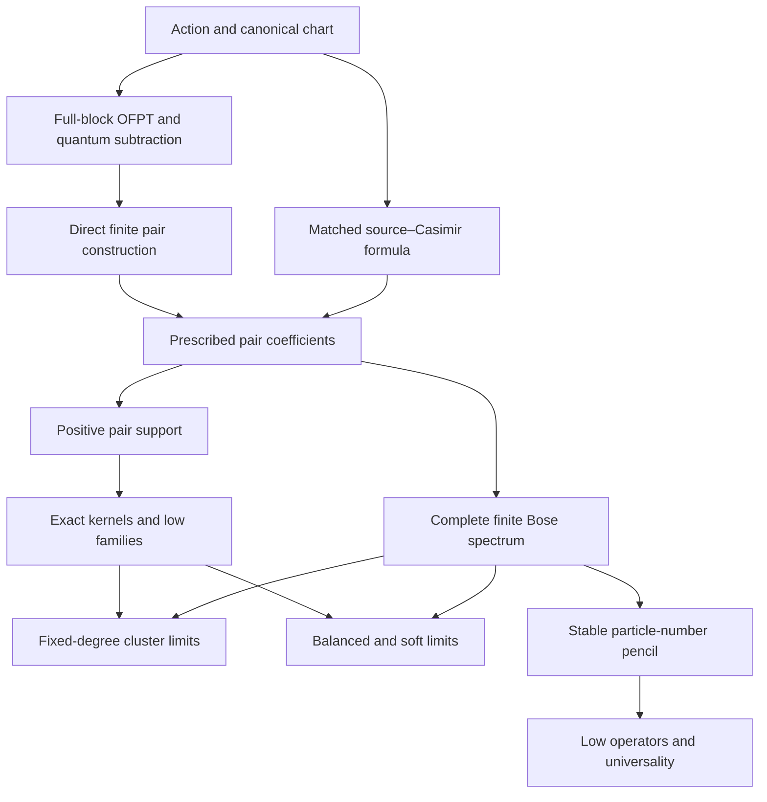

# AdS₃ Einstein–Scalar Master Note: Source, Claim, and Revision Map

This companion records how the retained results of the earlier research and independent reviews enter the new English master note. The main note follows the physics and proof dependencies. This file preserves provenance, dispositions of historical claims, precise conditions, implementation homes, and the distinction between current executions and inherited evidence.

The authoring and validation were carried out in new copies. The original reports, archives, and repository snapshot were not edited. The final integrity record compares all seventeen requested research inputs with their initial SHA-256 values and records a clean repository checkout. Hashes establish identity; they do not prove a mathematical assertion.

## 1. Inputs, versions, and reading coverage

All seventeen named research inputs were retrieved: nine Markdown reports/proof volumes and eight research or audit archives. The numbered Einstein-report copies were identical to the canonical report, with SHA-256

```
c8c42b134fc91924d6e1f5f727d4ebf0d0dd09a10bb6fa9303e7004d0c52dfaf
```

They were treated as one source. Archive containers and their first-level members were indexed without recursively rebundling older ZIPs. The inventory records 1,198 entries and 587 distinct contents, including 288 groups with duplicate contents. These are inventory counts, not a count of independent results or files read in full.

The current original repository was retrieved at commit

```
ff06682448838bcbb02b135bd61bc661b394cbba
```

from [GaoZ1en/obsidian_note](https://github.com/GaoZ1en/obsidian_note), principally the Einstein scalar spectrum subtree under Articles/Quantization in AdS/linearized gravity. The thirteen notes in that subtree were retained as original copies. The cited model file from the adjacent article directory and the supporting closure and audit notes are also identified in the read-only manifest.

The final portions of Unreduced OFPT calculation.md were read as a proof chain, including §§16–17, 39 and 70–77 and the necessary linked alternatives. The source-Casimir route, direct canonical route, and older incomplete reconstruction routes were assessed separately. No deleted file was reconstructed by guessing its former contents. A nonessential linked Radar page returned HTTP 403 and was not used as evidence; none of the required named inputs is missing.

### 1.1 Canonical research-record keys

| Key | Original file | Coverage and principal role |
|---|---|---|
| ES | ADS3_Einstein_scalar_research.md | Complete report; physical conventions, canonical/response interfaces, original chiral and formal-transfer proofs |
| FS | ADS3_Fock_space_research.md | Complete report; scalar Fock closure, positive pair support, complete kernel, physical Gram reduction and finite-shell construction |
| AS / AR | ADS3_Analytic_spectrum_research.md | Complete retained thematic proof coverage across the team; low families and root powers, exact edge, four-body limits, compiler specification, stable analytic pencils and scoped obstructions |
| DS / DR | ADS3_Deep_structure_research.md | Complete report; balanced law, completed all-particle compiler, low stable algebra, first correction, singleton inheritance and strict atom excess |
| HR | ADS3_Hierarchical_spectrum_research.md | Complete report; recursive clusters, soft windows, moving layer and universality |
| HP | ADS3_Hierarchical_spectrum_proofs.md | Complete proof volume; all cluster, soft, boundary-layer and universality proofs and appended independent repairs |
| A1 | AdS3两轮结果独立审查与补证.md | Entire physics and spectral content covered across the team, including all proof appendices; remainder, reciprocity, physical Gram, kernel and output repairs |
| A2 | AdS3后两轮独立审查与补证.md | Complete review; Gram-sensitive balanced limit, source-domain cautions, full Jordan and first-correction audits, compiler and Fredholm repairs |
| A3 / HA | AdS3层级谱独立审查与补证.md | Complete review and appendices; actual-right baselines, true projector ranks, all-subspace soft estimates, determining order and fail-closed execution |

The coverage ledgers distinguish full texts, specified thematic intervals, duplicate equivalents, code inspection, and execution. Package quickstarts and verification summaries were read as records of what their authors actually ran, including the complete Analytic, Deep and Hierarchy summaries. Reading a JSON record is never classified as a fresh computation. The record does not assert that every historical ancillary file or every old program was read in full.

### 1.2 Identity and physical copying

The ZIP contains sources/read_only with one retained copy per byte-identical original text: research reports, repository notes, cited supporting material, package guides, the user prompt and the supplied template archive. The read_only_copy_manifest.json maps every original path and deduplicated alias to its delivered copy. The input_archive_inventory.json preserves member-level hashes and archive provenance without putting nested copies of all older packages into the new archive.

The principal canonical code is under code/engine. Audited or new research modules are under code/research and checks. Current outputs are under runs/current; unchanged old numerical or algebraic records are under runs/inherited or are explicitly identified as historical read-only source records. README_REPRODUCIBILITY.md gives the concrete runnable entry points.

## 2. Notation and normalization reconciliation

| Older use or ambiguity | Master-note convention and reason |
|---|---|
| d as physical dimension or scalar representation parameter | Spacetime dimension is fixed to three. The scalar parameter is $\Delta>1$; local auxiliary calculations declare $d=\Delta$ explicitly. |
| G as Newton constant and as a Gram matrix | $G$ is only Newton's constant. Physical or coordinate Gram forms use $\Gamma$, including $\Gamma_{\rm u}$ and $\Gamma_{\rm frame}$ where needed. |
| Bare scalar mass versus measured scalar gap | $\mu=\Delta(\Delta-2)$ uses the fixed physical one-particle gap. Bare quantities and one-body subtraction remain explicit in the physical derivation. |
| P,Q for full levels and for primaries | $P,Q$ denote primary bidegrees. $M_L,M_R$ include global descendants. |
| Pair k,l versus radial/angular labels | $k,\ell$ are chiral relative labels; $n=\min(k,\ell)$, $s=|k-\ell|$ with $s$ even in Bose channels. |
| Swapping p and q inside a cluster | Internal baselines retain the actual right degree $b_m(q)$. A chirality swap requires adding its baseline difference. |
| A for a positive residual and for a stable slope | $A_N=W_N-b_N(Q)I\ge0$; the stable pencil uses $\mathscr A,\mathscr B$. |
| N in circular direct-$\mathcal K_4$ programs | That circular cutoff is $T$ in the note; $N$ always counts scalar particles. |
| Normalized pair creators, averaged tensors and Fock occupations | The tensor/Fock conversion and the repeated-pair factors are written before the lift. Creation-algebra multiplication does not mean pointwise multiplication of finite-$N$ wavefunctions. |
| A real coefficient array identified with a dual map without a metric | The physical right Gram and complex real-structure map enter the tensor–Hom construction explicitly; all ideal powers are retained. |
| Critical masses sharing a star | The low-channel mass is $\Delta_*=(\sqrt{33}-1)/4$. The de Donder no-radial-log exception is $\Delta_{\mathrm{dD}}=(1+\sqrt5)/2$. Stable local $d_*$ denotes the corresponding declared parameter. |
| $E=E_0+Gg+O(G^2)$ in early prose or CLI descriptions | The master assertion is $E=E_0+Gg+o(G)$ on each fixed finite block. Formal conditional higher-order statements are separately identified. |

## 3. Proof dependencies and status vocabulary

“Proved” in a finite or asymptotic mathematical dossier means proved for the specified pair coefficients and the explicitly stated domains and limit order. It does not remove the physical input conditions. “Conditional interface” identifies a hypothesis used in an optional physical comparison. “Exact finite certificate” and “high-precision diagnostic” describe evidence with finite stated parameters. “Inherited” means the old record was retained or inspected but its underlying computation was not rerun here.

The main dependencies are:



The arrows from the two pair routes identify their specified common prescription; they do not assert an additional all-label direct summation theorem. The continuum response reconstruction is an optional comparison attached to the physical pair interface and is not a prerequisite of the finite algorithms or their spectral theorems. Its lapse/shift, self-adjoint Hessian and averaged-endpoint hypotheses are stated in Chapter 3 and Appendix A.

The finite algorithm is prior to the logarithmic classification. FIN-03 computes the physical zero multiplicity as dimension minus exact rank without using EX-01. The closed kernel theorem then explains that number. The four-body determinant requires its own summable tails and exact nullity theorem, whereas the general cluster spectral-set theorem does not require that determinant. The low effective coefficients require the differential-order and ideal theorem before finite determining jets can prove an all-degree identity.

The machine-readable claim register resolves the former cross-contribution placeholders to actual claim IDs and records its acyclic dependency ordering. The dossiers include both named main statements and subordinate proof components; the dossier count is therefore not a count of formally titled theorems in the typeset note.

## 4. Audit corrections integrated at their proof homes

| Correction or additional proof | Current home and consequence |
|---|---|
| Full degenerate scalar-plus-boundary-graviton OFPT projection | Chapter 3 and Appendix D. The no-independent-free-occupation branch keeps constraints, virtual exchange and inverse dressing. |
| Non-global Ward identity, global $1\leftrightarrow3$ exclusion, and one-body subtraction treated separately | Chapters 3–4 and Appendix B. Symmetry alone is not used to guess the connected coefficients or remove quantum loops. |
| Canonical finite construction separated from optional continuous reconstruction | §§3.6, 4.3–4.4 and Appendix A. A missing general endpoint theorem neither invalidates the finite canonical algorithm nor becomes an unproved universal equivalence claim. |
| Removable $\Delta=3/2$ pole and vanishing trace versus nonzero stress tensor | §4.4 and Appendix C. Algebraic cancellation precedes specialization and the finite tensor response is retained. |
| Physical tensor–Hom map and all ideal powers | §6.2 and Appendix K. The full nonchiral kernel includes the correct Gram and higher-codimension compatibility. |
| True diagonal Bose projection and positive-image state map | Chapter 5 and Appendices F/CL. Left and right permutations are simultaneous; auxiliary zeros are removed before physical spectral counting. |
| Compact representation of large zero factors | Chapter 5 and the audited pair_gram.py copy. Outputs retain the zero multiplicity and positive polynomial separately. |
| Special-mass ranks, square-free factors and coincident roots | §§5.3, 5.6–5.7 and Appendix L. Generic pivots and multiplicities are recomputed at the actual algebraic mass. |
| Exact root-power upper and lower bounds and finite endpoints | §6.5 and Appendix L. The cubic and quartic representations are proved directly; a higher-cutoff counterexample limits extrapolation. |
| Strict Einstein equality after the collision gap | §6.6 and Appendix G. The proof removes extra comparison-operator equality states, including the two-particle case. |
| Actual-right cluster baseline and equal-source exterior square | §7.3 and Appendix CL.E. Cluster orientation and internal-source exchange are separate from elementary scalar Bose statistics. |
| Finite source support before true projector-rank comparison | §7.5 and Appendix CL.G. Eventual exact multiplicity is asserted only away from finer thresholds and after a finite source has been constructed. |
| Branch-free complex Fredholm convergence | §7.7 and Appendix CL.K. Real-axis square-root arguments are replaced by a common complex resolvent normalization and trace-norm control. |
| Auxiliary harmonic representation and actual Bose group | §8.1 and Appendix SC-A. Casimir approximants are compared in their own metrics; normalization is established before the trace limit. |
| Shared flags, restricted Riesz transport and all-subspace soft estimates | §§8.3–8.5 and Appendix SC-C/D. Weak trace convergence is not used to resolve exponential windows. |
| Exact zero atom versus exact kernel versus positive soft spectrum | Chapter 8. The nonzero absolutely continuous component coexists with the $r<1$ zero atom. Finite strict inertia subtracts auxiliary nullity only. |
| Singular physical Gram and actual leading Jordan resonance | §9.2 and Appendix ST-A. Finite self-adjointness gives a regular Hermitian frame in $N^{-1/2}$, not a semisimple limiting coordinate matrix. |
| Differential-order theorem before determining jets | §§9.5–9.6, §10.5 and Appendices ST/UN. The general effective operator and its first correction are not fitted from numerical eigenvalues. |
| Signed-defect counterexample | §10.7. Nonnegative affine defects remain sufficient rather than being presented as a necessary-and-sufficient classification. |
| Fail-closed execution and strict endpoint semantics | Appendix V and the two-level reproduction gate. Missing, stale, malformed, skipped or false payloads and optimized Python fail explicitly. |

The synthesis also repaired local transcription and interface details: a triangular evaluation identity in Appendix L; the explicit $N\ge1$ primary-projector guard; absent overlap terms at $N=2$; averaged-orbit normalization of one local coefficient; conflicting Gram notation; and an unqualified absolute-continuity phrase. Independent review confirmed the mixed example's exact physical matrix, Gram and state embedding. These repairs change no original input or recorded old data.

## 5. Disposition of older claims and material

| Older result, route, or record | Disposition and reason |
|---|---|
| Complete three-particle chiral spectrum and quartic Jastrow sector | Retained as the $Q=0$ specialization of the complete finite construction and kernel theorem; one complete block is worked through. Duplicate derivations are consolidated. |
| Earlier “higher particle number or nonchiral spectrum remains open” statements | Historical scope statements, superseded for finite construction by the Fock and completed compiler theorems. They remain visible in original read-only reports. |
| Earlier compiler specification without an integrated backend | Retained as the specification, with the completed Deep-structure implementation and later audit cited for the executable compiler and operation counts. |
| Low-channel quotient calculations and later Gram-dual proofs | Merged in §6.4 and Appendix L. The finite physical projector and full representation proof determine the exact valid range and multiplicity. |
| Attempts at a higher root-power spanning formula | The failed ansatz is retained as an explicit counterexample; no general higher-cutoff classification is asserted. |
| Empirical atomic laws and sparse cluster branches | Both retained. They answer different questions and neither substitutes for the other. |
| Deep-structure open higher-cluster upper inclusion | Superseded in its stated fixed-$Q$ range by the complete hierarchy theorem; deeper-threshold multiplicities and uniform effective cutoff errors remain open. |
| Old weak-trace route to an exponential soft window | Replaced at that inference by the full Riesz/concentration/min–max proof. The weak macroscopic law itself remains valid. |
| Stable small-block closed formulas | Retained when they exhibit a genuine Jordan resonance, protected collision, worked finite spectrum or determining coefficient. Large redundant tables are left in their original records. |
| Early unconditional $O(G^2)$ language | Replaced by $o(G)$. A conditional next-order Ward statement and the explicit toy obstruction are retained in Appendix D with their scope. |
| Static elimination, untransported observables, naive Weyl changes of coordinates, Gaussian integration called a tree proof | Retained as precise failure examples or corrected formal-transfer statements in Appendix D; they do not establish the AdS one-body quantum prescription. |
| General Markov, Gaudin, radical-solvability or analytic-charge claims | Retained only in the proved cone, residue class, finite polynomial, or globally analytic classical domain. No general nonintegrability conclusion is drawn. |
| Large binary64 spectra, old integration sweeps and plots | Inherited diagnostic evidence only where used. They are not added to this turn's current-run counts. The note does not need them to reconstruct a core proof. |
| Old full Wolfram/xAct and third-order OFPT sweeps | Read or referenced at the stated scope, not all rerun. Formal proofs and selected independently recomputed interfaces are distinguished from those old executions. |
| Alternative quantization, arbitrary independently excited boundary gravitons, fixed-nonzero-$G$ joint limits and other bulk theories | Outside the requested theory. No new claim about those sectors is introduced. |
| Historical notebook progress logs and broad novelty catalogues | Kept as provenance where needed, not used as final authority merely because of date or wording. Only actually used primary external mathematics was checked; no priority claim is made. |

## 6. Current execution and inherited evidence

The final portable execution passed in 102.64 seconds. Its five groups ran the eleven required hierarchy tasks, the seven finite regression groups, 111 canonical-physics and 10 ancillary checks, the seven extra cluster programs, and all six independent stable/soft/universality programs. Sixty top-level malformed/missing/false payload tests and optimized execution were rejected; the inner hierarchy gate also rejected its nine semantic mutations. The exact commands, dependency versions, timestamps, output hashes and unchanged-code comparison are in runs/current/portable_01/reproduce_all_summary.json.

This statement counts execution groups, not a new total of independent mathematical discoveries. The physics direct-$\mathcal K_4$ backend is inherited code rerun now; the ground-external quadratures and other symbolic identities are independently reconstructed checks. The stable and universal validators include separate Casimir-interpolation and rank-one-primary methods. Finite soft intervals are rational inertia certificates at $N=3,\Delta=2$, with the exact dimensions and nullities in Appendix V.

Current records and prepublication authoring records are retained separately. The final documentation-only change to three frontend scope strings is identified after the complete run and is accompanied by its unchanged non-string AST and targeted CLI check; it is not represented as a mathematical algorithm change. Old Galois certificates are retained as inherited exact evidence. The current billion-degree check establishes the count and compression size; the full large-integer polynomial remains an inherited computation.

## 7. Detailed claim dossiers

Each dossier below records the precise statement, assumptions, proof home, direct dependencies, original locations, absorbed repairs, and verification status. Local filenames in a proof home identify the modular document source in document_source; the authoritative reading order and theorem numbers are those of ADS3_Einstein_Scalar_Master_Note.md. The JSON register retains the original detailed contributor dossiers as well as normalized dependency IDs. Short task names or check paths within a verification field retain their contribution-relative authoring names; each group gives the full portable entry point and fresh record location. Paths beginning deliverables/ADS3_Master_Research_Package identify the same package root before extraction.

The register contains **74 dossiers**: 14 physics, 5 finite-construction, 9 exact-structure, 11 cluster, 17 semiclassical/soft, 11 stable, and 7 universality dossiers. Historical numbering is preserved; SC-10 and SC-18 are not new missing theorems. The dependency audit found no unresolved internal ID and no cycle. Named local proof components and standard external mathematics remain explicit instead of being converted into invented theorem IDs.

### 7.1. Physics and the pair prescription

**Portable verification and record locations:** portable entry: checks/independent/physics/check_physics.py; checks/independent/physics/check_ancillary.py; fresh records: runs/current/portable_01/physics/work/checks/physics_run.json; runs/current/portable_01/physics/work/checks/ancillary_run.json; authoring records: runs/current/physics_authoring/; qualification: General proof quantifiers are supplied by the manuscript. A current finite or high-precision check has only its recorded parameters.

#### PHY-01. Complete-block OFPT and normal-form identity

**Status:** proved on the stated canonical regulated/formal domain

**Precise current statement**

On the complete finite free-energy block, if the full cubic is [H0,S] with S anti-Hermitian, the second-order degenerate OFPT operator equals P(V2+[S,V1]/2)P, including resonant intermediate-state zeros and arbitrary block-diagonal generator choices.

**Assumptions and quantifiers**

- Complete scalar plus boundary-graviton free degenerate projection
- Canonical cubic and contacts from the same chart
- Regulated off-block sums when contractions are taken

**Main home:** physics/physics.md §3.2, equations (3.5)–(3.9)

**Complete proof home**

- physics/physics.md §3.2, equations (3.5)–(3.9)
- physics/physics_appendices.md §D.2

**Direct claim dependencies:** PHY-13

**Proof mechanism**

- For external energies E, replace each off-block S matrix element by the corresponding V1 element divided by its free energy difference.
- The two commutator placements each supply half the OFPT denominator; the within-block vertex is zero.
- Boundary-vacuum compression of the two conjugate cubic towers gives the scalar anticommutator and the separately retained quadratic double commutator.

**Original sources and locations**

- Unreduced OFPT calculation.md [SRC-OFPT], §70.1 and §76.2. Delivered copy: sources/read_only/repository/Unreduced OFPT calculation.md
- ADS3_Einstein_scalar_research.md [SRC-EINSTEIN], §4. Delivered copy: sources/read_only/reports/ADS3_Einstein_scalar_research.md
- AdS3两轮结果独立审查与补证.md [SRC-AUDIT1], Appendix A §2. Delivered copy: sources/read_only/reports/AdS3两轮结果独立审查与补证.md

**Audit corrections integrated**

- The projection is the full free block, not an isolated scalar state.
- Finiteness of external blocks does not imply finiteness of all loop intermediate sums.

**Actual verification and inherited evidence:** status: rerun inherited exact check; file: ancillary_run.json; test: inherited_exact_physics_audit; scope: One explicit degenerate 2+2 finite block; the general proof is algebraic.

**Limits of the claim:** The stated hypotheses and verification scope are part of this claim; no unstated continuum-domain or higher-order conclusion is inferred.

**Research disposition:** Consolidated source result or explicitly scoped interface; no priority claim.

#### PHY-02. Scalar branch closure and all-label number conservation

**Status:** proved at order G for fixed finite free-energy labels

**Precise current statement**

The complete resonant degree-four normal form is independent of physical gravitational oscillators. On the zero-independent-graviton scalar branch, all 3-to-1 and 1-to-3 quartic coefficients vanish, including integer Delta and spectator occupations; lower-degree terms preserve the branch.

**Assumptions and quantifiers**

- Boundary-completed action and proper-gauge section
- Classical global and non-global Ward identities at the indicated degrees
- Scalar parity, positive free energies, and regular local Weyl quantization

**Main home:** physics/physics.md §3.3, equations (3.10)–(3.13)

**Complete proof home:** physics/physics.md §3.3, equations (3.10)–(3.13)

**Direct claim dependencies:** PHY-01

**Proof mechanism**

- Project the transformed non-global Ward identity to the charge's free weight. The singular leading charge is a nonzero linear gravitational oscillator, so the resonant quartic commutes with every oscillator and its adjoint and is scalar-only.
- Use the same projection one order earlier and scalar parity to exclude any resonant cubic.
- The 31 component separately intertwines the two global lowest-weight actions. It kills the one-particle lowest vector by the minimum output energy, hence all its raised descendants. Independence of outgoing unordered triples then kills every symmetrized coefficient.
- Parity, energy, angular momentum, and gravitational-vacuum action exhaust the quadratic and constant possibilities.

**Original sources and locations**

- Unreduced OFPT calculation.md [SRC-OFPT], §§71.1–71.2, 76.2–76.4. Delivered copy: sources/read_only/repository/Unreduced OFPT calculation.md
- FULL_FOCK_PHYSICAL_CLOSURE.md [SRC-CLOSURE], full proof. Delivered copy: sources/read_only/supporting_notes/FULL_FOCK_PHYSICAL_CLOSURE.md
- ADS3_Fock_space_research.md [SRC-FOCK], §2. Delivered copy: sources/read_only/reports/ADS3_Fock_space_research.md
- AdS3两轮结果独立审查与补证.md [SRC-AUDIT1], Appendix A §§3–5. Delivered copy: sources/read_only/reports/AdS3两轮结果独立审查与补证.md

**Audit corrections integrated**

- No generic-Delta resonance shortcut is used at integer Delta.
- The four-leg Ward identity is not promoted to a quantum Virasoro theorem or an all-order scalar-only Hilbert space.
- Vanishing on a one-particle module is upgraded to coefficientwise vanishing before spectators are admitted.

**Actual verification and inherited evidence:** status: analytic proof; no finite-test substitution; scope: No all-oscillator quantum charge implementation is claimed.

**Limits of the claim:** The stated hypotheses and verification scope are part of this claim; no unstated continuum-domain or higher-order conclusion is inferred.

**Research disposition:** Consolidated source result or explicitly scoped interface; no priority claim.

#### PHY-03. Unique two-body lift

**Status:** proved

**Precise current statement**

After vacuum and physical one-body subtraction, the scalar correction is the unique normal-ordered 22 lift of its normalized two-particle matrix, equivalently the sum of the same pair operator over all unordered particle pairs.

**Assumptions and quantifiers**

- PHY-02 closure and number conservation
- No independent order-G scalar quartic counterterm is added
- Normalized unordered pair creators B†IJ=b†I b†J/sqrt(1+deltaIJ)

**Main home:** physics/physics.md §3.5, equation (3.19)

**Complete proof home:** physics/physics.md §3.5, equation (3.19)

**Direct claim dependencies**

- PHY-02
- PHY-08

**Proof mechanism**

- Each normal-ordered 22 monomial has a unique coefficient fixed by its two-particle matrix element.
- Expansion in normalized unordered pair creators gives the complete quartic, whose action on an N-particle tensor symmetrization is the sum over unordered pairs.

**Original sources and locations**

- ADS3_Fock_space_research.md [SRC-FOCK], §2.4. Delivered copy: sources/read_only/reports/ADS3_Fock_space_research.md
- AdS3两轮结果独立审查与补证.md [SRC-AUDIT1], Appendix A §5. Delivered copy: sources/read_only/reports/AdS3两轮结果独立审查与补证.md
- Unreduced OFPT calculation.md [SRC-OFPT], §71 and §76. Delivered copy: sources/read_only/repository/Unreduced OFPT calculation.md

**Audit corrections integrated**

- There is no extra factorial or chirality factor.
- One-body subtraction is applied once per particle rather than refixed independently in each N sector.

**Actual verification and inherited evidence:** status: handled by parent many-body validation; scope: Physics pair-normalization inputs are checked by the direct K4 reconstruction.

**Limits of the claim:** The stated hypotheses and verification scope are part of this claim; no unstated continuum-domain or higher-order conclusion is inferred.

**Research disposition:** Consolidated source result or explicitly scoped interface; no priority claim.

#### PHY-04. Paired canonical response and conditional covariant bridge

**Status:** canonical graph proved; covariant identification proved under explicit existence and endpoint hypotheses

**Precise current statement**

The paired oscillator graph has zero gravitational symplectic pullback and yields the canonical quartic. Its identification with minus one-quarter of the averaged stress-response pairing holds on a matching renormalized source/Hessian domain with solved lapse/shift reconstruction and sublinear endpoint.

**Assumptions and quantifiers**

- Same boundary-completed Hessian, boundary cylinder and clock
- Specified response complement and homogeneous data
- Lapse/shift reconstruction in its allowed domain
- B(T)/T tends to zero, including observable and scalar-coordinate endpoint transport

**Main home:** physics/physics.md §3.6, equations (3.20)–(3.23)

**Complete proof home**

- physics/physics.md §3.6, equations (3.20)–(3.23)
- physics/physics_appendices.md §§D.1–D.2

**Direct claim dependencies**

- PHY-13
- PHY-01

**Proof mechanism**

- Pull back the two conjugate oscillator two-forms to a+=-kappa D and a-=-kappa D*. They cancel exactly.
- Evaluate the free and cubic oscillator energies on the graph; the time derivative forces cancel and leave -2 kappa^2 m|D|^2.
- Compare the restricted first-order action with the stationary quadratic Einstein action. Equation-of-motion terms vanish on free external histories and the endpoint vanishes after time averaging.
- The completed Hessian Green identity proves only the reciprocity needed on this finite-source subspace.

**Original sources and locations**

- ADS3_Einstein_scalar_research.md [SRC-EINSTEIN], §8. Delivered copy: sources/read_only/reports/ADS3_Einstein_scalar_research.md
- Einstein scalar response prescription.md [SRC-RESPONSE], response domain and secular representatives. Delivered copy: sources/read_only/repository/Einstein scalar response prescription.md
- AdS3两轮结果独立审查与补证.md [SRC-AUDIT1], Appendix A §6, Appendix G §§1–3. Delivered copy: sources/read_only/reports/AdS3两轮结果独立审查与补证.md

**Audit corrections integrated**

- Bounded oscillator coordinates do not establish every continuum lapse/shift inverse or renormalized endpoint.
- Secular t times a constant endpoints cannot be dropped as bare total derivatives.
- A large diffeomorphism can leave an averaged pairing unchanged without becoming a proper gauge transformation.
- The direct finite canonical theorem is independent of this optional bridge.

**Actual verification and inherited evidence:** status: analytic proof and inherited paired polynomial audit rerun; file: ancillary_run.json; test: inherited_exact_physics_audit; not run: No general continuum lapse/shift reconstruction or all old secular representative transport was run.

**Limits of the claim:** The stated hypotheses and verification scope are part of this claim; no unstated continuum-domain or higher-order conclusion is inferred.

**Research disposition:** Consolidated source result or explicitly scoped interface; no priority claim.

#### PHY-05. Prescribed Einstein all-label pair kernel

**Status:** closed form proved on the declared matching source domain; independently checked against canonical finite evaluations

**Precise current statement**

For pair labels k,l with k+l even, gamma_kl=g_min(k,l),abs(k-l) is the three-case s=0,2,>=4 Einstein coefficient in (4.21), with the n=0, Delta=3/2 value taken from its removable algebraic limit. The closed source-Casimir proof uses the matching response domain of PHY-04.

**Assumptions and quantifiers**

- Minimal Einstein-real-scalar theory, Delta>1 fast branch
- The given fixed canonical and matching source/Hessian prescription
- No independent G phi^4 coupling

**Main home:** physics/physics.md §§4.2–4.4, equations (4.7)–(4.24)

**Complete proof home**

- physics/physics.md §§4.2–4.4, equations (4.7)–(4.24)
- physics/physics_appendices.md Appendix C

**Direct claim dependencies**

- PHY-04
- PHY-07
- PHY-13

**Proof mechanism**

- Evaluate the original fixed-momentum ground–J beta integral, not a symmetry-only ansatz, obtaining an entire triangular initial row.
- Use the tensor Einstein-Casimir identity and explicitly normalized local scalar and spin-two sources to derive the discrete crossed equation.
- Solve its finite-step recursion with the initial row; positive off-diagonal recurrence coefficients give uniqueness without an asymptotic high-spin assumption.
- Compute the only nonzero annihilation sectors by explicit scalar-conformal and TT responses and add them to crossed exchange.
- Cancel the exceptional scalar-source ratio before taking Delta=3/2; zero trace is distinguished from zero stress.

**Original sources and locations**

- Unreduced OFPT calculation.md [SRC-OFPT], §§72.1–72.5. Delivered copy: sources/read_only/repository/Unreduced OFPT calculation.md
- ADS3_Einstein_scalar_research.md [SRC-EINSTEIN], §6. Delivered copy: sources/read_only/reports/ADS3_Einstein_scalar_research.md
- AdS3两轮结果独立审查与补证.md [SRC-AUDIT1], Appendix B. Delivered copy: sources/read_only/reports/AdS3两轮结果独立审查与补证.md
- Direct K4 two-particle energy shifts.md [SRC-K4], independent finite canonical algorithm. Delivered copy: sources/read_only/repository/Direct K4 two-particle energy shifts.md

**Audit corrections integrated**

- s is the nonnegative even spin magnitude; j is the signed angular momentum.
- gamma here is dimensionless and is multiplied by G in the energy.
- The source-Casimir endpoint condition is stated; a separate all-label evaluation of the finite K4 sums into the compact formula is not claimed.
- The auxiliary no-radial-log de Donder gauge obstruction is not a physical pole.

**Actual verification and inherited evidence:** status: new symbolic identities, independent quadratures, and rerun canonical comparisons passed; files: physics_run.json; ancillary_run.json; tests: all_parameter_crossed_recurrence; positive_defect_and_exceptional_mass; independent_canonical_ground_J_integrals; rerun_direct_canonical_K4_all_channels; hypergeometric_Casimir_general_coefficient; scope: 64 exact canonical pair channels, 12 independent quadratures, and arbitrary-parameter rational recurrences; finite samples do not replace the general proofs.

**Limits of the claim:** The stated hypotheses and verification scope are part of this claim; no unstated continuum-domain or higher-order conclusion is inferred.

**Research disposition:** Consolidated source result or explicitly scoped interface; no priority claim.

#### PHY-06. Positive oriented residual and exact pair support

**Status:** proved

**Precise current statement**

For P>=Q, W_N=b_N(Q)I+A_N with A_N positive. Its pair coefficient a_kl is zero exactly for k>=l+4 and strictly positive for k<=l+2 among Bose-allowed pairs.

**Assumptions and quantifiers**

- Prescribed pair kernel PHY-05
- Physical positive Bargmann inner product
- Delta>1 and k+l even

**Main home:** physics/physics.md §4.5, equations (4.26)–(4.32)

**Complete proof home:** physics/physics.md §4.5, equations (4.26)–(4.32)

**Direct claim dependencies:** PHY-05

**Proof mechanism**

- For k>=l use the high-spin tail and positive spin-two fraction; at k=l=0 use the simplified ground coefficient.
- For k=l>=1 expand the spin-zero numerator in r=Delta-1 and j=n-1; all displayed coefficients are positive.
- For k<l add the positive Casimir difference.
- Expand the total quadratic right Casimir to obtain b_N(Q). Positivity of each summand gives the intersection-of-support characterization without assuming pairwise commutativity.

**Original sources and locations**

- ADS3_Fock_space_research.md [SRC-FOCK], §4. Delivered copy: sources/read_only/reports/ADS3_Fock_space_research.md
- AdS3两轮结果独立审查与补证.md [SRC-AUDIT1], Appendix C §2. Delivered copy: sources/read_only/reports/AdS3两轮结果独立审查与补证.md

**Audit corrections integrated**

- The orientation is based on the chosen right Casimir and is not a claim that all individual pair labels are ordered.
- Noncommuting pair projectors cause no problem for positivity or the common kernel.

**Actual verification and inherited evidence:** status: new all-parameter symbolic identities passed; file: physics_run.json; tests: positive_defect_and_exceptional_mass; oriented_baseline

**Limits of the claim:** The stated hypotheses and verification scope are part of this claim; no unstated continuum-domain or higher-order conclusion is inferred.

**Research disposition:** Consolidated source result or explicitly scoped interface; no priority claim.

#### PHY-07. Constructive direct canonical finite K4 evaluation

**Status:** proved finite canonical algorithm independent of the optional covariant response bridge

**Precise current statement**

At every finite circular compression level, all canonical pair matrix entries reduce to finite rational sums, with the sole nonrational radial moment cancelled by an exact virial identity. Invertible free CG reconstruction determines every primary coefficient and provides a route independent of the covariant bridge.

**Assumptions and quantifiers**

- Regular/fast scalar inverse and physical boundary momentum condition
- Resonant external scalar legs
- Free global representation covariance of the canonical operator

**Main home:** physics/physics_appendices.md Appendix A, especially §§A.2–A.5, equations (A.8)–(A.29)

**Complete proof home:** physics/physics_appendices.md Appendix A, especially §§A.2–A.5, equations (A.8)–(A.29)

**Direct claim dependencies**

- PHY-13
- PHY-01

**Proof mechanism**

- Expand Jacobi radial modes into finite powers and solve each scalar source by one U_Delta plus powers, with coefficients fixed by free-energy orthogonality.
- Integrate momentum primitives with center and physical flux conditions, retaining exceptional global harmonics.
- Reduce every radial pairing to beta moments and one common U moment. Prove its coefficient vanishes by the free radial virial identity; extend through Delta=3/2 by analyticity.
- Use normalized circular Bose states and six two-plus-two leg partitions to form the finite matrix.
- The product free chiral CG coefficients furnish an invertible reconstruction matrix. Circular states are a compression, so their raw matrix eigenvalues are not identified with primary energies.

**Original sources and locations**

- Direct K4 two-particle energy shifts.md [SRC-K4], complete note: constraints, circular source reduction, moments, primary extraction. Delivered copy: sources/read_only/repository/Direct K4 two-particle energy shifts.md
- Unreduced OFPT calculation.md [SRC-OFPT], §70 and direct-K4 interface. Delivered copy: sources/read_only/repository/Unreduced OFPT calculation.md
- ADS3_Einstein_scalar_research.md [SRC-EINSTEIN], §9.4. Delivered copy: sources/read_only/reports/ADS3_Einstein_scalar_research.md

**Audit corrections integrated**

- Do not diagonalize the circular compression as if it were invariant.
- Do not set the nonrational U moment to zero by fiat or choose a finite part.
- Do not claim the finite algorithm itself has supplied an additional all-label symmetry-free summation into the compact gamma.

**Actual verification and inherited evidence:** status: unchanged inherited backend rerun with new fail-closed all-channel comparisons; backend: direct_k4.py; source backend: CODE-K4; wrapper: check_physics.py; file: physics_run.json; test: rerun_direct_canonical_K4_all_channels; masses: 1001/1000; 3/2; 2; 7/3; maximum circular level: 6; channels: 64; scope: All produced s=0,2 and higher even-spin channels checked; backend retained off-diagonal reconstruction checks are active under non-optimized Python.

**Limits of the claim:** The stated hypotheses and verification scope are part of this claim; no unstated continuum-domain or higher-order conclusion is inferred.

**Research disposition:** Consolidated source result or explicitly scoped interface; no priority claim.

#### PHY-08. One-body quantum subtraction with fixed physical gap

**Status:** analytic proof retained in the stipulated prescription; original infinite-sum certificates are not reported as newly rerun

**Precise current statement**

In the stated common Weyl/Abel prescription, seagull and energy-weighted cubic terms cancel, the tadpole is removed at source level, and the matched local kinetic subtraction cancels the remaining exchange pole with zero finite part. The finite mass is fixed by E00=Delta, giving g1p_nj=0 for every fixed external mode.

**Assumptions and quantifiers**

- Local proper-constraint/FP determinant pairing, Darboux Liouville measure, midpoint Weyl prescription
- Common scalar external-leg weights and paired boundary regulator
- Source-level vacuum stress counterterm
- Clock-dependent kinetic counterterm Z_tau=-4G/(tau sqrt(1+r^2))
- Physical one-particle gap condition

**Main home:** physics/physics.md §3.4, equations (3.14)–(3.18)

**Complete proof home**

- physics/physics.md §3.4, equations (3.14)–(3.18)
- physics/physics_appendices.md Appendix B §§B.1–B.7

**Direct claim dependencies**

- PHY-01
- PHY-13

**Proof mechanism**

- Compute the Abel boundary tower sums and combine seagull, embedding, and energy-weighted cubic contributions using the radial virial primitive.
- Establish fixed-external-mode convergence through positive spectral form bounds before interchanging scalar and boundary limits.
- Use finite-support equivariance and positive two-time convergence to transport the external Casimir through the partial trace.
- Derive the full ground-row exchange directly from the constraint responses, a fixed six-dimensional rational current identity, and Jacobi moments; reconstruct general external modes by finite Newton polynomials.
- Use the two-time beta representation to control the nonuniform endpoint region: only odd nonanalytic degrees occur and the dangerous logarithmic coefficient is killed.
- Identify the pole coefficient with the local radial kinetic matrix element, match its external weight, and fix the remaining common mass shift.

**Original sources and locations**

- Unreduced OFPT calculation.md [SRC-OFPT], §17, §39, §§73–76; final source-row route §74. Delivered copy: sources/read_only/repository/Unreduced OFPT calculation.md
- Untitled.md [SRC-UNTITLED], Appendices B, D, E and H. Delivered copy: sources/read_only/repository/Untitled.md
- ADS3_Einstein_scalar_research.md [SRC-EINSTEIN], §7. Delivered copy: sources/read_only/reports/ADS3_Einstein_scalar_research.md
- AdS3两轮结果独立审查与补证.md [SRC-AUDIT1], Appendix A §7. Delivered copy: sources/read_only/reports/AdS3两轮结果独立审查与补证.md

**Audit corrections integrated**

- This is not deduced from free symmetry or from the classical tree theorem.
- Vacuum-energy subtraction as a number does not cancel the Hartree source.
- Keep the same external-leg weights until the final cancellation.
- Finite-tau kinetic subtraction depends on the regulator clock; no equivalence to every manifestly covariant scheme is claimed.
- The source trace at Delta=3/2 is handled by a removable tensor response limit.

**Actual verification and inherited evidence:** status: supporting finite algebra and pair checks only in current execution; files: physics_run.json; ancillary_run.json; not run: Original full Wolfram/xAct infinite intermediate-state certificate suite; A quantum Virasoro Ward identity at the next order; A general change-of-quantization-scheme comparison

**Limits of the claim:** The stated hypotheses and verification scope are part of this claim; no unstated continuum-domain or higher-order conclusion is inferred.

**Research disposition:** Consolidated source result or explicitly scoped interface; no priority claim.

#### PHY-09. Formal stationary tree transfer and observable transport

**Status:** proved formal ancillary theorem under exact hypotheses

**Precise current statement**

With a reciprocal inverse on a source-solvable complement and a complete degree-raising filtration, stationary elimination has a unique formal solution and exactly transfers all retained-external tree kernels, with symmetry factors, associative successive elimination, and transported observables.

**Assumptions and quantifiers**

- Specified completed variational and boundary domain
- True kernel/cohomology kept or its homogeneous choice and residual equations fixed
- All recursive sources in the inverse domain
- Existence of graph pairings at the claimed regulator/continuum level

**Main home:** physics/physics_appendices.md §D.1, equations (D.1)–(D.3)

**Complete proof home:** physics/physics_appendices.md §D.1, equations (D.1)–(D.3)

**Direct claim dependencies:** None; foundation at the stated proof home.

**Proof mechanism**

- Filtration induction proves uniqueness and existence.
- Recursive substitution enumerates rooted eliminated-edge trees.
- Stationarity makes the external derivative enumerate marked-leg trees; integration supplies unrooting factors.
- Maximal connected eliminated-edge components give a contraction–expansion bijection with reduced trees.
- Uniqueness proves successive elimination and source differentiation transports observables and insertion contacts.

**Original sources and locations**

- ADS3_Einstein_scalar_research.md [SRC-EINSTEIN], §11 and §13. Delivered copy: sources/read_only/reports/ADS3_Einstein_scalar_research.md
- AdS3两轮结果独立审查与补证.md [SRC-AUDIT1], Appendix A §9.1, Appendix G §5. Delivered copy: sources/read_only/reports/AdS3两轮结果独立审查与补证.md

**Audit corrections integrated**

- No mass hierarchy or locality-in-time assumption is necessary.
- This abstract theorem does not prove the actual AdS continuum inverse/endpoint hypotheses.
- Selected mediator elimination is not a quasi-isomorphism of a full field complex with omitted physical on-shell states.

**Actual verification and inherited evidence:** status: analytic proof; no claim of a continuum algorithm execution

**Limits of the claim:** The stated hypotheses and verification scope are part of this claim; no unstated continuum-domain or higher-order conclusion is inferred.

**Research disposition:** Consolidated source result or explicitly scoped interface; no priority claim.

#### PHY-10. Projected resolvent, eigenkernel and state norm

**Status:** proved exact ancillary operator identity

**Precise current statement**

The Feshbach-Schur identity holds on its inverse/domain locus. At eigenvalues the Schur eigenkernel and full eigenkernel correspond when the Q-block inverse exists, and the full state norm equals the P-space quadratic form 1 minus the energy derivative of the effective Hamiltonian.

**Assumptions and quantifiers**

- Specified self-adjoint H and orthogonal model projection
- Common domain for operator products
- Appropriate inverses as distinguished between resolvent and eigenkernel assertions

**Main home:** physics/physics_appendices.md §D.2, equations (D.5)–(D.9)

**Complete proof home:** physics/physics_appendices.md §D.2, equations (D.5)–(D.9)

**Direct claim dependencies:** None; foundation at the stated proof home.

**Proof mechanism**

- Solve the Q block and substitute into the P block.
- Use the invertible Q block to show injectivity and exact multiplicity preservation.
- Differentiate the inverse with its negative sign and use P/Q orthogonality to obtain the norm.
- Combine the two oscillator time orderings and retain Legendre contacts.

**Original sources and locations**

- ADS3_Einstein_scalar_research.md [SRC-EINSTEIN], §12.2. Delivered copy: sources/read_only/reports/ADS3_Einstein_scalar_research.md
- AdS3两轮结果独立审查与补证.md [SRC-AUDIT1], Appendix A §9.2. Delivered copy: sources/read_only/reports/AdS3两轮结果独立审查与补证.md

**Audit corrections integrated**

- The full resolvent is not evaluated as an ordinary inverse at its spectral pole.
- The norm has 1-dK/dE, not 1+dK/dE.
- The model projection includes the full degenerate block.

**Actual verification and inherited evidence:** status: one finite degenerate block rerun; file: ancillary_run.json; test: inherited_exact_physics_audit

**Limits of the claim:** The stated hypotheses and verification scope are part of this claim; no unstated continuum-domain or higher-order conclusion is inferred.

**Research disposition:** Consolidated source result or explicitly scoped interface; no priority claim.

#### PHY-11. All-order leading Weyl-symbol normal form

**Status:** proved formal ancillary leading-symbol theorem

**Precise current statement**

At every formal coupling order in a finite oscillator Weyl algebra, the leading hbar-zero quantum normal form equals the classical normal form when the quadratic H0 and the projection/inverse/generator conventions and leading input match.

**Assumptions and quantifiers**

- No negative hbar powers in symbols or generators
- Quadratic H0
- Same resonant projection and inverse; true zero divisors retained
- Same resonant-generator convention

**Main home:** physics/physics_appendices.md §D.3, equations (D.10)–(D.11)

**Complete proof home:** physics/physics_appendices.md §D.3, equations (D.10)–(D.11)

**Direct claim dependencies:** None; foundation at the stated proof home.

**Proof mechanism**

- The quadratic-H0 normalized star commutator equals the Poisson homological operator exactly.
- General normalized star brackets have the Poisson bracket as leading symbol.
- Coupling-order induction identifies each source, generator and resonant coefficient.

**Original sources and locations**

- ADS3_Einstein_scalar_research.md [SRC-EINSTEIN], §12.3. Delivered copy: sources/read_only/reports/ADS3_Einstein_scalar_research.md
- AdS3两轮结果独立审查与补证.md [SRC-AUDIT1], Appendix A §9.3. Delivered copy: sources/read_only/reports/AdS3两轮结果独立审查与补证.md

**Audit corrections integrated**

- Not an all-order fixed-occupation energy theorem.
- No convergence, infinite-Fock unitary implementation, loop cancellation or ordering independence follows.

**Actual verification and inherited evidence:** status: analytic induction; related nonlinear Weyl counterexample checked independently; file: ancillary_run.json; test: general_unitary_minus_naive_Weyl_kinetic_operator

**Limits of the claim:** The stated hypotheses and verification scope are part of this claim; no unstated continuum-domain or higher-order conclusion is inferred.

**Research disposition:** Consolidated source result or explicitly scoped interface; no priority claim.

#### PHY-12. Conditional next-order Ward repair and remainder strength

**Status:** proved conditional ancillary result; physical extra hypotheses remain unestablished

**Precise current statement**

If the full renormalized W2 commutes with all gravitational ladders, the next-order quantum charge identity holds with compatible regulator removal, and the parity/domain hypotheses hold, then the order-kappa-cubed compression within a fixed W2 eigenvalue vanishes. These extra inputs are not established here for all AdS states, so final energies retain o(G).

**Assumptions and quantifiers**

- Full quantum commutant including lower-degree gravity terms
- Next-order transported quantum charge identity including counterterm completions
- Eigenprojection formed across the free-energy ladder before restricting to one energy
- Gravity parity and regular finite-matrix perturbation hypotheses

**Main home:** physics/physics_appendices.md §§D.4.5–D.4.6, equations (D.23)–(D.26)

**Complete proof home:** physics/physics_appendices.md §§D.4.5–D.4.6, equations (D.23)–(D.26)

**Direct claim dependencies:** PHY-02

**Proof mechanism**

- Weight-project the next-order Ward identity.
- Compress to the same W2 eigenvalue so the commutator term vanishes.
- The compatible full ladder commutant makes the compressed W3 identity on the gravity Fock factor; odd parity forces it to zero.
- Distinct W2 eigenvalues contribute only at the next order via second-order mixing.

**Original sources and locations**

- AdS3两轮结果独立审查与补证.md [SRC-AUDIT1], Appendix A §8.1; Appendix G §4 conditional repair. Delivered copy: sources/read_only/reports/AdS3两轮结果独立审查与补证.md
- ADS3_Einstein_scalar_research.md [SRC-EINSTEIN], §14.6 and §17 for the remaining AdS calculation. Delivered copy: sources/read_only/reports/ADS3_Einstein_scalar_research.md

**Audit corrections integrated**

- Order-G scalar-branch invariance does not imply the stronger full quantum oscillator commutant.
- Coupling reflection can exchange branches and permits kappa-cubed splitting as a spectrum set.
- No assertion that actual AdS kappa-cubed splitting is nonzero is made.

**Actual verification and inherited evidence:** status: finite toy obstruction and symbolic examples rerun; file: ancillary_run.json; test: inherited_exact_physics_audit; not run: No actual AdS order-kappa-cubed charge or Hamiltonian computation

**Limits of the claim:** The stated hypotheses and verification scope are part of this claim; no unstated continuum-domain or higher-order conclusion is inferred.

**Research disposition:** Consolidated source result or explicitly scoped interface; no priority claim.

#### PHY-13. Action, free normalization and canonical constraint quartic

**Status:** proved canonical construction

**Precise current statement**

The boundary-completed minimal Einstein-real-scalar action with kappa^2=16piG, regular center, Brown-Henneaux metric falloff and Delta>1 scalar fast falloff gives the stated KG modes, physical boundary towers, maximal/conformal constraints, physical boundary momentum condition, and H4con.

**Assumptions and quantifiers**

- Fixed unit AdS radius, signature (-++) and boundary clock
- Proper diffeomorphisms only are quotiented
- Unreduced lapse/shift, off-shell scalar coefficients and boundary embedding retained until variation

**Main home:** physics/physics.md Chapter 2

**Complete proof home**

- physics/physics.md Chapter 2
- physics/physics_appendices.md §A.1

**Direct claim dependencies:** None; foundation at the stated proof home.

**Proof mechanism**

- Jacobi-beta integration verifies exact KG norm and oscillator dictionary.
- ADM variation gives Hamiltonian and momentum constraints at fixed scalar momentum.
- The bulk gravitational potential vanishes on the maximal/conformal section but its boundary flux survives; the scalar embedding term cancels only the bulk momentum-constraint term.
- The regular homogeneous non-global momentum response is fixed by the physical asymptotic flux condition.
- Pair the expanded Hamiltonian constraint with Ly=0 to convert its boundary charge into the displayed quartic bulk functional.

**Original sources and locations**

- 1_model.md [SRC-MODEL], boundary-completed CPS and model. Delivered copy: sources/read_only/supporting_notes/1_model.md
- Unreduced OFPT calculation.md [SRC-OFPT], §§16, 70; current canonical chart. Delivered copy: sources/read_only/repository/Unreduced OFPT calculation.md
- Direct K4 two-particle energy shifts.md [SRC-K4], constraint and Green-kernel construction. Delivered copy: sources/read_only/repository/Direct K4 two-particle energy shifts.md
- ADS3_Einstein_scalar_research.md [SRC-EINSTEIN], §§2–3. Delivered copy: sources/read_only/reports/ADS3_Einstein_scalar_research.md

**Audit corrections integrated**

- On-shell mode expansions do not remove off-shell coefficients or constraints before variation.
- Center regularity alone does not fix the physical non-global momentum response.
- Global m=0,1 source harmonics are retained even though they are not independent graviton oscillators.
- An older TT cubic cannot be imported without its chart's boundary completion.

**Actual verification and inherited evidence:** status: new exact mode normalization and canonical pair checks; file: physics_run.json; tests: independent_KG_norms; independent_canonical_ground_J_integrals; rerun_direct_canonical_K4_all_channels

**Limits of the claim:** The stated hypotheses and verification scope are part of this claim; no unstated continuum-domain or higher-order conclusion is inferred.

**Research disposition:** Consolidated source result or explicitly scoped interface; no priority claim.

#### PHY-14. Conditional gauge accessibility and an off-shell boundary obstruction

**Status:** conditional constructive gauge theorem; exact local algebraic obstructions proved

**Precise current statement**

A smooth on-shell scalar-sourced response has a proper log-free de Donder representative on each finite time interval away from Delta=(1+sqrt(5))/2, under the complete asymptotic and smooth reflecting-wave-domain hypotheses. The exceptional generic source and a concrete off-shell BH field have the stated log obstruction.

**Assumptions and quantifiers**

- Complete log-free asymptotic expansion with differentiated remainders
- Regular center and fixed differentiated BH domain
- Smooth normalizable reflecting solution domains for the massive vector and scalar equations
- Finite time interval; no uniform infinite-time assertion

**Main home:** physics/physics_appendices.md §A.6, equations (A.30)–(A.33)

**Complete proof home:** physics/physics_appendices.md §A.6, equations (A.30)–(A.33)

**Direct claim dependencies:** PHY-13

**Proof mechanism**

- Construct a proper radial gauge in a boundary collar and use the on-shell radial Einstein constraints to remove the leading resonant gauge source.
- Solve the radial/tangential indicial recursion at all source exponents; only the stated exceptional mass is resonant.
- Use a smooth Borel lift and reduce the rapidly decaying residual gauge equation to specified positive-mass vector and scalar wave problems.
- At the exceptional mass, the nonzero stress trace source resonates with the trace wave operator and requires a logarithm.
- For the explicit off-shell axial field, the averaged gauge equation forces an r^-2 log(r) covector and an inadmissible r^-3 log(r) metric component.

**Original sources and locations:** de Donder gauge accessibility.md [SRC-GAUGE], full construction, exceptional trace, off-shell obstruction and explicit analytic assumptions. Delivered copy: sources/read_only/repository/de Donder gauge accessibility.md

**Audit corrections integrated**

- No off-shell truncation is inferred from on-shell accessibility.
- Finite-time gauge accessibility supplies no uniform endpoint bound for PHY-04.
- The smooth reflecting domain is a declared analytic input, not certified by symbolic identities alone.
- The exceptional gauge mass is not a pole of the physical pair coefficient.

**Actual verification and inherited evidence:** status: original source symbolic verification retained, not rerun in the present physics bundle; not run: Original xAct/xTras accessibility scripts and global wave-domain construction

**Limits of the claim:** The stated hypotheses and verification scope are part of this claim; no unstated continuum-domain or higher-order conclusion is inferred.

**Research disposition:** Consolidated source result or explicitly scoped interface; no priority claim.

### 7.2. Complete finite construction and exact structures

**Portable verification and record locations:** portable entry: checks/finite_regressions.py; fresh records: runs/current/portable_01/finite/; authoring records: runs/current/finite_01/; runs/current/finite_root_independent/; inherited records: runs/inherited/fock_galois/; qualification: Only the seven recorded regression groups and the separately identified root norm arithmetic were freshly executed. Historical rank sweeps, modular Galois, Markov and Kohno calculations are not counted as fresh runs.

#### FIN-01. Complete finite primary-space construction

**Status:** proved

**Precise current statement**

For each finite scalar primary block, the diagonal-Bose space is [Sym^P(V) tensor Sym^Q(V)]^{S_N}, where V is the sum-zero standard representation. Its exact Molien series is (1-x)(1-y) sum_{lambda partition N} z_lambda^{-1} product_{a in lambda}[(1-x^a)(1-y^a)]^{-1}. Orbit sums, the common lowering kernel, and the physical positive Gram produce an injective basis embedding Phi. Finite Lagrange interpolation of the pair Casimirs C_{ij}=-(z_i-z_j)^2 partial_i partial_j+Delta(z_i-z_j)(partial_i-partial_j)+Delta(Delta-1), with distinct eigenvalues C_k=(Delta+k)(Delta+k-1), constructs every pair projector and hence the full matrix M of W_N=sum_{i<j}sum_{k,l} gamma_{kl} P^L_{ij,k}P^R_{ij,l}. It satisfies M^dagger Gamma=Gamma M, so it is semisimple with real spectrum and a complete physical eigenbasis. The finite global-primary projector is Pi_L(P)=sum_{j=0}^P (-1)^j U_L^j D_L^j/[j! product_{r=0}^{j-1}(N Delta+2P-r-2)], with the analogous commuting right projector.

**Assumptions and quantifiers**

- Delta>1; finite N,P,Q; P,Q nonnegative integers.
- The displayed standard-representation formula applies for N>=1. N=0 is the single vacuum at degree (0,0), and N=1 has only a degree-zero primary.
- The scalar branch, number preservation, and Einstein pair coefficients are the physical inputs proved in Chapters 2–4.
- The Bose action is one common permutation on the two chiralities, and the monomial norm is p!q!/[(Delta)_p(Delta)_q].

**Main home:** Chapter 5, §§5.1–5.2 (Theorem FIN-01)

**Complete proof home:** Chapter 5, §§5.1–5.2; Appendix F, §F.1 for the coupled-basis realization

**Direct claim dependencies**

- PHY-02
- PHY-03
- PHY-05

**Proof mechanism:** Exact monomial representation, positive Gram, invariant-theory counting, common lowering kernel, and finite pair-Casimir spectral calculus.

**Original sources and locations**

- ADS3_Fock_space_research.md [FS], §3.2 Bargmann realization and §3.3 diagonal-Bose Molien counting, original lines 326–401. Delivered copy: sources/read_only/reports/ADS3_Fock_space_research.md
- ADS3_Fock_space_research.md [FS], §6 complete finite pair–spectator construction, original lines 684–817. Delivered copy: sources/read_only/reports/ADS3_Fock_space_research.md
- ADS3_Fock_space_research.md [FS], §10 completeness theorem and §11.1 exact finite algorithm, original lines 1260–1358. Delivered copy: sources/read_only/reports/ADS3_Fock_space_research.md
- ADS3_Analytic_spectrum_research.md [AS], Appendix H, §2 physical primary projector, original lines 4414–4452. Delivered copy: sources/read_only/reports/ADS3_Analytic_spectrum_research.md
- AdS3两轮结果独立审查与补证.md [A1], Appendix D, §§1–3 finite-frame completeness and physical Gram, original lines 820–860. Delivered copy: sources/read_only/reports/AdS3两轮结果独立审查与补证.md

**Audit corrections integrated**

- Use simultaneous left/right Bose invariants; separate chiral symmetrization discards legitimate contractions.
- Orbit sums and averaged orbit states have different norms. The Gram is inherited from the physical Bargmann product, not the Euclidean coordinate norm.
- A primary projection can annihilate a seed; nonvanishing is a separate question.
- Positive-discrete-series denominators are nonzero in the stated domain; do not interpret singular coordinate charts as physical singularities.

**Actual verification and inherited evidence:** execution status: passed_existing_current_run_records; current runs: finite_01; portable_01:finite; finite regression groups: 1; 2; 3; records: deliverables/ADS3_Master_Research_Package/runs/current/finite_01/finite_regressions.json; deliverables/ADS3_Master_Research_Package/runs/current/portable_01/reproduce_all_summary.json; role: The current suite checks the cancelled pair interface and exact mixed-block characteristic polynomials for Delta=2, (N,P,Q)=(3,2,2),(4,2,2), comparing the differential/orbit engine with the recoupled compiler. These are implementation checks, not an all-index enumeration.; historical not rerun: The full finite-block sweeps in FS and A1 remain inherited source computations.

**Limits of the claim**

- This is a finite coefficient-level construction of E=E0+Gg+o(G), not an all-G diagonalization or a theorem about an infinite-Fock operator domain.
- At a symbolic real parameter it defines an algebraic family. A terminating exact numerical algorithm requires rational/algebraic input or an appropriate exact oracle; no algorithm is asserted for an arbitrary noncomputable real.

**Research disposition:** Consolidated established result with the stated scope; the current note supplies a local proof and does not claim a new general theorem.

#### FIN-02. Exact algebraic roots, multiplicities, specialization, and physical projectors

**Status:** proved

**Precise current statement**

After the mass and finite block are fixed, let m be the square-free characteristic polynomial of M. For a distinct root a, p_a(M)=[m(t)/(t-a)]_{t=M}/m'(a) is the full coordinate projector, and Phi p_a(M) Gamma^{-1} Phi^dagger is the physical orthogonal projector. Root multiplicities are the ranks of these projectors; exact polynomial factors and isolating intervals specify roots without radicals. Rational masses use rational arithmetic, algebraic masses use an ordered number field, and symbolic masses give a family over Q(Delta). At a special mass one must specialize before choosing pivots, computing ranks, square-free parts, gcds, multiplicities, or projectors. The apparent ground-channel pole at Delta=3/2 is cancelled before evaluation.

**Assumptions and quantifiers**

- A finite block and the positive physical Gram of FIN-01.
- The parameter is rational, algebraic with a chosen physical embedding, or kept symbolically with the stated specialization rule.
- Basis charts that become singular are replaced before forming an inverse; the physical finite operator is regular in the stated physical domain.

**Main home:** Chapter 5, §5.3 (Theorem FIN-02)

**Complete proof home:** Chapter 5, §5.3; Appendix L, §L.5 for physical Gram-dual projectors at the special mass

**Direct claim dependencies**

- FIN-01
- PHY-05

**Proof mechanism:** Finite-dimensional functional calculus in the square-free minimal polynomial, exact field specialization, and Gram transport.

**Original sources and locations**

- ADS3_Fock_space_research.md [FS], §10.2 primary states, descendants and projectors; §11.1 exact finite algorithm, original lines 1288–1358. Delivered copy: sources/read_only/reports/ADS3_Fock_space_research.md
- AdS3两轮结果独立审查与补证.md [A1], Appendix D, §6 exact projectors and specialization, original lines 883–888. Delivered copy: sources/read_only/reports/AdS3两轮结果独立审查与补证.md
- ADS3_Analytic_spectrum_research.md [AS], Appendix H, §6 Gram convention and state construction, original lines 4610–4641. Delivered copy: sources/read_only/reports/ADS3_Analytic_spectrum_research.md

**Audit corrections integrated**

- Use square-free decomposition after specialization, never reuse generic multiplicities at a collision mass.
- Convert coordinate projectors through the physical embedding and Gram; a left eigenfunctional is not itself a right eigenstate.
- The displayed two-state protected projector need not be the whole spectral projector when additional states share its eigenvalue.
- Do not identify distinct roots by floating-point proximity.

**Actual verification and inherited evidence:** execution status: passed_existing_current_run_records; current runs: finite_01; portable_01:finite; finite regression groups: 1; 2; 3; 4; 6; records: deliverables/ADS3_Master_Research_Package/runs/current/finite_01/finite_regressions.json; deliverables/ADS3_Master_Research_Package/runs/current/portable_01/reproduce_all_summary.json; role: The current suite executes roots=True, states=True, projectors=True for both mixed blocks and the complete shell. Its explicit cross-engine equality checks are on characteristic polynomials. At Delta_*=(sqrt(33)-1)/4 the entire N=4,P=3,Q=1 matrix is recomputed over Q(sqrt(33)); it is a scalar 2-by-2 matrix with square-free characteristic degree one. This records both execution and the actual assertion scope.; historical not rerun: None separately asserted.

**Limits of the claim**

- There is no general radical formula (EX-09).
- Executable projector generation is distinguished from an independent entry-by-entry projector test; the latter is not claimed for every output in the current regression.
- No uniform parameter chart or generic multiplicity is valid at every mass.

**Research disposition:** Consolidated established result with the stated scope; the current note supplies a local proof and does not claim a new general theorem.

#### FIN-03. Positive-image Gram compression with exact physical state correspondence

**Status:** proved

**Precise current statement**

Let F be a complete independent positive pair-12 frame invariant under S_2 times S_{N-2}, Gamma=F^dagger F>0, D=diag(a_{kl})>0 with [D,Gamma]=0, S=Pi_B F, and c_N=binom(N,2). Then T=c_N S^dagger S=Gamma+2(N-2)R_1+binom(N-2,2)R_0 and A_N=c_N S D Gamma^{-1}S^dagger. The auxiliary matrix M_aux=D Gamma^{-1}T satisfies A_N S=S M_aux and has exactly the physical positive spectrum of A_N, with multiplicity; its zero eigenvalue is semisimple and does not encode physical zero states. If I selects a maximal positive principal block of T, C=T_II^{-1}T_{I,:}, S=S_I C, and M_+=C(M_aux)_{:,I}; its physical Gram is T_II/c_N. Writing R=rank(T), det(xI-A_N)=x^{d_N-R}det(xI_R-M_+). The complete positive matrix is therefore available before using the closed kernel theorem.

**Assumptions and quantifiers**

- N>=2; finite oriented block P>=Q>=0; Delta>1; empty frames and zero-dimensional physical blocks handled separately.
- The Einstein oriented residual A_N=W_N-b_N(Q)I has strictly positive pair coefficients exactly on k<=l+2 with k+l even.
- The spectator contribution contains all required spectator descendants, not only internal spectator primaries.
- R_1 and R_0 are physical Gram overlaps for the actual overlapping and disjoint exchanges; the absent terms at N=2 or N<4 are omitted.

**Main home:** Chapter 5, §5.4 (Theorem FIN-03)

**Complete proof home:** Chapter 5, §5.4; Appendix F, §§F.1 and F.4

**Direct claim dependencies**

- FIN-01
- PHY-06

**Proof mechanism:** Positive factorization and singular-value correspondence; double-coset counting; exact independent-column extraction in a positive Gram.

**Original sources and locations**

- ADS3_Fock_space_research.md [FS], §6.1 complete coupled frame through §6.4 physical compression, original lines 688–817. Delivered copy: sources/read_only/reports/ADS3_Fock_space_research.md
- ADS3_Fock_space_research.md [FS], §8.1 three-particle Racah Gram and §8.3 physical eigenstates, original lines 888–1016. Delivered copy: sources/read_only/reports/ADS3_Fock_space_research.md
- AdS3两轮结果独立审查与补证.md [A1], Appendix D, §§1–4 complete frames, double cosets, physical Gram and Racah states, original lines 820–872. Delivered copy: sources/read_only/reports/AdS3两轮结果独立审查与补证.md
- AdS3两轮结果独立审查与补证.md [A1], Appendix D, §9 compact-output bug and repair, original lines 903–914. Delivered copy: sources/read_only/reports/AdS3两轮结果独立审查与补证.md
- ADS3_Deep_structure_research.md [DS], Appendix D, §§4–5 Bose projection and coordinate-extracted Grams, original lines 1777–1910. Delivered copy: sources/read_only/reports/ADS3_Deep_structure_research.md
- AdS3后两轮独立审查与补证.md [A2], Appendix E, §§2–4 diagonal Bose projection, compression and independent full blocks, original lines 1034–1088. Delivered copy: sources/read_only/reports/AdS3后两轮独立审查与补证.md

**Audit corrections integrated**

- Keep the order D Gamma^{-1}T; reversing a nonsymmetric coordinate product is not justified.
- Distinguish physical dimension d_N, physical kernel kappa_N, positive rank R, auxiliary dimension, and auxiliary nullity.
- A vanishing Schur pivot may be skipped by exact Gram elimination because the remaining matrix is positive semidefinite, not by an arbitrary indefinite-matrix rule.
- Retain zero multiplicity plus the nonzero polynomial instead of allocating an enormous dense zero-factor coefficient list.
- The three double-coset types remove a factorial outer sum; an old polynomial-wavefunction implementation can still have other large costs.

**Actual verification and inherited evidence:** execution status: passed_existing_current_run_records; current runs: finite_01; portable_01:finite; finite regression groups: 2; 3; 5; 7; records: deliverables/ADS3_Master_Research_Package/runs/current/finite_01/finite_regressions.json; deliverables/ADS3_Master_Research_Package/runs/current/portable_01/reproduce_all_summary.json; role: The current two mixed blocks agree exactly between direct and recoupled engines. The saturated N=3,P=12,Q=0 case checks an actual kernel state and a degree-two positive residual. The compact record has one physical zero factor and three descending coefficients for the positive quadratic; its old dense zero-factor field is absent. Billion-degree testing checks counts only.; historical not rerun: A1 frame and rank sweeps and A2 independent-comb/full-Bose suites are historical audits, not newly rerun in this dossier task.

**Limits of the claim**

- Auxiliary nullity alone cannot determine physical baseline multiplicity.
- The compression uses positivity of the prescribed support and does not automatically extend to signed residuals.
- The N=2 pair case is direct; the pair-plus-nonempty-spectator description is used for N>=3.

**Research disposition:** Consolidated established result with the stated scope; the current note supplies a local proof and does not claim a new general theorem.

#### FIN-04. Completed all-particle Racah and diagonal-Bose compiler

**Status:** proved

**Precise current statement**

The recursive binary intertwiner has exact norm eta(m;a,b)=m!(2a+2b+m-1)_m/[(2a)_m(2b)_m]; products give the raw-comb Gram. Its rational local Racah matrices implement actual adjacent leaf exchanges, including phase and metric factors. The recursion Pi_m=(I+sum_{i<m}U_(im))Pi_(m-1)/m is the true diagonal-Bose projector. Spectator projection, full Bose projection, and exact positive-image column extraction give precisely the operator and Gram in FIN-03 up to an invertible coordinate change. The implementation uses O(N^3) local permutation steps and labelled dimension D=binom(P+N-2,N-2)binom(Q+N-2,N-2). In the specified dense-arithmetic model, assembly costs O(N^3(P+Q+2)(r_0^2+rD)+r_0 r^2+rR^2+r^3), where r_0 is the labelled bad-pair seed count, r the spectator-Bose auxiliary count, and R the physical positive rank. One fixed-N,Q projected-column strategy stores O(P^{2N-5}) arithmetic entries for N>=4; the cached N=3 outer table uses O(P^2).

**Assumptions and quantifiers**

- Delta>1 and finite nonnegative P,Q; the implemented all-N backend takes N>=3 and P>=Q after the external orientation convention.
- Rational inputs are used by the exact rational implementation; actual positive-discrete-series coupled bases fix all phases.
- Complexity is measured in arithmetic operations on the specified dense representation; bit lengths and root-isolation work are not included.

**Main home:** Chapter 5, §5.5 (Theorem FIN-04)

**Complete proof home:** Appendix F, §§F.1–F.4; Chapter 5, §5.5

**Direct claim dependencies**

- FIN-01
- FIN-03
- PHY-06

**Proof mechanism:** Recursive finite Clebsch–Gordan intertwiners, literal leaf exchanges, completeness of each tree basis, exact coset projection, and physical Gram extraction.

**Original sources and locations**

- ADS3_Fock_space_research.md [FS], §6.1 finite binary coupled states, original lines 688–726. Delivered copy: sources/read_only/reports/ADS3_Fock_space_research.md
- ADS3_Fock_space_research.md [FS], §8.1 actual three-particle Racah and physical Gram, original lines 888–935. Delivered copy: sources/read_only/reports/ADS3_Fock_space_research.md
- ADS3_Analytic_spectrum_research.md [AS], Appendix E, §§1–6 constructive recoupling design, N=4 implementation, complexity and explicit remaining all-N integration gap, original lines 3408–3564. Delivered copy: sources/read_only/reports/ADS3_Analytic_spectrum_research.md
- ADS3_Deep_structure_research.md [DS], Appendix D, §§1–7 completed all-N backend, canonical raw metric, local exchange, Bose compression and assembly bound, original lines 1617–1976. Delivered copy: sources/read_only/reports/ADS3_Deep_structure_research.md
- ADS3_Deep_structure_research.md [DS], Appendix D, §§8–9 historical implementation checks and reproduction, original lines 1977–2033. Delivered copy: sources/read_only/reports/ADS3_Deep_structure_research.md
- AdS3后两轮独立审查与补证.md [A2], Appendix E, §§1–5 independent actual-CG anchoring, path cancellation, Bose compression and complexity audit, original lines 981–1096. Delivered copy: sources/read_only/reports/AdS3后两轮独立审查与补证.md

**Audit corrections integrated**

- Do not attribute the completed all-N implementation to Analytic Appendix E: that appendix explicitly left the integrated compiler unfinished; Deep Appendix D supplies the completion.
- Orthogonality by itself does not imply pentagon or path independence. Insert complete actual coupled bases so that intermediate resolution operators cancel.
- The factor t_r/t_k in raw coordinates and the product Gram must be retained; an arbitrary orthogonal Racah convention can have wrong physical phases.
- The single coset average is not a projector on the full space; its recursive product is exactly the group average.
- Avoid separate left and right Bose symmetrization.
- Absence of an N! enumeration is not a universal polynomial-time or wall-time superiority theorem.

**Actual verification and inherited evidence:** execution status: passed_existing_current_run_records; current runs: finite_01; portable_01:finite; finite regression groups: 2; 3; records: deliverables/ADS3_Master_Research_Package/runs/current/finite_01/finite_regressions.json; deliverables/ADS3_Master_Research_Package/runs/current/portable_01/reproduce_all_summary.json; role: At Delta=2 the compiled N=3 and N=4 mixed (P,Q)=(2,2) characteristic polynomials exactly match the differential/orbit construction. This is a fresh test of the implemented interface at these two blocks, not a fresh all-N sweep.; historical not rerun: Deep Appendix D implementation benchmarks and A2 Appendix E actual-variable exchange checks (360 comparisons) and eight full-Bose characteristic-polynomial checks remain historical evidence.

**Limits of the claim**

- The algorithm is complete given the Einstein pair input; it does not rederive gravity or make every quartic theory share the Einstein spectrum.
- The labelled dimension can be large when all indices vary; rational bit growth, characteristic polynomials and exact root isolation have additional costs.
- The cited small-block benchmarks do not establish uniform speedup over the orbit engine.

**Research disposition:** Consolidated established result with the stated scope; the current note supplies a local proof and does not claim a new general theorem.

#### FIN-05. Complete descendants and exact finite energy-shell assembly

**Status:** proved

**Precise current statement**

For each primary Psi at (P,Q), h_L=(N Delta+2P)/2 and h_R=(N Delta+2Q)/2. At full levels M_L>=P,M_R>=Q the normalized descendant is U_L^{M_L-P}U_R^{M_R-Q}Psi divided by sqrt((M_L-P)!(2h_L)_{M_L-P}(M_R-Q)!(2h_R)_{M_R-Q}); it has the same coefficient g. Each primary contributes once at that full level, so the full-level dimension is the sum of primary dimensions over P<=M_L,Q<=M_R. At a fixed free shell (E0,J), enumerate 0<=N<=floor(E0/Delta) with M_L=(E0-N Delta+J)/2 and M_R=(E0-N Delta-J)/2 nonnegative integers; combine the spectra of all those blocks using exact polynomial gcd splitting and root isolation, summing multiplicities of genuinely common roots. The vacuum is only the E0=J=0 state and has no raising tower; the N=1 tower is treated separately.

**Assumptions and quantifiers**

- A finite free shell and fixed Delta>1, with exact shell admissibility decisions.
- The scalar-number sectors are invariant by PHY-02 and global symmetry preserves g along descendants.
- These are leading dressed scalar states; undoing the perturbative dressing reconstructs their leading relation to original scalar/gravitational variables.

**Main home:** Chapter 5, §5.6 (Theorem FIN-05) and §5.7 complete-shell example

**Complete proof home:** Chapter 5, §5.6; the positive-discrete-series raising-norm identity used in Appendix F, §F.1

**Direct claim dependencies**

- PHY-02
- FIN-01
- FIN-02

**Proof mechanism:** Positive-discrete-series descendant decomposition and norms, finite energy admissibility, and exact polynomial gcd refinement across invariant sectors.

**Original sources and locations**

- ADS3_Fock_space_research.md [FS], §10 completeness, all leading eigenstates, projectors and free-shell counting, original lines 1260–1332. Delivered copy: sources/read_only/reports/ADS3_Fock_space_research.md
- ADS3_Fock_space_research.md [FS], §11.1 exact finite implementation, original lines 1335–1358. Delivered copy: sources/read_only/reports/ADS3_Fock_space_research.md
- AdS3两轮结果独立审查与补证.md [A1], Appendix D, §5 descendants/full shells and §6 exact root projectors, original lines 873–888. Delivered copy: sources/read_only/reports/AdS3两轮结果独立审查与补证.md

**Audit corrections integrated**

- Number-sector assembly depends on the physical closure theorem, not on a formal partition of occupations alone.
- Merge cross-sector degeneracies with exact gcds and algebraic embeddings, not numerical tolerances.
- A scalar one-particle tower exists, whereas the vacuum is a trivial representation without a descendant ladder.
- Report leading normal-form states without claiming an all-order or infinite-space dressing construction.

**Actual verification and inherited evidence:** execution status: passed_existing_current_run_records; current runs: finite_01; portable_01:finite; finite regression groups: 4; records: deliverables/ADS3_Master_Research_Package/runs/current/finite_01/finite_regressions.json; deliverables/ADS3_Master_Research_Package/runs/current/portable_01/reproduce_all_summary.json; role: The complete Delta=2,E0=10,J=0 scalar shell has dimension 20. Its five particle-number sectors have (N,M_L,M_R,dimension)=(1,4,4,1),(2,3,3,8),(3,2,2,8),(4,1,1,2),(5,0,0,1). The executed shell call requests exact roots, states and projectors and assembles cross-sector roots.; historical not rerun: The larger FS and A1 full-shell checks remain inherited.

**Limits of the claim**

- This finite-shell coefficient calculation does not provide a uniform expansion at unbounded energy or an all-order wavefunction.
- Exact real-parameter shell enumeration requires computable exact comparisons; arbitrary noncomputable real input is not covered.

**Research disposition:** Consolidated established result with the stated scope; the current note supplies a local proof and does not claim a new general theorem.

#### EX-01. Complete logarithmic-symbol classification of the oriented residual kernel

**Status:** proved

**Precise current statement**

For N>=2, Delta>1, and the oriented residual A_N=W_N-b_N(Q)I, its kernel is exactly the simultaneous pair-channel intersection k>=l+4. Let J_N=2N(N-1), let V_N be the Vandermonde in centered left variables, and let theta_a=sum_i Z_i^a Xi_i for a=1,...,N-1 be the logarithmic-symbol frame. Dividing a kernel tensor by V_N^4 and applying the physical tensor-to-Hom identification gives precisely a pure differential-order-Q symbol polynomial in the theta_a, with symmetric polynomial coefficients in e_2,...,e_N. Consequently sum_{P,Q} kappa_N(P,Q)x^P y^Q=x^{J_N}/[product_{r=2}^N(1-x^r) product_{a=1}^{N-1}(1-yx^a)]. The kernel is zero unless P>=Q+J_N and is one-dimensional at equality. Every state is reconstructed from V_N^4, this symbol frame and the actual degree-Q reproducing kernel, not a Euclidean replacement. The chiral V_N^4 intertwining parameter shift Delta_alg=Delta+4(N-1) is algebraic and is not a change of physical mass or an isometry.

**Assumptions and quantifiers**

- N>=2, Delta>1, finite P,Q>=0; external labels may be reflected to orient the bound, but internal pair labels keep the original right/left convention.
- Strict positivity and exact support of every oriented residual pair summand.
- Use the real structure of the physical Bargmann metric to identify the right tensor factor with its algebraic dual.

**Main home:** Chapter 6, §§6.1–6.2 (Theorem EX-01)

**Complete proof home:** Appendix K, §§K.1–K.5

**Direct claim dependencies**

- PHY-06
- FIN-01

**Proof mechanism:** Positive pair-kernel intersection; collision divisibility; physical tensor–Hom conversion; finite-order differential-symbol extension; logarithmic freeness and symmetric invariant theory.

**Original sources and locations**

- ADS3_Fock_space_research.md [FS], §5 theorem and §§5.1–5.5 collision flags, tensor–Hom map, logarithmic frame and physical states, original lines 476–666. Delivered copy: sources/read_only/reports/ADS3_Fock_space_research.md
- AdS3两轮结果独立审查与补证.md [A1], Appendix C, §§2–9 complete flag proof, Hilbert series, quadratic physical kernel and chiral intertwiner, original lines 612–790. Delivered copy: sources/read_only/reports/AdS3两轮结果独立审查与补证.md
- AdS3两轮结果独立审查与补证.md [A1], Appendix F, §§1–3 pure-order Hom and height-one divisibility completion, original lines 1086–1115. Delivered copy: sources/read_only/reports/AdS3两轮结果独立审查与补证.md
- ADS3_Deep_structure_research.md [DS], Appendix F, §5 logarithmic completeness and physical Gram re-audit, original lines 3276–3312. Delivered copy: sources/read_only/reports/ADS3_Deep_structure_research.md

**Audit corrections integrated**

- Distinct collision linear factors are relatively prime as irreducibles in a UFD, but their ideals need not be comaximal. Product divisibility uses valuations, not a false comaximal-ideal argument.
- With right tensor coefficients C and physical bilinear Gram Gamma, the Hom matrix is C Gamma; right projector transposition is transported accordingly. No unannounced Euclidean or antilinear identification is used.
- Extend the finite homogeneous flag condition to all ideal powers and prove pure differential order before invoking logarithmic symbols.
- The frame determinant is a constant multiple of the Vandermonde. Local removal of poles at every collision prime, together with polynomial-ring normality, settles multiple intersections too.
- The Q=2 physical reproducing kernel contains the trace/metric correction; the naive Euclidean contraction can violate the pair constraints.
- Mass-independent kernel counts do not make the reconstructed physical states mass independent.

**Actual verification and inherited evidence:** execution status: passed_existing_current_run_records; current runs: finite_01; portable_01:finite; finite regression groups: 5; 7; records: deliverables/ADS3_Master_Research_Package/runs/current/finite_01/finite_regressions.json; deliverables/ADS3_Master_Research_Package/runs/current/portable_01/reproduce_all_summary.json; master_work/vandermonde_norm.json; role: The current finite suite checks the actual Delta=2,N=3,P=12,Q=0 Vandermonde-fourth-power state, the complete residual and its one-dimensional kernel. The separate current exact expansion has 61 monomials and squared physical norm 15158/49.; historical not rerun: The first audit full flag-map/frame sweeps and its quadratic reproducing-kernel checks remain historical, not repeated by the current Vandermonde example.; additional current records: path: master_work/vandermonde_norm.json; status: passed; N: 3; Delta: 2; P: 12; Q: 0; monomial terms: 61; squared physical norm: 15158/49; timing: not recorded in this JSON; no timing inferred

**Limits of the claim**

- The result classifies one oriented baseline eigenspace, not the entire finite spectrum.
- It is not a quantum-Hall phase identification, a mass-changing unitary map, or a consequence of quartic degree alone.
- The count formula uses exact zero conditions; a small positive eigenvalue is not part of this kernel.

**Research disposition:** Consolidated established result with the stated scope; the current note supplies a local proof and does not claim a new general theorem.

#### EX-02. Exact positive ranks and unaveraged fixed-right-degree asymptotics

**Status:** proved

**Precise current statement**

The physical positive rank is exactly d_N(P,Q)-kappa_N(P,Q). For N>=4 fixed, Q fixed and P tending to infinity, it is rho_{N,Q}P^{N-3}+O(P^{N-4}), where L_{N,Q}=binom(Q+N-2,N-2), tau_{N,Q}=[y^Q](1-y)^{-(N-2)}(1+y)^{-1}, and rho_{N,Q}=((7 binom(N,2)+NQ)L_{N,Q}+binom(N,2)tau_{N,Q})/[2 N! (N-3)!]. This is an unaveraged coefficient asymptotic. For N=3, d_3=((P+1)(Q+1)+3 epsilon_P epsilon_Q+2 c_P c_Q)/6 with epsilon_j=1 for even j and zero otherwise and c_j=(1,-1,0)_{j mod 3}; kappa_3=sum_{j=0}^Q d_ch(P-12-Q-j), where d_ch(r)=floor(r/6)+1-1_{r mod 6=1} for r>=0 and zero otherwise. The auxiliary size is r_Q=floor((Q+4)^2/4)-2 when P>=Q+2, and the physical positive rank equals r_Q for every P>=2Q+8. Exact coefficient recurrences permit large-index counts without expanding a degree-P state.

**Assumptions and quantifiers**

- Delta>1; finite N>=3 and nonnegative right degree Q.
- The asymptotic statement fixes N>=4 and Q before taking P to infinity.
- The N=3 eventual threshold is sufficient, not asserted to be the earliest stable threshold at each Q.

**Main home:** Chapter 6, §6.3 (Theorem EX-02)

**Complete proof home:** Appendix K, §K.6

**Direct claim dependencies**

- FIN-01
- EX-01
- FIN-03

**Proof mechanism:** Exact generating functions and cyclotomic pole cancellation, with special treatment of the N=4 negative root of unity and the N=3 eventual numerator.

**Original sources and locations**

- ADS3_Fock_space_research.md [FS], §7 positive-rank generating function and §7.1 exact counting algorithm, original lines 818–840. Delivered copy: sources/read_only/reports/ADS3_Fock_space_research.md
- ADS3_Fock_space_research.md [FS], §8.2 exact three-particle multiplicities, eventual threshold and counterexamples, original lines 936–991. Delivered copy: sources/read_only/reports/ADS3_Fock_space_research.md
- AdS3两轮结果独立审查与补证.md [A1], Appendix C, §8 rank asymptotic audit, original lines 767–778. Delivered copy: sources/read_only/reports/AdS3两轮结果独立审查与补证.md
- AdS3两轮结果独立审查与补证.md [A1], Appendix D, §7 exact ranks and thresholds, original lines 889–896. Delivered copy: sources/read_only/reports/AdS3两轮结果独立审查与补证.md

**Audit corrections integrated**

- Cancel the leading pole at x=1 using the full kernel series. Identity and transposition terms contribute to the next coefficient.
- For N=4 explicitly cancel the potential double pole at x=-1; omitting that check would justify only an averaged claim.
- The formula rank=min(physical dimension,auxiliary size) fails: (P,Q)=(17,5) gives 18,18,17 and (18,6) gives 23,23,22.
- Count arithmetic operations separately from integer bit growth and the sum over conjugacy classes.

**Actual verification and inherited evidence:** execution status: passed_existing_current_run_records; current runs: finite_01; portable_01:finite; finite regression groups: 7; records: deliverables/ADS3_Master_Research_Package/runs/current/finite_01/finite_regressions.json; deliverables/ADS3_Master_Research_Package/runs/current/portable_01/reproduce_all_summary.json; role: The current exact large-index count at N=3,P=10^9,Q=6 gives physical dimension 1,166,666,668, physical kernel 1,166,666,645 and positive rank 23. This run did not compute the degree-23 polynomial or diagonalize a billion-degree block.; historical not rerun: The extensive FS/A1 finite-rank and cyclotomic sweeps, including historically stored large-index polynomial data, were not rerun in the current seven-group finite suite.

**Limits of the claim**

- Rank counts do not determine positive eigenvalues, projectors or a microscopic scale.
- Neither N nor Q is uniform in the displayed fixed-right-degree asymptotic.
- An auxiliary zero direction and a physical baseline state remain distinct.

**Research disposition:** Consolidated established result with the stated scope; the current note supplies a local proof and does not claim a new general theorem.

#### EX-03. Affine pair-support eigenstate lemma

**Status:** proved

**Precise current statement**

If every pair component of a primary Psi lies only in channels on which gamma_{kl}=a+beta(C_k-C_0)+eta(C_l-C_0), then Psi is an exact eigenstate of the pair sum with g=binom(N,2)a+beta P(N Delta+P-1)+eta Q(N Delta+Q-1). The conclusion follows from the identity sum_{i<j}C_{ij}=C_tot+(N-2)sum_i C_i in each chirality. Different overlapping pair interactions need not commute. The finite global-primary projector preserves a pair-channel cutoff because the global representation commutes with its pair Casimir.

**Assumptions and quantifiers**

- Identical positive-discrete-series scalar factors and a finite primary block.
- A covariant self-adjoint two-body kernel with the stated affine values on every pair channel actually supporting Psi.
- No Einstein formula is needed for the abstract lemma; the physical Einstein model is one application.

**Main home:** Chapter 6, §6.4 (Lemma EX-03)

**Complete proof home:** Chapter 6, §6.4; Appendix L, §§L.5–L.6 for applications

**Direct claim dependencies**

- FIN-01
- PHY-03

**Proof mechanism:** Pair spectral calculus followed by the exact total-Casimir sum identity and covariance of the finite primary projector.

**Original sources and locations**

- ADS3_Analytic_spectrum_research.md [AS], §8.1 general affine-support lemma, original lines 753–781. Delivered copy: sources/read_only/reports/ADS3_Analytic_spectrum_research.md
- ADS3_Analytic_spectrum_research.md [AS], Appendix C, §2.1 pair support and affine eigenstate construction, original lines 2250–2325. Delivered copy: sources/read_only/reports/ADS3_Analytic_spectrum_research.md
- ADS3_Analytic_spectrum_research.md [AS], Appendix H, §§2–4 physical projection, seed supports and four-channel affine interpolation, original lines 4414–4531. Delivered copy: sources/read_only/reports/ADS3_Analytic_spectrum_research.md
- AdS3后两轮独立审查与补证.md [A2], Appendix D, §2 finite-support exact states, original lines 771–822. Delivered copy: sources/read_only/reports/AdS3后两轮独立审查与补证.md

**Audit corrections integrated**

- Establish support on every pair and prove projection preserves it; a list of formal seed monomials alone is not an eigenspace proof.
- The Casimir-sum identity acts on a primary irrep; no simultaneous diagonalization of all pair operators is assumed.
- Being an exact affine-support state does not by itself make its energy a global lower bound.

**Actual verification and inherited evidence:** execution status: not_rerun_for_current_master_note; current runs: None separately asserted.; finite regression groups: None separately asserted.; records: None separately asserted.; role: The integrated mathematical proof is the justification for the all-index statement.; historical not rerun: The source symbolic affine/seed identities and their independent audits are inherited. The current special-mass finite block tests an application (EX-04), not a fresh all-kernel/all-index verification of this abstract lemma.

**Limits of the claim**

- The lemma is sufficient, not a classification of all exact eigenstates or all accidental degeneracies.
- A minimum theorem needs the additional sign conditions on every unused pair channel (EX-05).

**Research disposition:** Consolidated established result with the stated scope; the current note supplies a local proof and does not claim a new general theorem.

#### EX-04. Universal finite-support line, critical doublet, and chiral projected states

**Status:** proved

**Precise current statement**

Put a=gamma_00,b=gamma_20,c=gamma_11,e=gamma_31. The projected averaged seed Phi_1=Pi_{P,1}Av(z_1w_1z_2...z_P) is nonzero for every P>=1,N>=P+1 and has g=binom(N,2)a+N(c-a)/2+(b-a)(P-1)(N Delta+P)/[2(2Delta+1)]. For P>=3,N>=P-1, Phi_2=Pi_{P,1}Av(z_1^2w_1z_2...z_{P-1}) is nonzero; it has the same g when R=(2Delta+3)(a-b)-(2Delta+1)(c-e)=0. The two are independent for P>=3,N>=P+1. For Einstein values, R=-24Delta(2Delta^2+Delta-4)/[(2Delta-1)(2Delta+5)], whose only physical root is Delta_*=(sqrt(33)-1)/4. The complete N=4,P=3,Q=1 matrix at that mass is -(129+527sqrt(33))I_2/64. The chiral projected seed Pi_L(P)Av(z_1...z_P), 2<=P<=N, is also nonzero and has g=binom(N,2)a+(b-a)P(N Delta+P-1)/[2(2Delta+1)]. Coefficient functionals and their physical Gram duals give the actual states and the selected two-dimensional orthogonal projector.

**Assumptions and quantifiers**

- Delta>1 and a covariant pair kernel; the universal formulas use only its displayed low-channel coefficients.
- Each seed must exist and lie in the exact stated nonzero range; independence is asserted only on the stated overlap.
- The critical-mass value and the explicit 2-by-2 scalar block use the Einstein kernel.

**Main home:** Chapter 6, §6.4 (Theorem EX-04)

**Complete proof home:** Appendix L, §L.5; §L.4 for the complete finite endpoints within the minimum classification

**Direct claim dependencies**

- EX-03
- FIN-01
- FIN-02
- PHY-05

**Proof mechanism:** Pair-support counting; exact primary projection; coefficient-pairing nonvanishing; two-function Ward quotient; physical Gram-dual state reconstruction.

**Original sources and locations**

- ADS3_Analytic_spectrum_research.md [AS], §8.2–§8.4 explicit low-channel line and critical mass, original lines 782–892. Delivered copy: sources/read_only/reports/ADS3_Analytic_spectrum_research.md
- ADS3_Analytic_spectrum_research.md [AS], Appendix C, §§1–6 exact states, finite Ward calculation, coefficient functionals and critical scalar quotient, original lines 2112–2780. Delivered copy: sources/read_only/reports/ADS3_Analytic_spectrum_research.md
- ADS3_Analytic_spectrum_research.md [AS], Appendix H, §§2–7 physical projection, pair supports, all finite nonzero ranges, independence and Gram duals, original lines 4414–4702. Delivered copy: sources/read_only/reports/ADS3_Analytic_spectrum_research.md
- ADS3_Analytic_spectrum_research.md [AS], Appendix H, §9 chiral states and limits of nonchiral extensions, original lines 4782–4832. Delivered copy: sources/read_only/reports/ADS3_Analytic_spectrum_research.md
- AdS3后两轮独立审查与补证.md [A2], Appendix D, §2 finite-support exact-state audit, original lines 771–822. Delivered copy: sources/read_only/reports/AdS3后两轮独立审查与补证.md

**Audit corrections integrated**

- At N=P the first seed is a pure right descendant and projects to zero for every parity of P.
- Prove nonvanishing through the actual positive Gram and a primary test polynomial, rather than only seed existence.
- Two coefficient functionals are independent because their determinant is binom(P,2)(2-P), nonzero for P>=3.
- Convert covectors by Gamma^{-1}; the selected doublet projector need not be the full spectral projector in a block with additional degeneracy.
- R=0 is the condition for this four-channel interpolation and scalar quotient, not a classification of every possible degeneracy.
- At finite Delta the physical primary projector differs from ordinary coordinate centering; the Bargmann–Fock comparison takes Delta to infinity only at fixed finite degree.

**Actual verification and inherited evidence:** execution status: passed_existing_current_run_records; current runs: finite_01; portable_01:finite; finite regression groups: 6; records: deliverables/ADS3_Master_Research_Package/runs/current/finite_01/finite_regressions.json; deliverables/ADS3_Master_Research_Package/runs/current/portable_01/reproduce_all_summary.json; role: The entire Delta_* N=4,P=3,Q=1 physical matrix is specialized exactly over Q(sqrt(33)), verified to be a scalar 2-by-2 matrix, and recomputed to have square-free characteristic degree one. The current run tests this complete overlap block, not every finite seed endpoint.; historical not rerun: The AS and A2 seed nonzero/independence sweeps, critical quotient symbolic calculation, and generic-kernel counterexamples were not rerun in this finite suite.

**Limits of the claim**

- The universal line remains an eigenvalue above Delta_* but is not then guaranteed to be the lower edge.
- Do not extend the nonzero/independence ranges or identify this selected doublet with every degenerate state outside the complete minimum theorem.
- No exchange of the fixed-degree Delta contraction with large N or large excitation is established here.

**Research disposition:** Consolidated established result with the stated scope; the current note supplies a local proof and does not claim a new general theorem.

#### EX-05. Complete finite-N affine minimum multiplicities from root-power inverse systems

**Status:** proved

**Precise current statement**

The Fischer isometry z^p -> x^p/(Delta)_p carries the physical primary condition to B=sum_i(x_i partial_i^2+Delta partial_i) and the pair cutoff k<=r to (partial_i-partial_j)^{r+1}F=0. Orthogonality to multiplication by S=sum_i x_i identifies the primary slice with the homogeneous quotient by S. The cubic root-power quotient has Hilbert series (1+t)^N-t and the complete subset-module realization; the quartic quotient has series (1+(N-1)t^2)(1+t)^{N-1} and the exact marked-subset module sequence described in Appendix L. Pairing with the right Bose representation gives complete finite-N affine-minimum multiplicity series: 1+t^2(1-t^{N-1})/(1-t) in the chiral sector for every Delta>1; t(1-t^{N-1})/(1-t) in Q=1 for 1<Delta<Delta_*; and (t+t^3)(1-t^{N-1})/(1-t) in Q=1 at Delta_*. At the critical mass the two ladders run through P=1,...,N-1 and P=3,...,N+1, with multiplicity two exactly on 3<=P<=N-1. N=2 has only the critical degrees P=1,3. Exact positive pair defects identify these intersections with the complete lowest eigenspaces.

**Assumptions and quantifiers**

- N>=2, Delta>1, finite primary degrees; for N=1 only the chiral degree-zero primary remains and Q=1 intersections vanish.
- For the Q=1 minimum statement, use the stated subcritical or critical mass range. Chiral positivity holds throughout Delta>1.
- The full root-power ideals and physical Fischer pairing are used, not a proposed low-dimensional subset without a completeness proof.

**Main home:** Chapter 6, §6.5 (Theorem EX-05)

**Complete proof home:** Appendix L, §§L.1–L.6

**Direct claim dependencies**

- EX-03
- EX-04
- FIN-01
- PHY-05

**Proof mechanism:** Physical Fischer transform, harmonic quotient, matching root-power inverse-system upper/lower bounds, full permutation modules, Frobenius reciprocity, and strictly positive unused-channel defects.

**Original sources and locations**

- ADS3_Analytic_spectrum_research.md [AS], Appendix B, §§1–5 root-power inverse systems, full multiplicities, positive defects and arbitrary-right-degree intersection counts, original lines 1750–2066. Delivered copy: sources/read_only/reports/ADS3_Analytic_spectrum_research.md
- ADS3_Analytic_spectrum_research.md [AS], Appendix B, §6 next-root-power counterexample and literature restriction, original lines 2075–2094. Delivered copy: sources/read_only/reports/ADS3_Analytic_spectrum_research.md
- ADS3_Analytic_spectrum_research.md [AS], Appendix C, §6.3 generic seed-span noninvariance, original lines 2758–2780. Delivered copy: sources/read_only/reports/ADS3_Analytic_spectrum_research.md
- ADS3_Analytic_spectrum_research.md [AS], Appendix H, §8 exact positive-defect minimum audit, original lines 4703–4781. Delivered copy: sources/read_only/reports/ADS3_Analytic_spectrum_research.md
- ADS3_Analytic_spectrum_research.md [AS], Appendix I, §§1–8 complete independent root-power and representation proof, original lines 4853–5154. Delivered copy: sources/read_only/reports/ADS3_Analytic_spectrum_research.md
- AdS3后两轮独立审查与补证.md [A2], Appendix D, §3 exact finite-N minimum multiplicities, original lines 823–874. Delivered copy: sources/read_only/reports/AdS3后两轮独立审查与补证.md

**Audit corrections integrated**

- The bare derivative criterion is valid after the physical Fischer isometry, not in the original Bargmann coordinates.
- A list of normal-form spanning monomials gives only an upper bound. Actual inverse-system families and restriction kernels give matching lower bounds and the full permutation representation.
- Include all finite endpoints, especially P=N,N+1 at the critical mass and the N=2 exception.
- A zero coefficient of the multiplicity series means the affine bound is not attained; it does not supply the next energy.
- Above Delta_* the (3,1) affine defect is negative, so the subcritical global lower-bound statement cannot be continued.
- For arbitrary Q the module calculation counts intersections only; added right channels need not have affine physical values.
- A generic pair kernel need not preserve a pair-cutoff intersection or the two-seed span. The retained N=5,Delta=2,P=4,Q=1 counterexample has determinant 10080000.
- Do not extrapolate a zonotopal theorem beyond its hypotheses or infer the next cutoff from the cubic/quartic formulas.

**Actual verification and inherited evidence:** execution status: passed_existing_current_run_records; current runs: finite_01; portable_01:finite; finite regression groups: 6; records: deliverables/ADS3_Master_Research_Package/runs/current/finite_01/finite_regressions.json; deliverables/ADS3_Master_Research_Package/runs/current/portable_01/reproduce_all_summary.json; role: The current full N=4,P=3,Q=1 critical block verifies the predicted two-dimensional lowest eigenspace at this one overlap. The general representation identities, all finite endpoints and defect signs are proved locally and are not inferred from this check.; historical not rerun: AS/A2 Groebner and inverse-system dimension/character checks, finite endpoint sweeps, and the determinant-10080000 noninvariance example remain inherited source computations.

**Limits of the claim**

- The displayed complete minimum formulas are chiral and Q=1 statements, not a classification of arbitrary-Q low spectra.
- The quartic root-power result is not generalized to every higher power; for the next cutoff the family (product_i x_i)^2 already disproves the proposed small-family extrapolation at N>=3.
- A cutoff subspace need not be invariant under a generic sum of overlapping pair operators.

**Research disposition:** Consolidated established result with the stated scope; the current note supplies a local proof and does not claim a new general theorem.

#### EX-06. Exact top coefficient, global fixed-N gap, and equality classification

**Status:** proved

**Precise current statement**

For every fixed N>=2 and Delta>1, the upper coefficient of the full excitation tower is g_top=binom(N,2)gamma_00, carried only by the (0,0) primary and its global descendants. Put c=gamma_00-gamma_20=2Delta(2Delta^2+7Delta+2)/[(2Delta-1)(2Delta+3)]>0. The exact next coefficient is separated by delta g_N=c(N Delta+1)/(2Delta+1), attained only by primaries (2,0),(0,2) and descendants. At full levels (M_L,M_R), the upper multiplicity is one and the gap multiplicity is 1_{M_L>=2}+1_{M_R>=2}. The proof uses strict pair bands g_{n,0}>g_{n,2}>u_n>g_{n+1,0}, u_n=4mu-8(Delta+n)(Delta+n-1), and the stronger comparison gamma_00-gamma_{kl}>=c(1_{k>0}+1_{l>0}), whose equality channels are precisely 00,20,02. Each labelled chiral collision operator K_N=sum_{i<j}(I-P_{ij,0}) has first positive eigenvalue (N Delta+1)/(2Delta+1); triangle summation and its explicit degree-two saturating polynomial give the sharp many-body comparison.

**Assumptions and quantifiers**

- N>=2 fixed, Delta>1; the result concerns the entire finite-degree coefficient tower at that fixed particle number.
- Use the physical labelled positive-discrete-series Hilbert metric before restricting to diagonal Bose invariants.
- The all-index Einstein pair ordering and the three-site physical Gram are inputs established in the same proof appendix.

**Main home:** Chapter 6, §6.6 (Theorem EX-06)

**Complete proof home:** Appendix G, §§G.1–G.4

**Direct claim dependencies**

- PHY-05
- FIN-01
- FIN-05

**Proof mechanism:** Exact positive polynomial certificates for pair ordering; conditional Beta averaging; labelled three-site Gram diagonalization with low-rank exceptions; triangle inequality; sharp polynomial state and equality constraints.

**Original sources and locations**

- ADS3_Analytic_spectrum_research.md [AS], Appendix A, §4 exact collision gap and transfer to Einstein spectrum, original lines 1375–1493. Delivered copy: sources/read_only/reports/ADS3_Analytic_spectrum_research.md
- ADS3_Analytic_spectrum_research.md [AS], Appendix L, §§1–8 all-index ordering, strong comparison, labelled triangle estimate and equality, original lines 5482–5834. Delivered copy: sources/read_only/reports/ADS3_Analytic_spectrum_research.md
- AdS3后两轮独立审查与补证.md [A2], Appendix D, §4 complete upper-edge gap and finite-domain interpretation, original lines 875–902. Delivered copy: sources/read_only/reports/AdS3后两轮独立审查与补证.md

**Audit corrections integrated**

- The band inequalities do not imply that gamma_00 is negative for every Delta>1.
- Treat the lowest radial endpoint separately rather than evaluate a generic n>0 formula there.
- In the three-site Gram, degree T=0 has rank one and T=1 has rank two. Auxiliary zero directions are removed before extracting the physical spectral gap; T>=2 has the stated three-dimensional frame.
- Triangle summation is performed on the full labelled representation; disjoint-pair products are positive because those operators commute.
- Prove the equality space after the operator inequality; a numerical gap value alone does not classify its multiplicity.
- The coefficient gap is distinct from the one-body physical mass-gap subtraction and from a uniform full-energy gap at fixed nonzero G.

**Actual verification and inherited evidence:** execution status: not_rerun_for_current_master_note; current runs: None separately asserted.; finite regression groups: None separately asserted.; records: None separately asserted.; role: The integrated mathematical proof is the justification for the all-index statement.; historical not rerun: The AS pair-ordering, collision-gap and equality checks and the A2 independent audit are inherited. The current finite pair-interface group evaluates a few channels but is not reported as a rerun of the all-index ordering/gap suite.

**Limits of the claim**

- No uniform high-energy perturbation theorem or growing-N estimate at fixed nonzero G follows.
- A full level with both M_L<2 and M_R<2 contains no gap branch.
- This theorem does not assert that the full nonchiral operator is a Markov generator.

**Research disposition:** Consolidated established result with the stated scope; the current note supplies a local proof and does not claim a new general theorem.

#### EX-07. Physical Dirichlet dictionary, chiral Markov representation, and a scoped nonchiral obstruction

**Status:** proved

**Precise current statement**

The unitary map U_Delta z^p=p!L_p^{(Delta-1)}(x)/(Delta)_p realizes the Bargmann norm in the Gamma(Delta) measure. Tensor primaries become homogeneous S^P Y_P(x/S) with Dirichlet(Delta,...,Delta) angular measure; descendants have radial Laguerre parameter N Delta+2P-1. The pair Casimir is Delta(Delta-1) minus the Jacobi differential operator, and pair degree zero is conditional Beta averaging. A positive ground-descendant similarity makes the shifted chiral pair operator a reversible Markov generator with Beta-binomial local and Dirichlet-multinomial global stationary laws: the degree-two projector kernel obeys a_0+a_2 q_2(a)q_2(b)>=2Delta(Delta+1)/(2Delta-1)>0. In contrast, the full nonchiral kernel fails to preserve the natural product-Dirichlet positive cone for every Delta>1, already for two particles. For X=2u-1,Y=2v-1,F=X^2Y^2 and L=w-gamma_00 I, LF(0,0)=-12(10Delta^3+29Delta^2+8Delta-14)/[(2Delta-1)(2Delta+1)(2Delta+3)(2Delta+5)]<0. The exact evolved value is [1-2exp(-ct)+exp(-b_22 t)]/(2Delta+1)^2, negative for all sufficiently small positive t on an open positive-measure set. At Delta=2 the derivative is -88/35. A separate negative off-diagonal occupation cycle (312/35)(-528/35)(416/35) rules out a nonnegative off-diagonal generator obtained by invertible diagonal similarity in that particular basis.

**Assumptions and quantifiers**

- Delta>1; the explicit nonchiral counterexample uses N=2 and the separately even physical pair channels 00,20,02,22.
- The Markov statement specifies its positive similarity and cone; unitarity alone does not transport pointwise positivity.
- For pair degree T<2 the degree-two projector is absent.
- A labelled odd-channel extension is chosen for the chiral Markov realization; the physical Bose restriction is fixed.

**Main home:** Chapter 6, §6.7 (Theorem EX-07 and its physical dictionary)

**Complete proof home:** Chapter 6, §6.7; Appendix G, §G.5

**Direct claim dependencies**

- PHY-05
- FIN-01
- EX-06

**Proof mechanism:** Gamma–Laguerre/Jacobi intertwining, positive projector-kernel bounds, positive ground-state similarity, an explicit nonnegative polynomial with negative semigroup evolution, and a separate cycle-product invariant.

**Original sources and locations**

- ADS3_Analytic_spectrum_research.md [AS], Appendix A, §§2–3 Dirichlet realization and chiral Markov structure, original lines 1196–1374. Delivered copy: sources/read_only/reports/ADS3_Analytic_spectrum_research.md
- ADS3_Analytic_spectrum_research.md [AS], Appendix N, §§1–5 independent physical dictionary, all-mass cone counterexample and distinct discrete-cycle scope, original lines 6123–6299. Delivered copy: sources/read_only/reports/ADS3_Analytic_spectrum_research.md
- AdS3后两轮独立审查与补证.md [A2], Appendix D, §5 the two positive cones and nonchiral counterexample, original lines 903–920. Delivered copy: sources/read_only/reports/AdS3后两轮独立审查与补证.md

**Audit corrections integrated**

- Keep the actual Bargmann norm in the Laguerre transform and distinguish auxiliary representation coordinates from bulk radial coordinates or changed boundary conditions.
- Unitarity does not identify the discrete occupation cone with the continuous product-Dirichlet cone.
- The nonnegative test polynomial evolves inside a finite Jacobi sum; negativity extends to an open set, closing domain and single-point loopholes.
- Only physical even-even channels enter, so arbitrary unphysical odd completion cannot repair the counterexample.
- A negative occupation cycle is invariant under diagonal similarities and scalar shifts, but it does not exclude an arbitrary basis change or a different cone.
- The exact absolute-pair-Casimir decomposition is a nonpolynomial functional-calculus identity, not a finite-degree Casimir polynomial.

**Actual verification and inherited evidence:** execution status: not_rerun_for_current_master_note; current runs: None separately asserted.; finite regression groups: None separately asserted.; records: None separately asserted.; role: The integrated mathematical proof is the justification for the all-index statement.; historical not rerun: The AS collision/Dirichlet scripts, its all-mass positive-polynomial counterexample and the A2 exact audit are retained historical calculations, not rerun by the current finite seven-group suite.

**Limits of the claim**

- The natural nonchiral cone obstruction does not exclude an unrelated nonlocal unitary realization with a different positive cone.
- It is not a theorem of general nonintegrability or a statement that physical AdS time evolution is a classical stochastic process.
- The chiral generator theorem does not extend automatically to both chiralities.

**Research disposition:** Consolidated established result with the stated scope; the current note supplies a local proof and does not claim a new general theorem.

#### EX-08. Specified labelled Kohno-residue obstruction and limited related algebraic failures

**Status:** proved

**Precise current statement**

Prescribe all even pair eigenvalues to be the chiral Einstein values on identical labelled positive-discrete-series factors. Allow arbitrary odd pair eigenvalues, a common scalar shift, a common pair-Casimir addition and a nonzero common rescaling. For every Delta>1, no resulting residues Omega_{ij} satisfy [Omega_12,Omega_13+Omega_23]=0 on the full labelled tensor product. The generic Casimir shift is obstructed by exact primary degrees 2,3,4. At beta_*=Delta(2Delta^2+7Delta+2)/[(2Delta-1)(2Delta+1)(2Delta+3)], the old 02 test vanishes; degree-four 04 and 24 equations uniquely determine the odd values with coefficient determinant -3Delta/(2Delta+3). Degree five then has unavoidable commutator -6Delta^2(Delta+1)(Delta+4)^2(3Delta+8)/[(2Delta-1)^2(2Delta+3)(2Delta+5)]<0 (equal to -64 at Delta=2). Related finite facts have narrower scope: at N=4,Delta=2,P=6,Q=0 the two chiral low-channel sums have rank-two commutator and scalar common commutant; at N=3,Delta=2, [W_3,D_2]p_2=-64p_3/7. The chiral plateau with only two nonzero low-channel deviations also excludes one global fixed polynomial or nonsingular rational function of the pair Casimir.

**Assumptions and quantifiers**

- The prescribed even coefficients are exactly the Einstein chiral pair values at a fixed Delta>1.
- The relation is the labelled three-site infinitesimal braid/Kohno relation; all pair-odd channels remain available.
- The common shift, Casimir coefficient and odd values may depend on the chosen mass; the rescaling is nonzero.
- The finite commutant and D_2 statements are confined to the explicitly stated blocks and operators.

**Main home:** Chapter 6, §6.8 (Theorem EX-08 and adjacent scoped obstructions)

**Complete proof home:** Appendix O, §§O.2–O.4; Chapter 6, §6.8 for the finite commutant, D_2 and plateau arguments

**Direct claim dependencies**

- PHY-05
- FIN-01

**Proof mechanism:** Exact labelled differential Casimir interpolation; generic/exceptional case split in degrees 2–5; explicit nonzero rational commutator; finite linear commutant equations and an infinite-zero polynomial argument.

**Original sources and locations**

- ADS3_Fock_space_research.md [FS], §13.1 finite commutant and §13.2 logarithmic derivation/nonpolynomial limitations, original lines 1505–1564. Delivered copy: sources/read_only/reports/ADS3_Fock_space_research.md
- ADS3_Analytic_spectrum_research.md [AS], §9.1 labelled Kohno obstruction and §9.2 precise scope, original lines 1046–1083. Delivered copy: sources/read_only/reports/ADS3_Analytic_spectrum_research.md
- ADS3_Analytic_spectrum_research.md [AS], Appendix J, §§1–5 independent differential proof including the exceptional Casimir-shift branch, original lines 5155–5339. Delivered copy: sources/read_only/reports/ADS3_Analytic_spectrum_research.md
- AdS3后两轮独立审查与补证.md [A2], Appendix D, §6 independently reconstructed exceptional branch, original lines 921–942. Delivered copy: sources/read_only/reports/AdS3后两轮独立审查与补证.md

**Audit corrections integrated**

- Testing after Bose projection would not test the required labelled flatness relation.
- At beta_* the original 02 obstruction disappears; it cannot be reused. The exceptional branch requires the degree-five continuation.
- The newly forced shifted odd residues 1 and 3 also coincide, so the shorter degree-three odd check is inconclusive and is not presented as a successful obstruction.
- Nonzero determinants and denominators throughout Delta>1 make the proof pointwise in mass, not merely generic in a symbolic field.
- A scalar common commutant of two fixed channel sums does not exclude all mass-dependent conserved operators.
- Tangency of a derivation to the collision ideals does not make it commute with W_N.
- The infinite-plateau argument excludes a single global polynomial/rational formula; every finite truncation still has finite spectral interpolation.

**Actual verification and inherited evidence:** execution status: not_rerun_for_current_master_note; current runs: None separately asserted.; finite regression groups: None separately asserted.; records: None separately asserted.; role: The integrated mathematical proof is the justification for the all-index statement.; historical not rerun: The exact FS commutant/D_2 matrices, AS differential Kohno scripts and A2 symbolic exceptional-branch reconstruction are historical. None is rerun by the current finite regression or by this provenance task.

**Limits of the claim**

- This excludes the prescribed two-site residue ansatz, not arbitrary Bethe ansatze, unrelated spectral-parameter constructions, nonlocal changes of variables, or every notion of integrability.
- The finite common-commutant examples do not prove a global classification of conserved charges.
- The analytic bulk-charge obstruction has a separate proof home and hypotheses in the SC appendix; it is not subsumed by EX-08.

**Research disposition:** Consolidated established result with the stated scope; the current note supplies a local proof and does not claim a new general theorem.

#### EX-09. A physical finite quintic has Galois group S5

**Status:** proved

**Precise current statement**

At Delta=2,N=3,P=6,Q=3, with x=g+240, the physical finite characteristic polynomial contains f_5(x)=3713039955625x^5-942938552055500x^4+74501974772024800x^3-2003576214981165440x^2+19936439419181140992x-54992948200676982784. Its square-free reductions at primes 23 and 17 have factor degrees 5 and (2,3), respectively. Thus f_5 is irreducible, its Galois action is transitive of prime degree and hence primitive, and it contains a transposition (the cube of the 2,3-cycle element). Conjugates of that transposition define a connected invariant graph and generate S5, so Gal(f_5/Q)=S5. This nonsolvable factor rules out a general expression by radicals for all physical finite eigenvalues; an exact polynomial plus isolating interval remains a complete answer.

**Assumptions and quantifiers**

- The explicitly specified rational-mass physical finite block and energy shift.
- The displayed polynomial is an exact factor of that block, and the reductions have nonzero leading coefficient and are square-free at the indicated primes.
- Use the ordinary characteristic-zero Galois action on the five roots.

**Main home:** Chapter 6, §6.8 (Proposition EX-09)

**Complete proof home:** Appendix O, §O.1; Chapter 6, §6.8 for the exact polynomial and prime cycle types

**Direct claim dependencies**

- FIN-01
- FIN-02

**Proof mechanism:** Exact characteristic factor, good-prime finite-field factorization, Frobenius cycle types, prime-degree primitivity, and generation by conjugate transpositions.

**Original sources and locations**

- ADS3_Fock_space_research.md [FS], §11.2 explicit N=3 quintic factor and S5 certificate, original lines 1359–1387. Delivered copy: sources/read_only/reports/ADS3_Fock_space_research.md
- ADS3_Fock_space_research.md [FS], §11.3 additional retained N=4 sextic S6 example, original lines 1388–1418. Delivered copy: sources/read_only/reports/ADS3_Fock_space_research.md
- AdS3两轮结果独立审查与补证.md [A1], Appendix D, §8 independent finite-field certificate audit, original lines 897–902. Delivered copy: sources/read_only/reports/AdS3两轮结果独立审查与补证.md

**Audit corrections integrated**

- Check good-prime conditions and exact modular factorizations; numerical irreducibility or root separation is insufficient.
- The (2,3) factorization gives a transposition only after taking the cube of its Frobenius permutation.
- Use prime-degree primitivity plus the conjugate-transposition graph to conclude S5; the existence of a transposition alone is not enough for an arbitrary transitive group.
- Distinguish historical modular certificate verification from the finite regression actually rerun for this master note.

**Actual verification and inherited evidence:** execution status: not_rerun_for_current_master_note; current runs: None separately asserted.; finite regression groups: None separately asserted.; records: None separately asserted.; role: The integrated mathematical proof is the justification for the all-index statement.; historical not rerun: The FS modular irreducibility/Frobenius certificates and A1 exact modular product, square-free and characteristic-polynomial checks are retained historical computations. The current seven-group finite suite does not rerun either the quintic Galois certificate or the supplementary S6 example.

**Limits of the claim**

- No claim is made that every finite block has a full symmetric Galois group.
- The supplementary S6 block is retained provenance, not needed for the S5 radical obstruction.
- Failure of radical formulas is not failure of a complete exact algebraic algorithm and is not a theorem of dynamical nonintegrability.

**Research disposition:** Consolidated established result with the stated scope; the current note supplies a local proof and does not claim a new general theorem.

### 7.3. Fixed-right clusters and the four-body determinant

**Portable verification and record locations:** portable entry: checks/independent/cluster/run_cluster_checks.py; fresh records: runs/current/portable_01/cluster/work/runs/cluster_run_manifest.json and the neighboring fresh task payloads; authoring records: runs/current/cluster_authoring/; qualification: The seven-program suite supplies exact finite identities and declared diagnostics. The all-index, compactness, spectral-set and eventual-rank theorems use their complete local proofs.

#### CL-01. Fixed-Q positive atomic law, positive rank and descendant mixtures

**Status:** proved, subject to explicitly inherited finite-theory hypotheses

*The current theorem and its attached scope, copied from the integrated note.*

**Precise current statement**

Let $N\geq4$, $Q\geq0$, and $\Delta>1$ be fixed. Denote by $\mu^+_{N,P,Q}$ the probability measure on the strictly positive eigenvalues of $A_N(P,Q)$, with physical multiplicity. Set

$$
w_{N,Q}(\ell)=\binom{Q-\ell+N-3}{N-3},\qquad
 Z_{N,Q}=\sum_{(k,\ell)\in\mathcal B_Q}w_{N,Q}(\ell).
$$

Then

$$
W_2\!\left(\mu^+_{N,P,Q},\frac1{Z_{N,Q}}
\sum_{(k,\ell)\in\mathcal B_Q}w_{N,Q}(\ell)\delta_{a_{k\ell}}\right)
=O(P^{-1/2}).
\tag{CL.2}
$$

Coincident pair values have their weights added. The number of positive eigenvalues at distance more than $\varepsilon>0$ from the pair-atom set is $O(P^{N-4}\varepsilon^{-2})$. Constants may depend on $N,Q,\Delta$, and on $\varepsilon$ where indicated. The probability measure on the entire primary spectrum of $W_N$, including its exact kernel multiplicity, converges to $\delta_{b_N(Q)}$.

The proof uses a rectangular frame, so it does not identify the frame's auxiliary nullity with the physical kernel. If $F$ is the orthonormal distinguished-pair frame, $p_B$ the diagonal Bose projection, $D=\operatorname{diag}(a_{k\ell})$, and

$$
\binom N2 F^*p_BF=I+K,
$$

then the positive spectra of $A_N$ and $B=D^{1/2}(I+K)D^{1/2}$ agree with multiplicities.

Here the polynomial frame and its physical Gram matrix $\Gamma$ from Chapter 5 have been normalized: $F=F_{\mathrm{pol}}\Gamma^{-1/2}$. Thus $\Gamma$ is absorbed into the frame and the recoupling matrices; the auxiliary space still counts complete spectator levels. The quantitative statement is

$$
\|K\|_{\mathrm{HS}}^2+\|B-D\|_{\mathrm{HS}}^2=O(P^{N-4}).
\tag{CL.3}
$$

Overlapping pairs require the endpoint Racah estimate proved in Appendix CL.A; disjoint pairs require only descendant counting. Appendix CL.B proves the measure statement, including the removal of auxiliary zeros.

The same argument gives the positive-rank asymptotic
$$
\operatorname{rank}A_N(P,Q)=
\frac{Z_{N,Q}}{(N-2)!(N-3)!}P^{N-3}+O(P^{N-4}).
$$
This is exactly the coefficient $\rho_{N,Q}$ of Theorem EX-02. Indeed $\sum_{Q\geq0}Z_{N,Q}y^Q=(2-y^2)/[(1-y)^N(1+y)]$, which converts that theorem's identity and transposition terms into the displayed expression.

For instance, at $N=4,Q=2,\Delta=2$, the exact atom data are:

| Pair channel | Residual atom | Limiting weight |
|---|---:|---:|
| $(0,0)$ | $24/5$ | $3/13$ |
| $(2,0)$ | $8/35$ | $3/13$ |
| $(1,1)$ | $312/35$ | $2/13$ |
| $(3,1)$ | $8/21$ | $2/13$ |
| $(0,2)$ | $2808/35$ | $1/13$ |
| $(2,2)$ | $64/5$ | $1/13$ |
| $(4,2)$ | $40/77$ | $1/13$ |

The retained earlier matrix calculation (ADS3_Analytic_spectrum_research.md, Appendix A, §5.3) had $W_2=14.45596$ at $P=32$ and $W_2=3.00002$ at $P=512$; these finite values were not rerun here. Their slow convergence is compatible with the theorem's asymptotic rate and is a reason to keep the cluster analysis for exceptional eigenvalues.

For a complete free level, use $M_L,M_R$ for the level degrees to keep them separate from primary degrees. At fixed $M_R$, $M_L\to\infty$, the empirical measure of the entire correction spectrum converges to

$$
\sum_{q=0}^{M_R}
\frac{\binom{q+N-2}{N-2}}{\binom{M_R+N-1}{N-1}}
\delta_{b_N(q)}.
\tag{CL.4}
$$

The measure restricted to nonsaturated descendants instead converges, with the same $W_2$ rate, to the normalized sum of atoms $b_N(q)+a_{k\ell}$, $0\leq q\leq M_R$, $(k,\ell)\in\mathcal B_q$, with weights $\binom{q-\ell+N-3}{N-3}$. This is a descendant mixture, not another primary limit.

**Assumptions and quantifiers:** N≥4, Q≥0 and Δ>1 fixed; P→∞ after extracting the finite-block O(G) coefficient. W2=O(P^-1/2), outlier number O(P^(N-4)/epsilon^2), physical positive rank leading P^(N-3). Fixed right free level M_R gives descendant mixtures.

**Main home:** cluster/cluster.md, Theorem CL-01

**Complete proof home**

- cluster/cluster_appendices.md §CL.A
- cluster/cluster_appendices.md §CL.B

**Direct claim dependencies**

- PHY-06
- FIN-03
- FIN-01

**Local proof dependencies:** CL.A4 classical normalized Racah identity

**External mathematical input:** HoffmanWielandt1953

**Original sources and locations**

- ADS3_Analytic_spectrum_research.md [AR], Appendix A §5 (1494–1695). Delivered copy: sources/read_only/reports/ADS3_Analytic_spectrum_research.md
- FIXED_RIGHT_DEGREE_ATOMIC_LIMIT_AUDIT.md [AA], §§1–6. Delivered copy: sources/read_only/supporting_notes/FIXED_RIGHT_DEGREE_ATOMIC_LIMIT_AUDIT.md
- CLUSTER_FREDHOLM_AUDIT.md [FA], §2. Delivered copy: sources/read_only/supporting_notes/CLUSTER_FREDHOLM_AUDIT.md

**Audit corrections integrated**

- Distinguish full spectator level count from spectator primary count
- Remove auxiliary Gram zeros rather than physical kernel states
- No commuting assumption in trace positivity inequality

**Actual verification and inherited evidence:** actual checks: independent_cluster_certificate: exact endpoint interface; cg_endpoint_checks: polynomial CG and asymptotic ratios; execution status: These declared programs were executed in the current seven-program cluster suite and again in the complete portable run.

**Limits of the claim**

- No uniformity in N,Q,Δ
- No fixed-Q law in the balanced regime
- No statement that all finite-P roots are close to atoms
- No s=0 logdet conclusion before positive gap

**Research disposition:** Consolidated proved result under the declared finite pair and physical-space hypotheses.

#### CL-02. Overlap compactness and partition-join multiplication

**Status:** proved, subject to explicitly inherited finite-theory hypotheses

*The current theorem and its attached scope, copied from the integrated note.*

**Precise current statement**

If $S\cap T\ne\varnothing$,

$$
\mathcal C_S^{\leq Q}\mathcal C_T^{\leq Q}
\subseteq\mathcal C_{S\cup T}^{\leq Q}.
$$

For arbitrary partitions,

$$
\mathcal C_\pi\mathcal C_\tau\subseteq\mathcal C_{\pi\vee\tau}.
\tag{CL.6}
$$

For fixed left internal cutoffs on $S,T$, the product of their cutoff projections has norm $O(J^{-|S\cap T|\Delta})$ on union degree $J$. The assertion for arbitrary $c_0$ operators follows by taking the finite cutoff before the large-$J$ limit. In particular, the one-block component is compact on the fixed-$Q$ global-primary direct sum.

The exponent is controlled by the common **effective cluster**, whose lowest weight is $|S\cap T|\Delta/2+p_{S\cap T}$. Merely stating that two coupling trees become orthogonal does not supply the uniform finite-rectangle estimate needed for operator compactness. Appendix CL.C supplies it and explains why arbitrary matrices on internal multiplicity spaces cause no additional difficulty.

Let

$$
H_\pi=\sum_{S\in\pi}A_{|S|}^{(S)},\qquad
\mu(\pi,1_N)=(-1)^{|\pi|-1}(|\pi|-1)!.
$$

The superscript specifies the labelled cluster; singleton residuals vanish.

**Assumptions and quantifiers:** Fixed N,Q,Δ>1. Finite cutoffs first, union degree J→∞, then remove cutoff. Finite endpoint rectangle O(J^(-|S∩T|Δ)); arbitrary internal left/right multiplicity matrices admitted.

**Main home:** cluster/cluster.md, Theorem CL-02

**Complete proof home**

- cluster/cluster_appendices.md §CL.A
- cluster/cluster_appendices.md §CL.C

**Direct claim dependencies:** PHY-06

**Local proof dependencies**

- CL.A3 positive discrete-series decomposition
- CL.A4 normalized Racah identity

**Original sources and locations**

- ADS3_Hierarchical_spectrum_proofs.md [HP], Appendix A §§2–3; Appendix B §3. Delivered copy: sources/read_only/reports/ADS3_Hierarchical_spectrum_proofs.md
- AdS3层级谱独立审查与补证.md [HA], Appendix A §§3.1–3.5. Delivered copy: sources/read_only/reports/AdS3层级谱独立审查与补证.md

**Audit corrections integrated**

- Bound all A,C,B internal labels before applying endpoint decay
- Use the common effective cluster weight
- Use actual right-budget operator images
- Never commute overlapping factors

**Actual verification and inherited evidence:** actual checks: independent_cluster_certificate: 171 rational CG checks; cg_endpoint_checks: six polynomial checks and three endpoint ratios; execution status: These declared programs were executed in the current seven-program cluster suite and again in the complete portable run.

**Limits of the claim**

- Proper-cluster c0 is not globally compact
- Compactness does not imply Schatten membership

**Research disposition:** Consolidated proved result under the declared finite pair and physical-space hypotheses.

#### CL-03. Connected Möbius functional calculus and physical partition quotient

**Status:** proved, subject to explicitly inherited finite-theory hypotheses

*The current theorem and its attached scope, copied from the integrated note.*

**Precise current statement**

For every continuous $f$ on an interval containing the spectra of all $H_\pi$,

$$
\mathfrak M_N(f):=
\sum_{\pi\in\Pi_N}\mu(\pi,1_N)f(H_\pi)
\tag{CL.7}
$$

belongs to the compact one-block component. If $f(x)=x^r$ and $0\leq r\leq N-2$, the expression is identically zero on every finite block. For $z\notin\mathbb R$, the connected resolvent

$$
\sum_\pi\mu(\pi,1_N)(z-H_\pi)^{-1}
$$

is compact. The same conclusion holds for real $z$ outside the union of the actual spectra. Its expansion at infinity first permits a nonzero term at order $z^{-N}$, built from all ordered spanning-tree words. On the labelled degree-zero vector the coefficient is

$$
(N-1)!N^{N-2}a_{00}^{N-1}.
\tag{CL.8}
$$

The proof expands **ordered** pair words, associates a graph component partition to each word, and uses finite partition-lattice Möbius inversion. No overlapping interaction factors are commuted. Polynomial approximation then gives the continuous calculus. On the physical space, internal Bose projections are inserted before using cluster spectra; the argument does not assert that functional calculus commutes with an arbitrary compression. See Appendix CL.D.

Compactness in Theorems CL-02–03 is an operator-norm tail assertion. It is not a trace-class or Schatten-class assertion. A pair tail proportional to $1/\log(k+2)$ already gives a compact connected two-body resolvent belonging to no finite Schatten class. The separate four-body trace-norm theorem below uses the actual endpoint exponent $\Delta>1$.

**Assumptions and quantifiers:** Every continuous f on a common bounded spectral interval; compact connected combination. Exact polynomial cancellation for r≤N-2; resolvent coefficient z^-N is ordered spanning trees. Normalizer-scaled Bose compression is a quotient star homomorphism.

**Main home:** cluster/cluster.md, Theorem CL-03

**Complete proof home**

- cluster/cluster_appendices.md §CL.D
- cluster/cluster_appendices.md §CL.D.1

**Direct claim dependencies**

- CL-02
- FIN-03

**Local proof dependencies:** continuous functional calculus

**Original sources and locations**

- ADS3_Hierarchical_spectrum_proofs.md [HP], Appendix A §§4–6; Appendix B §§4,8; Appendix G2 §§3–5,9. Delivered copy: sources/read_only/reports/ADS3_Hierarchical_spectrum_proofs.md
- AdS3层级谱独立审查与补证.md [HA], Appendix A §4. Delivered copy: sources/read_only/reports/AdS3层级谱独立审查与补证.md

**Audit corrections integrated**

- Ordered word expansion
- Internal Bose reducing projection before using cluster spectra
- Real resolvent interpolation only across a gap containing z
- No faithfulness assumption on a physical right-budget quotient

**Actual verification and inherited evidence:** actual checks: independent_cluster_certificate: all 1154 component partitions for N=2,…,7; execution status: These declared programs were executed in the current seven-program cluster suite and again in the complete portable run.

**Limits of the claim**

- No generic trace-class connected resolvent
- No compression/functional-calculus interchange

**Research disposition:** Consolidated proved result under the declared finite pair and physical-space hypotheses.

#### CL-04. Recursive essential spectrum and complete Bose-parity Hausdorff limit

**Status:** proved, subject to explicitly inherited finite-theory hypotheses

*The current theorem and its attached scope, copied from the integrated note.*

**Precise current statement**

For fixed $N,Q,\Delta$,

$$
\sigma_{\mathrm{ess}}\!\left(\bigoplus_{P\geq0}A_N(P,Q)\right)
=\mathfrak C_{N,Q}.
\tag{CL.11}
$$

Along $P+Q$ even, the finite spectral sets converge in Hausdorff distance to $\mathfrak C_{N,Q}$. If $N\geq3$ is odd, this convergence holds along all sufficiently large $P$. For $N=2$, the odd total-degree physical block is empty and the even-subsequence limit is $\{0\}$.

For even $N=2m\geq4$, the precise odd-subsequence limit needs the actual internal source space. Let $\mathfrak h_{m,Q}$ be the orthogonal direct sum of all $\mathcal P_m(p,q)$, $p\geq0$, $0\leq q\leq Q$, and choose a complete eigenstate list $(\lambda_i,p_i,q_i)$ with multiplicity. Define

$$
\begin{aligned}
\mathfrak U_{2m,Q}
 &=\bigcup_{a<m}\ \bigcup_{q_1+q_2\leq Q}
 (\Sigma_{a,q_1}+\Sigma_{2m-a,q_2}),\\
\mathfrak E_{m,Q}^{+}
 &=\overline{\{\lambda_i+\lambda_j:i\leq j,\ q_i+q_j\leq Q\}},\\
\mathfrak E_{m,Q}^{-}
 &=\overline{\{\lambda_i+\lambda_j:i<j,\ q_i+q_j\leq Q\}}.
\end{aligned}
\tag{CL.12}
$$

Then along $(-1)^{P+Q}=\eta$, the Hausdorff limit is

$$
\mathfrak U_{2m,Q}\cup\mathfrak E_{m,Q}^{\eta}.
\tag{CL.13}
$$

The exterior square in the minus case acts on internal **states**, including their degrees and multiplicities, not on the set of distinct numerical eigenvalues. Two different states of the same energy are admissible in the exterior square; a single state paired with itself is not. This exchange rule comes from the Bose projection of two equal clusters and does not change the statistics of the original scalar field.

There are two parts to the proof. Connected functional calculus excludes every compact window outside the proper-cluster sum set on the whole high-$P$ block. Binary Clebsch–Gordan maps construct the converse inclusion; their finite families become isometries after Bose projection and a polar correction. For equal clusters the exact swap is a degree-twisted exchange involution. Conjugating that involution gives precisely the symmetric or exterior source in (CL.12). Compactness and a finite net upgrade the pointwise construction to Hausdorff convergence. Appendix CL.E gives the full argument.

For five particles this becomes the particularly usable formula

$$
\mathfrak C_{5,Q}=
\bigcup_{q\leq Q}\Sigma_{4,q}
\ \cup\!
\bigcup_{q_1+q_2\leq Q}(\Sigma_{3,q_1}+\Sigma_{2,q_2}).
\tag{CL.14}
$$

A countable comparison operator consists of every $A_4(p,q)$ and every $A_3(p,q_1)+\alpha I$, $\alpha\in\Sigma_{2,q_2}$, with the indicated budgets. Truncating its internal degree at $R$ approximates the limiting spectral set as $R\to\infty$. This is a target-$P$-independent spectral-set construction. It gives neither a proved effective uniform $R(\varepsilon)$ nor an operator-norm approximation by one copy of that countable operator. Collapsing the repeated two-body zero is valid for this set construction, not for a multiplicity calculation.

**Assumptions and quantifiers:** Fixed N,Q,Δ>1. All P essential spectrum equals binary set. Even total degree gives full Hausdorff set; odd N≥3 gives all large P; even N uses actual symmetric/exterior source. N=2 odd blocks are empty.

**Main home:** cluster/cluster.md, Theorem CL-04

**Complete proof home:** cluster/cluster_appendices.md §CL.E

**Direct claim dependencies**

- CL-02
- CL-03
- PHY-06

**Local proof dependencies:** finite binary Clebsch–Gordan coupling

**Original sources and locations**

- ADS3_Hierarchical_spectrum_research.md [HR], H1–H3. Delivered copy: sources/read_only/reports/ADS3_Hierarchical_spectrum_research.md
- ADS3_Hierarchical_spectrum_proofs.md [HP], Appendix A §§7–9; Appendix B §§1–6. Delivered copy: sources/read_only/reports/ADS3_Hierarchical_spectrum_proofs.md
- AdS3层级谱独立审查与补证.md [HA], Appendix A §5; HP Appendix G2 §10. Delivered copy: sources/read_only/reports/AdS3层级谱独立审查与补证.md

**Audit corrections integrated**

- Use b_m(actual q), even p<q
- Retain multiplicity and degree labels in equal-cluster source
- Use both relative coupling degrees
- Finite-family polar correction followed by finite-net argument

**Actual verification and inherited evidence:** actual checks: convention_certificates: 60 oriented-baseline cases, including backend baseline states; independent_cluster_certificate and convention_certificates: source exchange counts; convention_certificates: nontrivial degree-twisted exchange conjugation; execution status: These declared programs were executed in the current seven-program cluster suite and again in the complete portable run.

**Limits of the claim**

- No operator norm equivalence to one copy of a countable comparison operator
- No effective uniform R(epsilon) proved
- Collapsing zero duplicates is allowed only for spectral sets

**Research disposition:** Consolidated proved result under the declared finite pair and physical-space hypotheses.

#### CL-05. Finite Cantor–Bendixson depth

**Status:** proved, subject to explicitly inherited finite-theory hypotheses

*The current theorem and its attached scope, copied from the integrated note.*

**Precise current statement**

For the finite-support Einstein pair residual and fixed $N\geq2,Q$,

$$
\Sigma_{N,Q}^{(N-2)}\subseteq
\widehat\Sigma_2(Q):=\{0\}\cup\{a_{k\ell}:(k,\ell)\in\mathcal B_Q\},
\qquad
\Sigma_{N,Q}^{(N-1)}=\varnothing.
\tag{CL.15}
$$

Thus every $\Sigma_{N,Q}$ is compact and countable and has no nonempty perfect subset and no interval. The bound need not be attained. In particular, an eigenvalue repeated in infinitely many finite blocks is not by that repetition alone a derived-set point.

For a general self-adjoint $c_0$ pair residual, the weaker conclusions are

$$
\widehat\Sigma_N(Q)^{(N-1)}\subseteq\{0\},
\qquad \widehat\Sigma_N(Q)^{(N)}=\varnothing,
$$

where $\widehat\Sigma_N(Q)=\bigcup_{q\leq Q}\Sigma_{N,q}$. The proof is the elementary derived-set rule for finite unions and Minkowski sums, applied to Theorem CL-04; Appendix CL.F keeps the zero-rank and singleton cases explicit.

**Assumptions and quantifiers:** Einstein: Σ_N,Q^(N-2) lies in finite union of pair atoms and zero; next derivative empty. General self-adjoint c0 pair tail: the weaker (N-1) derivative is contained in {0}, next empty.

**Main home:** cluster/cluster.md, Theorem CL-05

**Complete proof home:** cluster/cluster_appendices.md §CL.F

**Direct claim dependencies**

- CL-04
- PHY-06

**Original sources and locations**

- ADS3_Hierarchical_spectrum_research.md [HR], H4. Delivered copy: sources/read_only/reports/ADS3_Hierarchical_spectrum_research.md
- ADS3_Hierarchical_spectrum_proofs.md [HP], Appendix A §10.1; Appendix B §7; Appendix F §3.6. Delivered copy: sources/read_only/reports/ADS3_Hierarchical_spectrum_proofs.md
- AdS3层级谱独立审查与补证.md [HA], Appendix B §1. Delivered copy: sources/read_only/reports/AdS3层级谱独立审查与补证.md

**Audit corrections integrated**

- Derived sets use distinct numerical points, not multiplicities
- Keep singleton split and mixed Minkowski derivative indices explicit

**Actual verification and inherited evidence:** actual checks: None separately asserted.; execution status: These declared programs were executed in the current seven-program cluster suite and again in the complete portable run.

**Limits of the claim**

- Bound need not be sharp
- Infinite repetition of zero is not by itself an accumulation point

**Research disposition:** Consolidated proved result under the declared finite pair and physical-space hypotheses.

#### CL-06. Exact eventual projector ranks at regular binary thresholds

**Status:** proved, subject to explicitly inherited finite-theory hypotheses

*The current theorem and its attached scope, copied from the integrated note.*

**Precise current statement**

For every regular $\lambda$, there is $\varepsilon_0>0$ such that, for each fixed $0<\varepsilon<\varepsilon_0$, there is $P_0(\varepsilon)$ for which

$$
\operatorname{rank}\mathbf1_{(\lambda-\varepsilon,\lambda+\varepsilon)}(A_N(P,Q))
=\sum_{a<N/2}M_{a,N-a}^{Q}(\lambda)
+\mathbf1_{2\mid N}\,M_{N/2,N/2}^{Q,(-1)^{P+Q}}(\lambda)
\tag{CL.19}
$$

whenever $P\geq P_0(\varepsilon)$. All eigenvalues counted there converge to $\lambda$. There is one source for each cluster-size orbit; no factor $\binom Na$ multiplies (CL.19). An unused right degree gives the unique binary relative coupling and contributes no extra multiplicity.

The proof first excludes unbounded internal degrees by regularity, then derives an operator-norm approximation to the entire target spectral projector. The Bose-projected source maps have a joint Gram matrix $I+o(1)$; their polar isometry gives an actual finite-rank projection. Two orthogonal projections at distance less than one have the same rank. This yields an exact eventual integer, not a rank inferred from a trial subspace or from numerical near-degeneracy. The quantifiers in (CL.19) concern a fixed window; no rate for shrinking windows or individual eigenvalue series follows. Appendix CL.G gives the proof and the source-space exchange trace that produces (CL.18).

For example, when $N=3$, $\mathfrak F_{3,Q}=\{0\}$, so a positive pair atom has eventual multiplicity equal to the number of bad channel labels with that value. For $N=5,Q=0$,

$$
\mathfrak F_{5,0}=\Sigma_{3,0}\cup(\Sigma_{2,0}+\Sigma_{2,0}).
$$

At a regular value, the count is

$$
\sum_p\operatorname{mult}_{A_4(p,0)}(\lambda)
+\sum_{\alpha\in\{a_{00},a_{20}\}}\sum_p
\operatorname{mult}_{A_3(p,0)}(\lambda-\alpha).
$$

The zero two-body term is absent here because it would put the value in $\mathfrak F_{5,0}$.

**Assumptions and quantifiers:** N≥3, λ in binary cluster set outside the ≥3-cluster set. For each sufficiently small fixed epsilon, exact target spectral rank formula for every P≥P0(epsilon); equal-cut term depends on (-1)^(P+Q).

**Main home:** cluster/cluster.md, Theorem CL-06

**Complete proof home:** cluster/cluster_appendices.md §CL.G

**Direct claim dependencies**

- CL-03
- CL-04
- CL-02

**Local proof dependencies:** finite source Clebsch–Gordan maps

**Original sources and locations**

- ADS3_Hierarchical_spectrum_research.md [HR], H5. Delivered copy: sources/read_only/reports/ADS3_Hierarchical_spectrum_research.md
- ADS3_Hierarchical_spectrum_proofs.md [HP], Appendix C §§1–7; Appendix G2 §11. Delivered copy: sources/read_only/reports/ADS3_Hierarchical_spectrum_proofs.md
- AdS3层级谱独立审查与补证.md [HA], Appendix A §6; Appendix B §§2–5. Delivered copy: sources/read_only/reports/AdS3层级谱独立审查与补证.md

**Audit corrections integrated**

- Prove local source finite before counting
- Combine all orbit families before polar decomposition
- Turn bump into exact target spectral projection using upper exclusion
- Norm-close projections give exact rank
- One size orbit, not binomial copies

**Actual verification and inherited evidence:** actual checks: independent_cluster_certificate: 30 source rank cases; convention_certificates: 30 budgeted twisted source sectors with repeated energies; execution status: These declared programs were executed in the current seven-program cluster suite and again in the complete portable run.

**Limits of the claim**

- No shrinking-window rate
- No claim for values on finer thresholds
- No exact multiplicity from set isolation alone

**Research disposition:** Consolidated proved result under the declared finite pair and physical-space hypotheses.

#### CL-07. Singleton inheritance, eventual simple chiral maximum, and atomic compactness obstruction

**Status:** proved, subject to explicitly inherited finite-theory hypotheses

*The current theorem and its attached scope, copied from the integrated note.*

**Precise current statement**

For $N\geq3$, along all sufficiently large $P$, the largest eigenvalue of $A_N(P,0)$ is simple and

$$
\lambda_{\max}(A_N(P,0))
=\binom{N-1}{2}a_0+O(P^{-\Delta}).
\tag{CL.20}
$$

The source is the unique degree-zero ground state of the $(N-1)$-particle cluster, coupled to a singleton. The finite-block inequality $A_m\leq\binom m2a_0I$ has equality only at its unique degree-zero state. To use that inequality on the **closed** set $\Sigma_{m,0}$, one must also exclude a high-degree sequence tending to the endpoint. The recursive upper theorem gives this exclusion. It then places $\binom{N-1}{2}a_0$ outside the finer threshold, so Theorem CL-06 gives simplicity. Appendix CL.H proves this closure step and the rate.

More generally, every fixed finite orthonormal family of internal $(N-1)$-particle eigenstates of degrees $(p_i,q_i)$, $q_i\leq Q$, has normalized Bose-coupled images $U_P$ satisfying

$$
\|A_N(P,Q)U_P-U_P\operatorname{diag}(\lambda_i)\|
=O(P^{-\Delta}).
\tag{CL.21}
$$

The constants depend on the selected finite family. Two successive singleton insertions imply that if a positive $m$-body eigenvalue $\lambda$ is fixed, then for $N\geq m+2$ and $Q$ at least its right degree, the number of $N$-body eigenvalues in every fixed neighborhood of $\lambda$ tends to infinity. This supplies no multiplicity growth rate.

For $N\geq5,Q=0$, the inherited value $3a_0$ lies above both pair atoms and has unbounded local multiplicity. Consequently the positive residual cannot be represented as

$$
A_N^+(P,0)=D_P+K_P+E_P,
\qquad \sigma(D_P)\subseteq\{a_0,a_2\},\quad\|E_P\|\to0,
\tag{CL.22}
$$

with self-adjoint $K_P$ uniformly compact, meaning that the number of singular values of $K_P$ above each fixed positive threshold stays bounded as $P\to\infty$. This obstruction concerns a uniformly compact correction to the pair-atom description. It leaves the recursive cluster comparison of Theorem CL-04 intact.

**Assumptions and quantifiers:** N≥3 top chiral eigenvalue eventually simple on both parities, equals binom(N-1,2)a0+O(P^-Δ). Fixed finite singleton family residual O(P^-Δ). Two insertions give unbounded multiplicity in fixed neighborhoods; N≥5 Q=0 prevents uniformly compact correction to pair atoms.

**Main home:** cluster/cluster.md, Theorem CL-07

**Complete proof home:** cluster/cluster_appendices.md §CL.H

**Direct claim dependencies**

- CL-04
- CL-06
- PHY-05

**Local proof dependencies:** CL.A endpoint identity

**Original sources and locations**

- ADS3_Hierarchical_spectrum_research.md [HR], H6. Delivered copy: sources/read_only/reports/ADS3_Hierarchical_spectrum_research.md
- ADS3_Hierarchical_spectrum_proofs.md [HP], Appendix C §8; Appendix G2 §12. Delivered copy: sources/read_only/reports/ADS3_Hierarchical_spectrum_proofs.md
- AdS3层级谱独立审查与补证.md [HA], Appendix A §7.2; Appendix B §6. Delivered copy: sources/read_only/reports/AdS3层级谱独立审查与补证.md
- ADS3_Deep_structure_research.md [DR], Appendix C §§1–7. Delivered copy: sources/read_only/reports/ADS3_Deep_structure_research.md
- CLUSTER_FREDHOLM_AUDIT.md [FA], §8. Delivered copy: sources/read_only/supporting_notes/CLUSTER_FREDHOLM_AUDIT.md

**Audit corrections integrated**

- Exclude an endpoint approached through unbounded internal degrees before claiming unique closure source
- State constants depend on selected finite family
- Use trace/rank min–max obstruction only in its stated class

**Actual verification and inherited evidence:** actual checks: cg_endpoint_checks: finite source endpoint behavior; convention_certificates: oriented source interface; execution status: These declared programs were executed in the current seven-program cluster suite and again in the complete portable run.

**Limits of the claim**

- No nonzero leading coefficient or all-small-P simplicity
- No multiplicity growth rate
- No universal determinant or integrability no-go theorem

**Research disposition:** Consolidated proved result under the declared finite pair and physical-space hypotheses.

#### CL-08. Four-body refined positive spectrum and exact auxiliary nullity

**Status:** proved, subject to explicitly inherited finite-theory hypotheses

*The current theorem and its attached scope, copied from the integrated note.*

**Precise current statement**

At fixed $Q,\Delta>1$, along $(-1)^{P+Q}=\epsilon$, the strictly positive spectrum of $A_4(P,Q)$ converges in Hausdorff distance to

$$
\mathfrak S_Q^\epsilon=
\overline{\begin{aligned}
&\{a_\alpha:\alpha\in\mathcal B_Q\}
\ \cup\!\bigcup_{\substack{t\geq0\\u\leq Q}}
\sigma_+(A_{3;t,u}^{\mathrm{aux}})\\
&\quad\cup\{a_\alpha+a_\beta:
\ell_\alpha+\ell_\beta\leq Q,
\ \alpha\ne\beta\ \text{or}\ \epsilon=+1\}
\end{aligned}}.
\tag{CL.24}
$$

This compact set is separated from zero. At any isolated value outside the pair-atom set, the eventual multiplicity is the sum of the corresponding three-body positive multiplicities and allowed unordered pair-pair channels. Accidental numerical coincidences add. The full residual spectrum additionally has its physical zero eigenspace; the auxiliary zeros in (CL.23) are a different count.

The last distinction is necessary. For example, the auxiliary three-body block at $(t,u)=(0,1)$ has a zero column although the physical primary block is empty. The no-positive-collapse assertion in (CL.24) therefore needs an exact auxiliary nullity computation, not only positive-matrix norm convergence.

Define

$$
\mathcal A(y)=\frac{2-y^2}{(1-y)(1-y^2)},\qquad
z_3(y)=\frac{3y^4-5y^3-2y+6}{(1-y)^4(1+y+y^2)}.
$$

For every $P>15+3Q$, the exact auxiliary nullity is

$$
z_{4,P,Q}=[y^Q]\left\{
\frac{z_3(y)}{1-y}
+\frac{\mathcal A(y)^2-\epsilon\mathcal A(y^2)}{2(1-y)}
\right\}.
\tag{CL.25}
$$

For $Q=0$ it is $7$ on the even-total-degree subsequence and $9$ on the odd one; for $Q=2$ these values are $64$ and $68$. Appendix CL.J derives the generating functions, the finite transient bound, and the comparison of zero spectral projections.

**Assumptions and quantifiers:** N=4, fixed Q,Δ>1, fixed total-degree parity. Positive Hausdorff limit is atoms, positive triple sources, allowed unordered pair-pair sums; uniform positive gap. Exact auxiliary nullity for P>15+3Q.

**Main home:** cluster/cluster.md, Theorem CL-08

**Complete proof home**

- cluster/cluster_appendices.md §CL.I
- cluster/cluster_appendices.md §CL.J

**Direct claim dependencies**

- FIN-03
- EX-01
- FIN-01

**Local proof dependencies:** CL.A

**Original sources and locations**

- ADS3_Analytic_spectrum_research.md [AR], Appendix D §§1–4. Delivered copy: sources/read_only/reports/ADS3_Analytic_spectrum_research.md
- CLUSTER_FREDHOLM_AUDIT.md [FA], §§3–4. Delivered copy: sources/read_only/supporting_notes/CLUSTER_FREDHOLM_AUDIT.md

**Audit corrections integrated**

- Changing-space comparison uses fixed-section polar isometry
- J_P is an involution, not globally norm-small
- Auxiliary zeros differ from physical zeros
- Exact nullity closes zero-pollution gap

**Actual verification and inherited evidence:** actual checks: fourbody_nullity_checks: exact generating-function identities and transient degree; fredholm_formula_check: pair-pair/three-body matrix interface; convention_certificates: minimum certificate; execution status: These declared programs were executed in the current seven-program cluster suite and again in the complete portable run.

**Limits of the claim**

- Physical kernel count is not auxiliary nullity
- No root multiplicity assertion at the bulk atom locations

**Research disposition:** Consolidated proved result under the declared finite pair and physical-space hypotheses.

#### CL-09. Complex locally uniform branch-free Fredholm limit

**Status:** proved, subject to explicitly inherited finite-theory hypotheses

*The current theorem and its attached scope, copied from the integrated note.*

**Precise current statement**

Let $n_\alpha(P,Q)$ be the multiplicity of $a_\alpha$ in the distinguished-pair diagonal matrix and set

$$
\Omega_Q=\mathbb C\setminus\{-a_\alpha:\alpha\in\mathcal B_Q\},
\qquad
\mathcal F_{P,Q}(s)=
\frac{\det(sI+B_{P,Q})}{\prod_\alpha(s+a_\alpha)^{n_\alpha(P,Q)}}.
\tag{CL.26}
$$

Along either parity subsequence, $\mathcal F_{P,Q}$ converges locally uniformly as a holomorphic function on $\Omega_Q$ to

$$
\mathcal F_Q^\epsilon(s)=
\mathcal F_{22,Q}^\epsilon(s)
\prod_{u=0}^Q\prod_{t=0}^{\infty}
\frac{\det(sI+A_{3;t,u}^{\mathrm{aux}})}
{\prod_{\alpha:\,k_\alpha\leq t,\ \ell_\alpha\leq u}(s+a_\alpha)},
\tag{CL.27}
$$

where

$$
\mathcal F_{22,Q}^\epsilon(s)=
\prod_{\substack{\{\alpha,\beta\},\ \alpha\ne\beta\\
\ell_\alpha+\ell_\beta\leq Q}}
\frac{s(s+a_\alpha+a_\beta)}{(s+a_\alpha)(s+a_\beta)}
\prod_{\substack{\alpha\\2\ell_\alpha\leq Q}}
\frac{s+(1+\epsilon)a_\alpha}{s+a_\alpha}.
\tag{CL.28}
$$

The infinite product converges normally. On every compact $K\subset\Omega_Q$, a triple-degree cutoff $T$ has determinant error controlled by a constant times the trace-norm tail $O_K(T^{1-\Delta})$, followed by a finite-$T$ error tending to zero as $P\to\infty$. The order of these limits matters.

The proof uses the branch-free normalization $(s+D)^{-1}$, whose norm is uniformly bounded on $K$. A real-$s$ argument involving square roots would not establish this complex theorem. Local uniform convergence and Rouché's theorem give the multiplicities of isolated zeros away from the excluded atom locations. At $s=0$, (CL.25) specifies the power to remove before taking a pseudodeterminant. Logarithms require an explicitly chosen zero-free domain and branch; the theorem itself is a statement about determinants. Appendix CL.K supplies the trace-norm comparison.

**Assumptions and quantifiers:** Holomorphic locally uniform convergence on C minus negative pair atoms, along each parity. Uniform compact-s error after triple cutoff O_K(T^(1-Δ)); P→∞ first at fixed T, then T→∞. Isolated zeros counted by Rouché.

**Main home:** cluster/cluster.md, Theorem CL-09

**Complete proof home:** cluster/cluster_appendices.md §CL.K

**Direct claim dependencies:** CL-08

**Local proof dependencies:** CL.I7 summable endpoint tail

**External mathematical input:** Bornemann2010 equation (4.1)

**Original sources and locations**

- ADS3_Analytic_spectrum_research.md [AR], Appendix D §§4–5. Delivered copy: sources/read_only/reports/ADS3_Analytic_spectrum_research.md
- CLUSTER_FREDHOLM_AUDIT.md [FA], §5 (repair). Delivered copy: sources/read_only/supporting_notes/CLUSTER_FREDHOLM_AUDIT.md

**Audit corrections integrated**

- Use (s+D)^-1, not branch-dependent square roots
- Trace-norm finite-section comparison on compact complex s sets
- Remove exact s=0 power before pseudodeterminant

**Actual verification and inherited evidence:** actual checks: fourbody_nullity_checks: exact beta-tail telescope; nonchiral_gamma_value: one numerical determinant specialization; execution status: These declared programs were executed in the current seven-program cluster suite and again in the complete portable run.

**Limits of the claim**

- No unspecified complex logarithm branch
- No excluded-atom root count
- Not a consequence of generic cluster compactness alone

**Research disposition:** Consolidated proved result under the declared finite pair and physical-space hypotheses.

#### CL-10. Finite Gamma representation for integer Δ and full nonchiral specialization

**Status:** proved, subject to explicitly inherited finite-theory hypotheses

*The current theorem and its attached scope, copied from the integrated note.*

**Precise current statement**

Suppose $\Delta\in\mathbb Z$, $\Delta\geq2$, with $Q$ fixed. For each right degree $u\leq Q$ and parity $\eta=(-1)^t$, the sufficiently large-$t$ determinant factor in (CL.27) is a rational function

$$
f_{u,\eta}(t;s)=
\frac{\prod_j(t-\alpha_j(s))}{\prod_j(t-\beta_j(s))},
\qquad
\#\{\alpha_j\}=\#\{\beta_j\},\quad
\sum_j\alpha_j=\sum_j\beta_j.
\tag{CL.29}
$$

After cancelling common factors, choose the first $m\geq Q+2$ of that parity. Then

$$
\prod_{n=0}^{\infty}f_{u,\eta}(m+2n;s)
=\prod_j\frac{\Gamma((m-\beta_j(s))/2)}
{\Gamma((m-\alpha_j(s))/2)}.
\tag{CL.30}
$$

Together with the finitely many omitted triple blocks and (CL.28), this is a finite Gamma representation of the limit determinant. The expression is interpreted by symmetric root multisets and analytic continuation on $\Omega_Q$ across root collisions and removable specializations. No ordering of roots or global square-root branch is part of the theorem. A conservative total root-count bound is $O(Q^4)$ for fixed integer $\Delta$. No finite Gamma formula is asserted for noninteger $\Delta$.

For $\Delta=2,Q=0$, $a_0=24/5$, $a_2=8/35$. If $C=(t+2)(t+3)$, $L=(5s+24)(35s+8)$, then for $t\geq2$

$$
\begin{aligned}
f_{0,\eta}(t;s)&=\frac{N_\eta(C;s)}{LC^2(C-2)(C-6)},\\
N_\eta(C;s)&=LC^2(C-2)(C-6)\\
&\quad+\eta\{16800sC(C^2-32C+396)
+34560C(C^2-64C+908)\}\\
&\quad-19353600(C-18).
\end{aligned}
\tag{CL.31}
$$

A quartic in $C$ therefore gives eight roots in $t$. The denominator roots, counted with multiplicity, are

$$0,-1,-2,-2,-3,-3,-4,-5.$$

The even and odd tails start at $2$ and $3$, respectively. The finite $t=0,1$ prefix is $(s+72/5)s/(s+24/5)^2$. Appendix CL.L derives this rational determinant and the Gamma product without taking arbitrary square roots of matrix entries.

The nonchiral integer-dimension calculation is covered by the same theorem. In the retained $\Delta=2,u=1,s=20$ specialization, the rational factor is degree ten in $C$, its denominator is

$$
49512859\,C^4(C-12)(C-6)^2(C-2)^3,
$$

and the $t=0,1,2$ prefix factors are $25/31$, $8875/7843$, and $1413125/1388211$. The even tail starts at $4$, the odd tail at $3$. The associated value was recomputed in this assembly at 80 decimal working precision:

$$
\log\mathcal F_1^+(20)
=-0.0358546286698960811729531052143874137590\ldots.
$$

Both nonchiral rational identities were also reconstructed independently for symbolic $t$. The displayed decimal is a numerical evaluation of the proved rational/Gamma mechanism, with polynomial-root residual checks; it is not an interval certificate. Appendix CL.L gives the full exact numerator coefficients and the recorded numerical scope.

**Assumptions and quantifiers:** Integer Δ≥2, fixed Q. Rational parity tails have equal degrees and root sums; finite Gamma ratios by analytic continuation. Conservative O(Q^4) root count. Explicit Δ=2,u=0 and u=1 coefficients retained.

**Main home:** cluster/cluster.md, Theorem CL-10

**Complete proof home:** cluster/cluster_appendices.md §CL.L

**Direct claim dependencies:** CL-09

**Local proof dependencies**

- CL.A4 normalized Racah identity
- Gamma finite product identity

**Original sources and locations**

- ADS3_Analytic_spectrum_research.md [AR], Appendix D §§6–7. Delivered copy: sources/read_only/reports/ADS3_Analytic_spectrum_research.md
- CLUSTER_FREDHOLM_AUDIT.md [FA], §6. Delivered copy: sources/read_only/supporting_notes/CLUSTER_FREDHOLM_AUDIT.md
- nonchiral_gamma_verification.json [NG], complete exact polynomial data. Delivered copy: sources/read_only/supporting_notes/nonchiral_gamma_verification.json

**Audit corrections integrated**

- Diagonal determinant gauge removes square roots
- Balanced root sums established before Gamma product
- Collision/degree-drop values defined by holomorphic continuation

**Actual verification and inherited evidence:** actual checks: fredholm_formula_check: symbolic u=0 identity at all t and both signs; nonchiral_rational_identity: new symbolic u=1,s=20 all-index identities and prefixes; nonchiral_gamma_value: new 80-digit working-precision evaluation with root residuals; execution status: These declared programs were executed in the current seven-program cluster suite and again in the complete portable run.

**Limits of the claim**

- No finite Gamma theorem for noninteger Δ
- Numerical decimal is not interval-certified

**Research disposition:** Consolidated proved result under the declared finite pair and physical-space hypotheses.

#### CL-11. Certified smallest positive four-body limit at Δ=2,Q=0

**Status:** proved, subject to explicitly inherited finite-theory hypotheses

*The current theorem and its attached scope, copied from the integrated note.*

**Precise current statement**

For either total-degree parity,

$$
\lim_{P\to\infty}\lambda_{\min}^+(A_4(P,0))
=\lambda_*:=\frac{33220-4\sqrt{66856729}}{15015}
=0.03420674817\ldots.
\tag{CL.32}
$$

The value is the smaller positive eigenvalue of the three-body $t=9$ block. Its characteristic polynomial, made monic, is

$$
x^2-\frac{3654200}{825825}x+\frac{124032}{825825}.
$$

An exact rational check of the explicit two-by-two matrices for $2\leq t\leq128$ puts every other positive triple eigenvalue above $7/200$. A uniform analytic Gershgorin estimate gives, for every $t\geq129$,

$$
\|R_3(t,0)\|\leq\frac{18595}{2397824}<\frac1{100},
\qquad
\lambda_{\min}(A_{3;t,0}^{\mathrm{aux}})\geq\frac{116}{875}>
\frac7{200}.
\tag{CL.33}
$$

All pair atoms and positive pair-pair sums are larger. The exact finite certificate and the uniform tail proof are given in Appendix CL.M. Thus (CL.32) is not an extrapolation from a numerical degree cutoff. The physical correction has the additional baseline $b_4(0)=-96$.

**Assumptions and quantifiers:** Both parity subsequences. Minimum tends to (33220-4 sqrt(66856729))/15015. All other finite t≤128 positives exceed 7/200; every t≥129 has lower bound 116/875.

**Main home:** cluster/cluster.md, Theorem CL-11

**Complete proof home:** cluster/cluster_appendices.md §CL.M

**Direct claim dependencies:** CL-08

**Local proof dependencies:** CL.L5 explicit triple matrix

**Original sources and locations**

- ADS3_Analytic_spectrum_research.md [AR], Appendix D minimum statement. Delivered copy: sources/read_only/reports/ADS3_Analytic_spectrum_research.md
- CLUSTER_FREDHOLM_AUDIT.md [FA], §7 independent all-t repair. Delivered copy: sources/read_only/supporting_notes/CLUSTER_FREDHOLM_AUDIT.md

**Audit corrections integrated**

- Complete analytic tail t≥129
- No numerical cutoff extrapolation
- Separate zero from positive spectrum by exact nullity

**Actual verification and inherited evidence:** actual checks: fredholm_formula_check: 127 rational finite cases plus uniform tail; convention_certificates: complete independent Fraction finite certificate including t=9; execution status: These declared programs were executed in the current seven-program cluster suite and again in the complete portable run.

**Limits of the claim:** No claimed finite-P equality to the limiting minimum

**Research disposition:** Consolidated proved result under the declared finite pair and physical-space hypotheses.

### 7.4. Balanced, soft, stable, and universal structures

**Portable verification and record locations:** portable entry: checks/independent/semiclassical/run_local_checks.py; fresh records: runs/current/portable_01/semiclassical/work/checks/execution_manifest.json; authoring records: runs/current/semiclassical_authoring/; qualification: Finite certificates and symbolic determining identities have their stated scope. The continuous laws, full-subspace bounds and all-degree effective identities depend on the proof hypotheses and order theorems.

#### SC-01. Grassmannian spectral law, support and edges

**Status:** proved

**Precise current statement**

d_N^{-1}Tr f(W_N/P^2)->E f(-8 sum_e min(X_e,r^2Y_e)); residual law is a=8 sum_e(r^2Y_e-X_e)_+. Here X,Y are squared Pluecker coordinates of independent Haar oriented planes. d_N~P^(N-2)Q^(N-2)/(N!((N-2)!)^2). The residual law has full support [0,8r^2], is absolutely continuous away zero, has only zero atom p_N(r)>0 for r<1, and has no atoms for r=1. Extreme residual eigenvalues divided by P^2 tend to 0 and 8r^2.

**Assumptions and quantifiers**

- N>=3 fixed
- Delta>1 fixed
- P,Q->infinity
- Q/P->r in (0,1]

**Main home:** semiclassical/chapter8.md §8.1

**Complete proof home:** semiclassical/appendix_sc.md §SC-A

**Direct claim dependencies**

- PHY-05
- PHY-06
- FIN-01

**Proof mechanism:** Exact O(P+Q) pair remainder; harmonic tensor resolution; fixed-word traces; polynomial approximation; analytic chambers.

**Original sources and locations**

- ADS3_Deep_structure_research.md [DS], Appendix A, original lines 740–1087. Delivered copy: sources/read_only/reports/ADS3_Deep_structure_research.md
- ADS3_Deep_structure_research.md [DS], Appendix G, original lines 3343–3966. Delivered copy: sources/read_only/reports/ADS3_Deep_structure_research.md
- AdS3后两轮独立审查与补证.md [A2], Appendix A, sections 2–6, original lines 113–182. Delivered copy: sources/read_only/reports/AdS3后两轮独立审查与补证.md

**Audit corrections integrated**

- Fix Casimir polynomial approximants before taking limits; use each mass's own positive functional calculus.
- Obtain the dimension at auxiliary mass before normalizing physical traces.
- Use the true signed-permutation group with a common permutation and four central terms.
- Derive spectral edges from positivity/uniform upper bound as well as weak convergence.

**Actual verification and inherited evidence:** run ids: soft_exact; execution manifest: checks/execution_manifest.json; execution status: passed; role: Independent finite/symbolic checks; local mathematical proof supplies infinite quantifiers.

**Limits of the claim:** No individual microscopic eigenvalue expansion or uniformity in growing N or Delta.

**Research disposition:** Consolidated established result; no new general theorem claimed.

#### SC-02. Exact kernel fraction and positive-only empirical law

**Status:** proved

**Precise current statement**

kappa_N/d_N->k_N(r)=E_Dir(1,...,1)(1-r sum_(a=1)^(N-1) aT_a)_+^(N-2), with the explicit divided-difference spline in §8.2. The positive-only empirical law tends to (nu_Nr-k_N delta_0)/(1-k_N). Its atom at zero is (p_N-k_N)/(1-k_N).

**Assumptions and quantifiers**

- N>=3 fixed
- Delta>1 fixed
- P,Q->infinity
- Q/P->r in (0,1]

**Main home:** semiclassical/chapter8.md §8.2

**Complete proof home:** semiclassical/appendix_sc.md §SC-B.1

**Direct claim dependencies**

- SC-01
- EX-01

**Proof mechanism:** Weighted partition asymptotic with error; simplex Riemann sums; repeated truncated-power integration.

**Original sources and locations**

- ADS3_Deep_structure_research.md [DS], Appendix A, original lines 740–1087. Delivered copy: sources/read_only/reports/ADS3_Deep_structure_research.md
- ADS3_Deep_structure_research.md [DS], Appendix G, original lines 3343–3966. Delivered copy: sources/read_only/reports/ADS3_Deep_structure_research.md
- AdS3后两轮独立审查与补证.md [A2], Appendix A, sections 2–6, original lines 113–182. Delivered copy: sources/read_only/reports/AdS3后两轮独立审查与补证.md

**Audit corrections integrated**

- Use finite exact measure decomposition, not continuity of weak convergence at zero.
- Distinguish the counting simplex from the Grassmannian law.
- Keep the finite Vandermonde shift before the asymptotic count.

**Actual verification and inherited evidence:** run ids: None separately asserted.; execution manifest: checks/execution_manifest.json; execution status: no new execution claimed for this general argument; role: Independent finite/symbolic checks; local mathematical proof supplies infinite quantifiers.

**Limits of the claim:** Positive finite eigenvalues can contribute to the limiting zero atom.

**Research disposition:** Consolidated established result; no new general theorem claimed.

#### SC-03. Strict excess atom: all three-particle ratios and every N at small ratio

**Status:** proved

**Precise current statement**

p_3(r)>k_3(r) for every 0<r<1. For every fixed N>=4, p_N-k_N >= c_N r^2 log(1/r)-O_N(r^2), c_N=8(N-2)(N-3)/(pi^2 N(N-1)); liminf z_N^+/(r log(1/r))>=16(N-3)/(pi^2 N^2(N-1)). For N=4, p_4-k_4>=r^2/90 when 0<r<=exp(-23).

**Assumptions and quantifiers**

- N fixed
- r is then sent to zero in the N>=4 statement
- Delta>1 fixed

**Main home:** semiclassical/chapter8.md §8.2.1

**Complete proof home:** semiclassical/appendix_sc.md §§SC-B.2–3

**Direct claim dependencies**

- SC-01
- SC-02

**Proof mechanism:** Three-particle positive series and second-derivative sign argument; star-radius logarithmic intersection term for N>=4.

**Original sources and locations**

- ADS3_Deep_structure_research.md [DS], Appendix G, original lines 3343–3966. Delivered copy: sources/read_only/reports/ADS3_Deep_structure_research.md
- ADS3_Deep_structure_research.md [DS], Appendix I, original lines 4300–4644. Delivered copy: sources/read_only/reports/ADS3_Deep_structure_research.md
- AdS3后两轮独立审查与补证.md [A2], Appendix A, sections 7–8, original lines 183–202. Delivered copy: sources/read_only/reports/AdS3后两轮独立审查与补证.md

**Audit corrections integrated**

- Merge two shared-particle violation events before a union bound; no uncontrolled inclusion-exclusion truncation.
- The all-N strict excess is proved at sufficiently small fixed r, not throughout (0,1).

**Actual verification and inherited evidence:** run ids: None separately asserted.; execution manifest: checks/execution_manifest.json; execution status: no new execution claimed for this general argument; role: Independent finite/symbolic checks; local mathematical proof supplies infinite quantifiers.

**Limits of the claim:** No all-r strict-excess theorem for N>=4 is claimed.

**Research disposition:** Consolidated established result; no new general theorem claimed.

#### SC-04. Exponential positive window with explicit density loss

**Status:** proved

**Precise current statement**

For fixed 0<r<1 and delta>0, liminf #{0<lambda(A_N)<=exp(-delta^2 P/32)}/d_N >= max(0,p_(N,delta)(r)-k_N(r)). Since p_N-p_(N,delta)<=K_N delta, K_N=choose(N,2)(N-2), c_eta=eta^2/(32K_N^2) gives density at least p_N-k_N-eta below exp(-c_eta P).

**Assumptions and quantifiers**

- N>=3 and Delta>1 fixed
- Q/P->r in (0,1)
- delta or eta fixed before P->infinity

**Main home:** semiclassical/chapter8.md §8.3

**Complete proof home:** semiclassical/appendix_sc.md §SC-C

**Direct claim dependencies**

- SC-01
- SC-02
- SC-12
- SC-13
- SC-14

**Proof mechanism:** Exact flags; polynomial metric transport; Hoeffding tails; concentration cutoff; min–max.

**Original sources and locations**

- ADS3_Hierarchical_spectrum_proofs.md [HP], Appendix D, original lines 2019–2831. Delivered copy: sources/read_only/reports/ADS3_Hierarchical_spectrum_proofs.md
- AdS3层级谱独立审查与补证.md [A3], Appendix C, original lines 593–843. Delivered copy: sources/read_only/reports/AdS3层级谱独立审查与补证.md

**Audit corrections integrated**

- Construct a uniform Rayleigh bound on a whole concentration spectral subspace.
- Transport every collision subspace by one restricted Riesz map.
- Subtract exact physical kernel after min–max; do not count it as positive.

**Actual verification and inherited evidence:** run ids: soft_exact; master_symbolic; execution manifest: checks/execution_manifest.json; execution status: passed; role: Independent finite/symbolic checks; local mathematical proof supplies infinite quantifiers.

**Limits of the claim:** No common action, matching exponential lower bound, rate-law existence, or exclusion of superexponential/zero-density families.

**Research disposition:** Consolidated established result; no new general theorem claimed.

#### SC-05. Subexponential subquadratic threshold counting

**Status:** proved

**Precise current statement**

If t_(P,Q)>0, log t=o(P), and t/P^2->0, then #{0<lambda(A_N)<=t}/(d_N-kappa_N)->(p_N-k_N)/(1-k_N). The fraction between any two such windows tends to zero.

**Assumptions and quantifiers**

- SC-04 fixed-r regime
- Both conditions on the moving threshold

**Main home:** semiclassical/chapter8.md §8.3.1

**Complete proof home:** semiclassical/chapter8.md §8.3.1 and semiclassical/appendix_sc.md §SC-C

**Direct claim dependencies**

- SC-02
- SC-04

**Proof mechanism:** Exponential lower count with arbitrarily small density loss; fixed-window weak-law upper count.

**Original sources and locations**

- ADS3_Hierarchical_spectrum_proofs.md [HP], Appendix D, original lines 2019–2831. Delivered copy: sources/read_only/reports/ADS3_Hierarchical_spectrum_proofs.md
- AdS3层级谱独立审查与补证.md [A3], Appendix C, original lines 593–843. Delivered copy: sources/read_only/reports/AdS3层级谱独立审查与补证.md

**Audit corrections integrated:** For the upper bound first use a fixed positive rescaled threshold and only then send it to zero.

**Actual verification and inherited evidence:** run ids: None separately asserted.; execution manifest: checks/execution_manifest.json; execution status: no new execution claimed for this general argument; role: Independent finite/symbolic checks; local mathematical proof supplies infinite quantifiers.

**Limits of the claim:** Does not cover windows with log t of order -P or smaller.

**Research disposition:** Consolidated established result; no new general theorem claimed.

#### SC-06. All ordered positive logarithmic spectra at two masses

**Status:** proved

**Precise current statement**

For fixed Delta_1,Delta_2>1, sup_j |P^(-1)log lambda_j^+(Delta_1)-P^(-1)log lambda_j^+(Delta_2)|=O(log P/P), with every positive index included. Any existing empirical rate limit is independent of these fixed masses.

**Assumptions and quantifiers**

- N>=3 fixed
- Delta>1 fixed
- P,Q->infinity
- Q/P->r in (0,1]
- Delta_1,Delta_2 independent of P,Q

**Main home:** semiclassical/chapter8.md §8.4

**Complete proof home:** semiclassical/appendix_sc.md §SC-C.2

**Direct claim dependencies**

- SC-12
- SC-13

**Proof mechanism:** Two-sided polynomial comparison with the same auxiliary support operator.

**Original sources and locations**

- ADS3_Hierarchical_spectrum_proofs.md [HP], Appendix D, original lines 2019–2831. Delivered copy: sources/read_only/reports/ADS3_Hierarchical_spectrum_proofs.md
- AdS3层级谱独立审查与补证.md [A3], Appendix C, original lines 593–843. Delivered copy: sources/read_only/reports/AdS3层级谱独立审查与补证.md

**Audit corrections integrated**

- Compare full ordered spectra by an invertible all-subspace min–max map.
- Exact common kernel fixes the common number of positive indices.
- Do not replace existence of a rate law by equality of any subsequential coupled limits.

**Actual verification and inherited evidence:** run ids: soft_exact; execution manifest: checks/execution_manifest.json; execution status: passed; role: Independent finite/symbolic checks; local mathematical proof supplies infinite quantifiers.

**Limits of the claim:** No mass growing with excitation; no proof of rate distribution existence or tightness at +infinity.

**Research disposition:** Consolidated established result; no new general theorem claimed.

#### SC-07. Three-particle moving boundary layer

**Status:** proved

**Precise current statement**

For r=Q/P in [1/2,1), mu=p_3-(1-r)^2/(2r), if mu>=1280/min(P,Q), at least mu d_3/2 positive eigenvalues obey lambda<=96D a_max/(mu m_Pm_Q) exp(-P mu^2/2304). If Pmu^2/log P->infinity, replace by exp(-Pmu^2/4608). For 1-r~cP^-beta, 0<beta<=1/4, the count and exponent constants are c^2 beta^2/(8pi^2) and c^4 beta^4/(2048pi^4).

**Assumptions and quantifiers**

- N=3
- Delta>1 fixed
- Moving r obeys the displayed finite or asymptotic hypotheses

**Main home:** semiclassical/chapter8.md §8.5

**Complete proof home:** semiclassical/appendix_sc.md §SC-D

**Direct claim dependencies**

- SC-04
- SC-17
- SC-19

**Proof mechanism:** Uniform cubic-rotation trace bound; finite triangle count; concentration cutoff with shrinking margin.

**Original sources and locations**

- ADS3_Hierarchical_spectrum_proofs.md [HP], Appendix E, original lines 2832–3254. Delivered copy: sources/read_only/reports/ADS3_Hierarchical_spectrum_proofs.md
- AdS3层级谱独立审查与补证.md [A3], Appendix C, section 6, original lines 744–806. Delivered copy: sources/read_only/reports/AdS3层级谱独立审查与补证.md

**Audit corrections integrated**

- Uniform bound for every measurable moving set is separate from fixed-r dominated convergence.
- Retain the exact P-Q-12 kernel shift and allocate all three dimension losses.
- Explicitly integrate the endpoint remainder twice.

**Actual verification and inherited evidence:** run ids: soft_exact; execution manifest: checks/execution_manifest.json; execution status: passed; role: Independent finite/symbolic checks; local mathematical proof supplies infinite quantifiers.

**Limits of the claim:** No optimal boundary-layer claim; beta>1/4 and exact-balance microscopic scales remain open.

**Research disposition:** Consolidated established result; no new general theorem claimed.

#### SC-08. Precisely delimited balanced compression and analytic-charge obstructions

**Status:** proved_obstruction

**Precise current statement**

(i) At r=1 no uniformly bounded finite-atom Hermitian approximation to A_N/P^2 can differ by rank o(d_N) or normalized trace norm o(1), with bounded spectra. (ii) On S^2 x rS^2, r>0, every globally real-analytic F commuting with -8 sum_i min(x_i^2,z_i^2) on every strict comparison chamber is constant.

**Assumptions and quantifiers**

- Physical Hermitian metric for (i)
- Uniform bound on number of atoms and spectra for (i)
- Global real analyticity and all strict chambers for (ii)

**Main home:** semiclassical/chapter8.md §8.7

**Complete proof home:** semiclassical/chapter8.md §8.7 and semiclassical/appendix_sc.md §SC-E

**Direct claim dependencies:** SC-01

**Proof mechanism:** Rank/trace-norm empirical bounds; analytic continuation plus Poisson-Jacobian spanning.

**Original sources and locations**

- ADS3_Deep_structure_research.md [DS], Appendix A, section 11, original lines 1054–1087. Delivered copy: sources/read_only/reports/ADS3_Deep_structure_research.md
- ADS3_Deep_structure_research.md [DS], Appendix B, original lines 1088–1228. Delivered copy: sources/read_only/reports/ADS3_Deep_structure_research.md
- AdS3后两轮独立审查与补证.md [A2], Appendix A, section 9, original lines 203–210. Delivered copy: sources/read_only/reports/AdS3后两轮独立审查与补证.md

**Audit corrections integrated**

- The piecewise analytic energy is outside the global analytic class.
- A quantum conclusion additionally needs a proved symbol/commutator correspondence.
- The atom obstruction does not exclude growing spectral parametrizations or implicit determinants.

**Actual verification and inherited evidence:** run ids: master_symbolic; execution manifest: checks/execution_manifest.json; execution status: passed; role: Independent finite/symbolic checks; local mathematical proof supplies infinite quantifiers.

**Limits of the claim:** Neither statement is a general nonintegrability theorem.

**Research disposition:** Consolidated established result; no new general theorem claimed.

#### SC-09. Balanced auxiliary Gram Hilbert–Schmidt obstruction

**Status:** proved_obstruction

**Precise current statement**

For N>=4 fixed and P=Q=L, d_aux/d_phys->choose(N,2)/2 and liminf ||T_norm-I||_HS^2/d_aux >=1-2/choose(N,2)>0. The balanced physical residual has no exact baseline kernel.

**Assumptions and quantifiers**

- N>=4 fixed
- Delta>1 fixed
- P=Q=L->infinity
- The original identity Gram comparator

**Main home:** semiclassical/appendix_sc.md §SC-F

**Complete proof home:** semiclassical/appendix_sc.md §SC-F

**Direct claim dependencies**

- SC-01
- FIN-03
- PHY-06

**Proof mechanism:** Molien leading term, half-triangle/parity count, exact auxiliary -1 eigenvalues.

**Original sources and locations:** ADS3_Analytic_spectrum_research.md [AS], Appendix M, section 6, original lines 6064–6122. Delivered copy: sources/read_only/reports/ADS3_Analytic_spectrum_research.md

**Audit corrections integrated**

- Use spectator full-level dimension, not spectator primary dimension.
- Auxiliary zeros are exactly rank redundancy because the balanced physical residual is full rank.

**Actual verification and inherited evidence:** run ids: None separately asserted.; execution manifest: checks/execution_manifest.json; execution status: no new execution claimed for this general argument; role: Independent finite/symbolic checks; local mathematical proof supplies infinite quantifiers.

**Limits of the claim:** Changing comparator or removing dependencies is not ruled out.

**Research disposition:** Consolidated established result; no new general theorem claimed.

#### SC-11. Exact harmonic coherent normalization and true Bose group

**Status:** proved

**Precise current statement**

At d0=1/2, z^alpha maps to y^(2alpha)/prod(1/2)_alpha; primaries are coordinate-even harmonics of degree 2P, C_ij=J_ij^2/4-1/4, and normalized symbol C/P^2 is B_ij^2. The group has size 2^(2N)N! and exactly four leading central sign pairs.

**Assumptions and quantifiers**

- N>=3
- Fixed-word/coherent trace limit only before polynomial approximation

**Main home:** semiclassical/chapter8.md §8.1

**Complete proof home:** semiclassical/appendix_sc.md §§SC-A.2–3

**Direct claim dependencies:** FIN-01

**Local proof dependencies:** §4.1, equation (4.2), and Appendix SC-A.1–3: unitary polynomial and harmonic realization

**Proof mechanism:** Schur resolution and distinct tensor-slot expansion; dominated convergence for noncentral group elements.

**Original sources and locations**

- ADS3_Deep_structure_research.md [DS], Appendix A, original lines 740–1087. Delivered copy: sources/read_only/reports/ADS3_Deep_structure_research.md
- ADS3_Deep_structure_research.md [DS], Appendix G, original lines 3343–3966. Delivered copy: sources/read_only/reports/ADS3_Deep_structure_research.md
- AdS3后两轮独立审查与补证.md [A2], Appendix A, sections 2–6, original lines 113–182. Delivered copy: sources/read_only/reports/AdS3后两轮独立审查与补证.md

**Audit corrections integrated**

- Degree is 2P; no factor-of-four symbol error.
- Do not project chiral factors separately onto S_N invariants.

**Actual verification and inherited evidence:** run ids: soft_exact; execution manifest: checks/execution_manifest.json; execution status: passed; role: Independent finite/symbolic checks; local mathematical proof supplies infinite quantifiers.

**Research disposition:** Consolidated established result; no new general theorem claimed.

#### SC-12. Common collision flags and restricted Riesz transport

**Status:** proved

**Precise current statement**

F_e(K)=V_P intersect delta_e^K C[z] equals the sum of pair channels k>=K for every d>0. Z_e(d)=sum_l F_L(l+3) tensor F_R(l+1)^perp_d. The one Bose-equivariant map I tensor M_Q(d)^(-1) sends every Z_e(1/2) to Z_e(d); its squared norm and distance distortions lie between m_P and m_Q^-1.

**Assumptions and quantifiers**

- Positive discrete representation d>0 for flags
- d>1 for the displayed physical polynomial bounds

**Main home:** semiclassical/chapter8.md §§8.3–8.4

**Complete proof home:** semiclassical/appendix_sc.md §§SC-C.1–2

**Direct claim dependencies:** FIN-01

**Proof mechanism:** Triangular differential Casimir and orthogonal-complement transport.

**Original sources and locations**

- ADS3_Hierarchical_spectrum_proofs.md [HP], Appendix D, original lines 2019–2831. Delivered copy: sources/read_only/reports/ADS3_Hierarchical_spectrum_proofs.md
- AdS3层级谱独立审查与补证.md [A3], Appendix C, original lines 593–843. Delivered copy: sources/read_only/reports/AdS3层级谱独立审查与补证.md

**Audit corrections integrated**

- M_Q is defined by the restricted primary Riesz identity, not by pretending an ambient diagonal remains diagonal.
- The offset three becomes four on pair-even physical vectors.
- Derivative at fixed original spectators is distinguished from derivative at fixed translated spectators.

**Actual verification and inherited evidence:** run ids: soft_exact; execution manifest: checks/execution_manifest.json; execution status: passed; role: Independent finite/symbolic checks; local mathematical proof supplies infinite quantifiers.

**Research disposition:** Consolidated established result; no new general theorem claimed.

#### SC-13. Uniform Einstein nonzero residual bounds

**Status:** proved

**Precise current statement**

Every nonzero allowed oriented pair residual satisfies (2Delta+3)^(-3)<=a_kl<=20(Delta+Q)^2. Together with m_L=e^(-2N(Delta-1/2))2^(-N(Delta-1/2))(L+1)^(-N(Delta-1/2)), this yields the two-sided whole-spectrum comparison in §8.4.

**Assumptions and quantifiers**

- Delta>1
- l<=Q
- Allowed even pair parity
- Nonzero bad channels only

**Main home:** semiclassical/chapter8.md §8.4

**Complete proof home:** semiclassical/appendix_sc.md §SC-C.2

**Direct claim dependencies**

- PHY-05
- PHY-06
- FIN-01

**Proof mechanism:** Positive-coefficient polynomial certificate and elementary denominator bounds.

**Original sources and locations**

- ADS3_Hierarchical_spectrum_proofs.md [HP], Appendix D, original lines 2019–2831. Delivered copy: sources/read_only/reports/ADS3_Hierarchical_spectrum_proofs.md
- AdS3层级谱独立审查与补证.md [A3], Appendix C, original lines 593–843. Delivered copy: sources/read_only/reports/AdS3层级谱独立审查与补证.md

**Audit corrections integrated**

- Treat the n=0 diagonal coefficient separately.
- Use the full all-mass polynomial certificate; not a bounded mass scan.

**Actual verification and inherited evidence:** run ids: master_symbolic; execution manifest: checks/execution_manifest.json; execution status: passed; role: Independent finite/symbolic checks; local mathematical proof supplies infinite quantifiers.

**Research disposition:** Consolidated established result; no new general theorem claimed.

#### SC-14. Concentration operator dimension and all-vector Rayleigh bound

**Status:** proved

**Precise current statement**

For fixed strict chamber margin delta, C_Omega satisfies 0<=C<=I, Tr C/d->vol Omega, rank 1_[tau,1](C)>=(Tr C-tau d)/(1-tau), and every unit v in its range has <v,B0v><=4 choose(N,2)D/tau exp(-Pdelta^2/16).

**Assumptions and quantifiers**

- delta,tau>0 fixed before P->infinity
- Q/P approaches fixed r

**Main home:** semiclassical/chapter8.md §8.3

**Complete proof home:** semiclassical/appendix_sc.md §SC-C.3

**Direct claim dependencies:** SC-11

**Proof mechanism:** Bounded independent tensor-slot Hoeffding inequality; spectral cutoff and positive trace comparison.

**Original sources and locations**

- ADS3_Hierarchical_spectrum_proofs.md [HP], Appendix D, original lines 2019–2831. Delivered copy: sources/read_only/reports/ADS3_Hierarchical_spectrum_proofs.md
- AdS3层级谱独立审查与补证.md [A3], Appendix C, original lines 593–843. Delivered copy: sources/read_only/reports/AdS3层级谱独立审查与补证.md

**Audit corrections integrated**

- Coherent states are not presumed independent.
- The trace inequality uses positive sandwiches and remains valid when B0 and C do not commute.

**Actual verification and inherited evidence:** run ids: None separately asserted.; execution manifest: checks/execution_manifest.json; execution status: no new execution claimed for this general argument; role: Independent finite/symbolic checks; local mathematical proof supplies infinite quantifiers.

**Research disposition:** Consolidated established result; no new general theorem claimed.

#### SC-15. Closed moments and regularized logarithmic determinant

**Status:** proved

**Precise current statement**

|B12|~Beta(1,N-2); E h_Nr=-8r^2 2F1(2,2-N;N+1;r). At r=1, means of W/P^2 and A/P^2 are -4N/(2N-3) and 12(N-2)/(2N-3). For fixed s>0, d^-1 log det(sI+A/P^2)->E log(s+a_Nr).

**Assumptions and quantifiers**

- N>=3 fixed
- Delta>1 fixed
- P,Q->infinity
- Q/P->r in (0,1]
- s>0 fixed for the logarithmic observable

**Main home:** semiclassical/chapter8.md §8.1.1

**Complete proof home:** semiclassical/appendix_sc.md §SC-A.5

**Direct claim dependencies:** SC-01

**Proof mechanism:** Star-radius product moments and beta integral; continuous functional calculus.

**Original sources and locations**

- ADS3_Deep_structure_research.md [DS], Appendix A, original lines 740–1087. Delivered copy: sources/read_only/reports/ADS3_Deep_structure_research.md
- ADS3_Deep_structure_research.md [DS], Appendix G, original lines 3343–3966. Delivered copy: sources/read_only/reports/ADS3_Deep_structure_research.md
- AdS3后两轮独立审查与补证.md [A2], Appendix A, sections 2–6, original lines 113–182. Delivered copy: sources/read_only/reports/AdS3后两轮独立审查与补证.md

**Audit corrections integrated**

- Marginal beta variables do not make Pluecker components independent.
- Keep the determinant regularizer positive.

**Actual verification and inherited evidence:** run ids: soft_exact; execution manifest: checks/execution_manifest.json; execution status: passed; role: Independent finite/symbolic checks; local mathematical proof supplies infinite quantifiers.

**Limits of the claim:** No inverse moments, s=0 determinant or pseudodeterminant conclusion.

**Research disposition:** Consolidated established result; no new general theorem claimed.

#### SC-16. Strict finite positive-eigenvalue inertia certificates

**Status:** exact_finite_certificate

**Precise current statement**

N=3,Delta=2: at (P,Q)=(16,8), (d,kappa,aux,aux_zero)=(26,0,34,8) and 1/5<lambda_min^+<1/3. At (32,16), values are (94,4,98,8) and 1/6000<lambda_min^+<1/5000. The exact inertia triples are printed in §8.6 and validated in the local manifest.

**Assumptions and quantifiers**

- The two stated finite blocks
- Rational arithmetic

**Main home:** semiclassical/chapter8.md §8.6

**Complete proof home:** semiclassical/chapter8.md §8.6; checks/soft/independent_soft_certificate.py

**Direct claim dependencies:** FIN-03

**Proof mechanism:** Direct polynomial transposition; rational one- and two-pivot congruence inertia.

**Original sources and locations**

- ADS3_Hierarchical_spectrum_proofs.md [HP], Appendix D, section 9.2, original lines 2740–2786. Delivered copy: sources/read_only/reports/ADS3_Hierarchical_spectrum_proofs.md
- AdS3层级谱独立审查与补证.md [A3], Appendix E, section 3, original lines 1039–1064. Delivered copy: sources/read_only/reports/AdS3层级谱独立审查与补证.md

**Audit corrections integrated**

- Subtract auxiliary nullity from shifted negative inertia, not physical kappa.
- Both nonzero endpoints must have zero inertia nullity to certify strictness.
- Assert all dimensions and expected outputs, beyond subprocess exit status.

**Actual verification and inherited evidence:** run ids: soft_exact; execution manifest: checks/execution_manifest.json; execution status: passed; role: Independent finite/symbolic checks; local mathematical proof supplies infinite quantifiers.

**Limits of the claim:** Finite examples do not prove asymptotic exponential rates.

**Research disposition:** Consolidated established result; no new general theorem claimed.

#### SC-17. Three-particle atom series and controlled endpoint

**Status:** proved

**Precise current statement**

p3=1-3r/2+3q2, with q2's positive odd-harmonic series and stated geometric tail. p3(1-epsilon)=3/(2pi^2)epsilon^2 log^2(1/epsilon)+O(epsilon^2 log(1/epsilon)). At r=1/2, k3=1/4, p3~0.355012640323455 and positive fraction~0.140016853764606.

**Assumptions and quantifiers**

- 0<r<1
- Endpoint epsilon->0+

**Main home:** semiclassical/chapter8.md §8.2.1

**Complete proof home:** semiclassical/appendix_sc.md §SC-B.2

**Direct claim dependencies**

- SC-01
- SC-02

**Proof mechanism:** Dirichlet comparison integration; positive series; two derivative identities.

**Original sources and locations**

- ADS3_Deep_structure_research.md [DS], Appendix G, original lines 3343–3966. Delivered copy: sources/read_only/reports/ADS3_Deep_structure_research.md
- AdS3层级谱独立审查与补证.md [A3], Appendix C, section 6.4, original lines 782–806. Delivered copy: sources/read_only/reports/AdS3层级谱独立审查与补证.md

**Audit corrections integrated:** Integrate the endpoint error twice with p3(1)=p3'(1)=0; include the explicit logarithmic integral.

**Actual verification and inherited evidence:** run ids: None separately asserted.; execution manifest: checks/execution_manifest.json; execution status: no new execution claimed for this general argument; role: Independent finite/symbolic checks; local mathematical proof supplies infinite quantifiers.

**Research disposition:** Consolidated established result; no new general theorem claimed.

#### SC-19. Uniform moving-region trace and finite zero-count inequalities

**Status:** proved

**Precise current statement**

For N=3 and every measurable Omega, |Tr C_Omega/d3-vol Omega|<=160/min(P,Q). If P<=2Q, kappa3=#{a,b>=0:2a+3b<=P-Q-12} and kappa3/d3<=(P-Q)^2/(2PQ).

**Assumptions and quantifiers**

- N=3
- P,Q positive integers
- P<=2Q for the lattice inequality

**Main home:** semiclassical/chapter8.md §8.5

**Complete proof home:** semiclassical/appendix_sc.md §SC-D

**Direct claim dependencies**

- SC-11
- EX-01

**Proof mechanism:** 384 group elements, four centers, cubic rotation integral <=1/P; exact dimension and unit-cell triangle count.

**Original sources and locations**

- ADS3_Hierarchical_spectrum_proofs.md [HP], Appendix E, sections 2–3, original lines 2936–3179. Delivered copy: sources/read_only/reports/ADS3_Hierarchical_spectrum_proofs.md
- AdS3层级谱独立审查与补证.md [A3], Appendix C, section 6, original lines 744–806. Delivered copy: sources/read_only/reports/AdS3层级谱独立审查与补证.md

**Audit corrections integrated**

- Subtract volume inside each group integral to avoid an unnecessary factor two.
- Prove the finite kernel upper bound, not an uncontrolled moving-ratio asymptotic.

**Actual verification and inherited evidence:** run ids: soft_exact; execution manifest: checks/execution_manifest.json; execution status: passed; role: Independent finite/symbolic checks; local mathematical proof supplies infinite quantifiers.

**Research disposition:** Consolidated established result; no new general theorem claimed.

#### ST-01. Exact stable affine pencil and averaged occupation normalization

**Status:** proved

**Precise current statement**

For N>=max(1,P+Q), W_N=gamma00 choose(N,2)+N A+B on the fixed centered primary algebra. A is a triangular derivation and B has order<=2. The averaged occupation map is prod h_alpha^(n_alpha/2)/sqrt(N!) times the canonical occupation creation monomial, with Gamma_s=g_s/(N)_downarrow r_s.

**Assumptions and quantifiers**

- Unique zero excitation
- Conserved nonnegative excitation bidegrees
- Number-preserving two-body pair operator
- Global covariance for the primary restriction

**Main home:** semiclassical/chapter9.md §9.1

**Complete proof home:** semiclassical/appendix_st.md §ST-A.1

**Direct claim dependencies:** PHY-03

**Proof mechanism:** Literal unordered pair counting and centered generating function.

**Original sources and locations**

- ADS3_Analytic_spectrum_research.md [AS], Appendix F, original lines 3565–4235. Delivered copy: sources/read_only/reports/ADS3_Analytic_spectrum_research.md
- AdS3后两轮独立审查与补证.md [A2], Appendix C, original lines 446–741. Delivered copy: sources/read_only/reports/AdS3后两轮独立审查与补证.md

**Audit corrections integrated**

- Count actual source zero occupations; keep (N-R) on the right.
- Distinguish creation multiplication from pointwise fixed-N wavefunction multiplication.
- Retain the full state-map numerator and sqrt(N!) normalization.

**Actual verification and inherited evidence:** run ids: stable_jordan; stable_rational; execution manifest: checks/execution_manifest.json; execution status: passed; role: Independent finite/symbolic checks; local mathematical proof supplies infinite quantifiers.

**Research disposition:** Consolidated established result; no new general theorem claimed.

#### ST-02. Analytic Hermitian N^-1/2 theorem

**Status:** proved

**Precise current statement**

For every fixed primary block and Delta>1 there is a regular analytic orthonormal frame in t=N^-1/2. Its matrix is Hermitian for real t near zero; eigenvalues and orthonormal eigenvectors have convergent Taylor series in t. g_j=gamma00 choose(N,2)+N sum_m lambda_jm N^(-m/2). Simple leading branches are even; degenerate clusters can exchange under parity.

**Assumptions and quantifiers**

- Fixed P,Q and Delta>1
- Stable N sufficiently large

**Main home:** semiclassical/chapter9.md §9.2

**Complete proof home:** semiclassical/appendix_st.md §§ST-A.2–3

**Direct claim dependencies:** ST-01

**External mathematical input:** external:Rellich_finite_analytic_Hermitian_theorem

**Proof mechanism:** Occupation-count exponent bounds, analytic Cholesky frame, rational selfadjointness identity and Rellich.

**Original sources and locations**

- ADS3_Analytic_spectrum_research.md [AS], Appendix F, original lines 3565–4235. Delivered copy: sources/read_only/reports/ADS3_Analytic_spectrum_research.md
- AdS3后两轮独立审查与补证.md [A2], Appendix C, original lines 446–741. Delivered copy: sources/read_only/reports/AdS3后两轮独立审查与补证.md

**Audit corrections integrated**

- Regularize the N-dependent Gram on the full occupation space, then regularize the primary frame.
- Use signed t^r rather than absolute values.
- Do not infer universal integer powers from finite-N selfadjointness.
- Do not divide inside an unresolved degenerate cluster.

**Actual verification and inherited evidence:** run ids: stable_jordan; execution manifest: checks/execution_manifest.json; execution status: passed; role: Independent finite/symbolic checks; local mathematical proof supplies infinite quantifiers.

**Limits of the claim:** No uniform radius across all degrees/masses; no assertion that every odd coupling splits eigenvalues.

**Research disposition:** Consolidated established result; no new general theorem claimed.

#### ST-03. Actual leading Jordan resonance and exact (4,1) branches

**Status:** proved

**Precise current statement**

The complete stable (4,1) leading matrix is the displayed triangular 3x3 with delta=d^2F/(2D4), F=2d^3-37d^2-11d+100 and v>0. F has two roots >1 in the displayed rational intervals. At either root A-s0I is nonzero rank-one square-zero, Jordan type (2,1). The exact invariant 2x2 plane has k>0 and yields a nonzero +/-sqrt(kv N) split and the stated detuning law.

**Assumptions and quantifiers**

- N>=5
- Delta>1
- At resonance or the stated local detuning for the half-power formula

**Main home:** semiclassical/chapter9.md §9.2.1

**Complete proof home:** semiclassical/appendix_st.md §§ST-A.4–5

**Direct claim dependencies**

- ST-01
- PHY-05

**Proof mechanism:** Independent bivariate rank-one pair lift; rational invariant-plane identity and polynomial root counts.

**Original sources and locations**

- ADS3_Analytic_spectrum_research.md [AS], Appendix F, original lines 3565–4235. Delivered copy: sources/read_only/reports/ADS3_Analytic_spectrum_research.md
- AdS3后两轮独立审查与补证.md [A2], Appendix C, original lines 446–741. Delivered copy: sources/read_only/reports/AdS3后两轮独立审查与补证.md

**Audit corrections integrated**

- A Jordan limit is not a finite-N non-Hermitian Hamiltonian.
- Check the reverse matrix element k and exact plane, not just the leading Jordan block.

**Actual verification and inherited evidence:** run ids: stable_jordan; master_symbolic; execution manifest: checks/execution_manifest.json; execution status: passed; role: Independent finite/symbolic checks; local mathematical proof supplies infinite quantifiers.

**Research disposition:** Consolidated established result; no new general theorem claimed.

#### ST-04. All-bidegree generic linearization

**Status:** proved

**Precise current statement**

Outside a countable algebraic set of Delta>1, triangular polynomial eigenvariables u_pq put A=sum sigma_pq u_pq partial_u_pq in every degree. Each cutoff has finitely many exceptions. The nonidentity of every genuine-splitting divisor follows from residue rho_pq=(3/2)(2 f_p f_q-1) at d=1/2 and v2(rho_pq)=-[2(p+q)-s2(p)-s2(q)].

**Assumptions and quantifiers**

- Einstein rational channel family
- Each generator degree at least two
- Generic fixed physical mass

**Main home:** semiclassical/chapter9.md §9.3

**Complete proof home:** semiclassical/appendix_st.md §ST-B

**Direct claim dependencies:** ST-01

**Proof mechanism:** Binary valuation prevents one-generator resonance identities; finite triangular homological recursion.

**Original sources and locations**

- ADS3_Deep_structure_research.md [DS], Appendix E, section 2, original lines 2140–2334. Delivered copy: sources/read_only/reports/ADS3_Deep_structure_research.md
- AdS3后两轮独立审查与补证.md [A2], Appendix C, section 6, original lines 576–602. Delivered copy: sources/read_only/reports/AdS3后两轮独立审查与补证.md

**Audit corrections integrated**

- Treat d=1/2 as an algebraic pole probe, not physical mass continuation.
- Check cancellation of apparent poles in channels (2,0) and (1,1).
- A resonant divisor need not be a genuine obstruction if its forcing vanishes.

**Actual verification and inherited evidence:** run ids: None separately asserted.; execution manifest: checks/execution_manifest.json; execution status: no new execution claimed for this general argument; role: Independent finite/symbolic checks; local mathematical proof supplies infinite quantifiers.

**Limits of the claim:** No local finiteness of the full exceptional set, no classification of all resonances, no simultaneous diagonalization of B.

**Research disposition:** Consolidated established result; no new general theorem claimed.

#### ST-05. Einstein chiral low algebra and oblique retraction

**Status:** proved

**Precise current statement**

For Q=0, N>=P>=2, K=A-(sigma2/2)E has semisimple zero kernel C[c2,c3], with all other eigenvalues positive. q=lim exp(-tau K) exists degreewise and is multiplicative. The exact minimum is gamma00 choose(N,2)+(P sigma2/2)N+(beta2/2)P(P-1).

**Assumptions and quantifiers**

- Delta>1 fixed
- Stable chiral block

**Main home:** semiclassical/chapter9.md §9.4

**Complete proof home:** semiclassical/chapter9.md §9.4 and semiclassical/appendix_st.md §ST-C

**Direct claim dependencies**

- ST-01
- UN-03

**Proof mechanism:** Positive affine defects; triangular multiplicity count; exponential derivation flow.

**Original sources and locations**

- ADS3_Deep_structure_research.md [DS], Appendix E, sections 3–10, original lines 2335–3076. Delivered copy: sources/read_only/reports/ADS3_Deep_structure_research.md
- ADS3_Deep_structure_research.md [DS], Appendix H, original lines 3967–4299. Delivered copy: sources/read_only/reports/ADS3_Deep_structure_research.md
- AdS3后两轮独立审查与补证.md [A2], Appendix C, sections 7–11, original lines 603–712. Delivered copy: sources/read_only/reports/AdS3后两轮独立审查与补证.md

**Audit corrections integrated**

- Prove full Kc2=Kc3=0, not just zero diagonals.
- Compare actual kernel dimension with algebraic zero multiplicity.
- A spectral retraction here is not a fixed-metric orthogonal projection.

**Actual verification and inherited evidence:** run ids: stable_rational; universality_symbolic; execution manifest: checks/execution_manifest.json; execution status: passed; role: Independent finite/symbolic checks; local mathematical proof supplies infinite quantifiers.

**Research disposition:** Consolidated established result; no new general theorem claimed.

#### ST-06. Einstein Gegenbauer first low operator

**Status:** proved

**Precise current statement**

B_low=(beta2/2)E(E-1)+(epsilon/2)(y^2+4x^3)partial_y^2 with the exact positive rational epsilon in §9.5. Monic polynomials F_b satisfy J F_b''=b(b-1)F_b; x^a F_b, 2a+3b=P, have gap epsilon choose(b,2). The Gegenbauer parameter is -1/2.

**Assumptions and quantifiers**

- Delta>1
- Fixed chiral degree
- Einstein exact channels

**Main home:** semiclassical/chapter9.md §9.5

**Complete proof home:** semiclassical/appendix_st.md §§ST-C.2 and ST-C.5

**Direct claim dependencies**

- ST-05
- ST-10

**Proof mechanism:** Low-module commutators, six exact jets and a finite triangular polynomial recurrence.

**Original sources and locations**

- ADS3_Deep_structure_research.md [DS], Appendix E, sections 3–10, original lines 2335–3076. Delivered copy: sources/read_only/reports/ADS3_Deep_structure_research.md
- ADS3_Deep_structure_research.md [DS], Appendix H, original lines 3967–4299. Delivered copy: sources/read_only/reports/ADS3_Deep_structure_research.md
- AdS3后两轮独立审查与补证.md [A2], Appendix C, sections 7–11, original lines 603–712. Delivered copy: sources/read_only/reports/AdS3后两轮独立审查与补证.md

**Audit corrections integrated**

- Prove differential order<=2 before using six jets.
- Do not use a positive Gegenbauer orthogonality measure at parameter -1/2.
- Leading effective polynomials need not be exact finite-N eigenvectors.

**Actual verification and inherited evidence:** run ids: stable_rational; universality_symbolic; master_symbolic; execution manifest: checks/execution_manifest.json; execution status: passed; role: Independent finite/symbolic checks; local mathematical proof supplies infinite quantifiers.

**Research disposition:** Consolidated established result; no new general theorem claimed.

#### ST-07. Convergent integer expansions only for the isolated chiral low cluster

**Status:** proved

**Precise current statement**

For each fixed P and Delta>1, the # {2a+3b=P} isolated lowest leading branches have convergent integer 1/N expansions, g=g_min+epsilon choose(b,2)+eta(a,b)/N+O(N^-2).

**Assumptions and quantifiers**

- Fixed P>=2, Delta>1
- Einstein chiral low cluster

**Main home:** semiclassical/chapter9.md §9.5

**Complete proof home:** semiclassical/appendix_st.md §ST-C.5

**Direct claim dependencies**

- ST-05
- ST-06

**Proof mechanism:** Analytic Riesz graph in u=1/N followed by simple-root analytic perturbation.

**Original sources and locations**

- ADS3_Deep_structure_research.md [DS], Appendix E, sections 3–10, original lines 2335–3076. Delivered copy: sources/read_only/reports/ADS3_Deep_structure_research.md
- ADS3_Deep_structure_research.md [DS], Appendix H, original lines 3967–4299. Delivered copy: sources/read_only/reports/ADS3_Deep_structure_research.md
- AdS3后两轮独立审查与补证.md [A2], Appendix C, sections 7–11, original lines 603–712. Delivered copy: sources/read_only/reports/AdS3后两轮独立审查与补证.md

**Audit corrections integrated**

- Use semisimple isolated K=0 and first-low simplicity after dividing the reduced pencil by u.
- Do not promote this result to all nonchiral or resonant blocks.

**Actual verification and inherited evidence:** run ids: stable_rational; execution manifest: checks/execution_manifest.json; execution status: passed; role: Independent finite/symbolic checks; local mathematical proof supplies infinite quantifiers.

**Limits of the claim:** Remainder not uniform when P grows with N.

**Research disposition:** Consolidated established result; no new general theorem claimed.

#### ST-08. Exact third-order C2 and all first energy corrections

**Status:** proved

**Precise current statement**

In graph gauge qOmega=I, C2=-qBRB with R=K^-1(1-q). C2=J[r0 partial_y^2+r1 partial_x^3+r2 x partial_x partial_y^2+r3 y partial_y^3], with the full rational r_i table in Appendix ST-C.4. Its Gegenbauer diagonal is eta(a,b) in §9.6, including the listed Delta=2,P=12 values.

**Assumptions and quantifiers:** Fixed Einstein chiral degree and Delta>1

**Main home:** semiclassical/chapter9.md §9.6

**Complete proof home:** semiclassical/appendix_st.md §§ST-C.3–5

**Direct claim dependencies**

- ST-05
- ST-06
- ST-10

**Proof mechanism:** Fourth-commutator cancellation via qR=0; exact character; weighted degree; symbolic full reduced matrices at 6,8,9.

**Original sources and locations**

- ADS3_Deep_structure_research.md [DS], Appendix E, sections 3–10, original lines 2335–3076. Delivered copy: sources/read_only/reports/ADS3_Deep_structure_research.md
- ADS3_Deep_structure_research.md [DS], Appendix H, original lines 3967–4299. Delivered copy: sources/read_only/reports/ADS3_Deep_structure_research.md
- AdS3后两轮独立审查与补证.md [A2], Appendix C, sections 7–11, original lines 603–712. Delivered copy: sources/read_only/reports/AdS3后两轮独立审查与补证.md

**Audit corrections integrated**

- Retain the oblique upper-right reduced-inverse block T D^-2.
- Prove order<=3 before four determining jets.
- Prove cusp-image coefficient divisibility.
- eta(a,0)=0 does not say C2 annihilates x^a.

**Actual verification and inherited evidence:** run ids: stable_symbolic; stable_rational; master_symbolic; execution manifest: checks/execution_manifest.json; execution status: passed; role: Independent finite/symbolic checks; local mathematical proof supplies infinite quantifiers.

**Research disposition:** Consolidated established result; no new general theorem claimed.

#### ST-09. Protected (3,1) discriminant-square doublet

**Status:** proved

**Precise current statement**

In the stable two-dimensional (3,1) block, the exact shifted pencil has discriminant delta31^2(N+6beta)^2. At Delta*=(sqrt33-1)/4 it is scalar with the displayed energy coefficient and multiplicity two. This is not the nonzero Jordan collision of ST-03.

**Assumptions and quantifiers**

- N>=4
- Complete (3,1) stable block

**Main home:** semiclassical/chapter9.md §9.2.2

**Complete proof home:** semiclassical/chapter9.md §9.2.2; semiclassical/appendix_st.md §ST-A.5

**Direct claim dependencies:** ST-01

**Proof mechanism:** Exact all-mass 2x2 pair-lift identity and scalar specialization.

**Original sources and locations**

- ADS3_Analytic_spectrum_research.md [AS], Appendix F, section 5, original lines 3814–3928. Delivered copy: sources/read_only/reports/ADS3_Analytic_spectrum_research.md
- AdS3后两轮独立审查与补证.md [A2], Appendix C, section 5, original lines 548–575. Delivered copy: sources/read_only/reports/AdS3后两轮独立审查与补证.md

**Audit corrections integrated**

- Do not continue the stable two-dimensional state space through its rank change at N=3.
- All-degree exact Q=1 families/endpoints are assigned to the root exact-family chapter.

**Actual verification and inherited evidence:** run ids: stable_jordan; execution manifest: checks/execution_manifest.json; execution status: passed; role: Independent finite/symbolic checks; local mathematical proof supplies infinite quantifiers.

**Research disposition:** Consolidated established result; no new general theorem claimed.

#### ST-10. Exact chiral character and persistent cusp quotient

**Status:** proved

**Precise current statement**

For any real chiral pair sequence, L(c_p)=(1-p)t^p is a nonzero exact left character at degree P>=2, with L A=sdP L and L B=sP(P-1)L. On C[x,y], kernel L=(y^2+4x^3). The quotient is preserved at every effective order after subtracting the exact scalar.

**Assumptions and quantifiers**

- Stable creation algebra
- Same covariant pair representation
- No positivity needed for the character

**Main home:** semiclassical/chapter9.md §9.4.1

**Complete proof home:** semiclassical/appendix_st.md §ST-C.1; semiclassical/chapter10.md §10.4

**Direct claim dependencies:** ST-01

**Proof mechanism:** Two incoming occupation coefficients; monic polynomial division and parity in t.

**Original sources and locations**

- ADS3_Deep_structure_research.md [DS], Appendix E, original lines 2042–3076. Delivered copy: sources/read_only/reports/ADS3_Deep_structure_research.md
- ADS3_Hierarchical_spectrum_proofs.md [HP], Appendix F, section 6, original lines 4026–4088. Delivered copy: sources/read_only/reports/ADS3_Hierarchical_spectrum_proofs.md
- AdS3层级谱独立审查与补证.md [A3], Appendix D, section 3.1, original lines 899–906. Delivered copy: sources/read_only/reports/AdS3层级谱独立审查与补证.md

**Audit corrections integrated**

- Derive the coefficient identity using the lowering relation Pf1+2f2=0 and exact pair outputs.
- Cusp quotient is algebraic, not a substitute for the physical Hilbert metric.

**Actual verification and inherited evidence:** run ids: universality_symbolic; execution manifest: checks/execution_manifest.json; execution status: passed; role: Independent finite/symbolic checks; local mathematical proof supplies infinite quantifiers.

**Research disposition:** Consolidated established result; no new general theorem claimed.

#### ST-11. Fixed-degree oscillator contraction

**Status:** proved

**Precise current statement**

With x_i=sqrt(Delta)z_i and degree fixed, Delta^p p!/(Delta)_p->p!, (w_chiral+4Delta^2)/Delta->relative-degree-zero projector, epsilon/Delta->27/34, and the first low gap divided by Delta tends to 27b(b-1)/68.

**Assumptions and quantifiers**

- Excitation degree fixed before Delta->infinity
- Chiral pair operator and first low layer

**Main home:** semiclassical/chapter9.md §9.7

**Complete proof home:** semiclassical/chapter9.md §9.7; exact pair formula

**Direct claim dependencies:** ST-06

**Proof mechanism:** Finite-dimensional coefficient limits and explicit rational epsilon limit.

**Original sources and locations:** ADS3_Deep_structure_research.md [DS], Appendix E, section 7, original lines 2695–2741. Delivered copy: sources/read_only/reports/ADS3_Deep_structure_research.md

**Audit corrections integrated:** Give the model-specific norm/operator contraction before comparing with rotating-boson literature.

**Actual verification and inherited evidence:** run ids: master_symbolic; execution manifest: checks/execution_manifest.json; execution status: passed; role: Independent finite/symbolic checks; local mathematical proof supplies infinite quantifiers.

**Limits of the claim:** No interchange with growing-degree limits or equality of finite-mass physical models.

**Research disposition:** Consolidated established result; no new general theorem claimed.

#### UN-01. Common-support kernel and principal-symbol class

**Status:** proved

**Precise current statement**

For w_kl=u-c min(Ck,Cl)+epsilon_|k-l|(min), c>0, epsilon0,epsilon2>0 and higher even epsilon=0, the oriented residual has exactly the Einstein positive bad support and hence identical full kernel, Hilbert series and rank. If sup_(n<=L) epsilon0,2(n)=o(L^2), the Grassmannian symbols agree with coefficient 8 replaced by c.

**Assumptions and quantifiers**

- Same unitary global scalar representation
- Real symmetric allowed pair coefficients
- Growth only for symbol statement

**Main home:** semiclassical/chapter10.md §10.2

**Complete proof home:** semiclassical/chapter10.md §10.2

**Direct claim dependencies**

- EX-01
- SC-01

**Proof mechanism:** Positive sum kernel intersection and o(P^2) perturbation of the Casimir minimum.

**Original sources and locations**

- ADS3_Hierarchical_spectrum_proofs.md [HP], Appendix F, original lines 3255–4447. Delivered copy: sources/read_only/reports/ADS3_Hierarchical_spectrum_proofs.md
- AdS3层级谱独立审查与补证.md [A3], Appendix D, original lines 844–1002. Delivered copy: sources/read_only/reports/AdS3层级谱独立审查与补证.md

**Audit corrections integrated**

- Strict positivity is sufficient, not asserted necessary at every finite block.
- No growth hypothesis is needed for the kernel.
- Separate polynomial upper and lower weight hypotheses for soft upper bounds and logarithmic comparison.

**Actual verification and inherited evidence:** run ids: universality_symbolic; execution manifest: checks/execution_manifest.json; execution status: passed; role: Independent finite/symbolic checks; local mathematical proof supplies infinite quantifiers.

**Limits of the claim:** Identical kernel does not fix positive eigenvalues or symbol.

**Research disposition:** Consolidated established result; no new general theorem claimed.

#### UN-02. Compactness does not imply finite Schatten summability

**Status:** proved_counterexample

**Precise current statement**

The diagonal chiral tail v_k=1/log(k+2), k even, is c0 and selfadjoint. Its connected resolvent at 2 has entries v_k/[2(2-v_k)]>=v_k/4 and belongs to no finite Schatten S_s.

**Assumptions and quantifiers**

- Abstract pair operator
- Every finite s>0

**Main home:** semiclassical/chapter10.md §10.3

**Complete proof home:** semiclassical/chapter10.md §10.3

**Direct claim dependencies:** CL-03

**Proof mechanism:** Divergence of every logarithmic power series.

**Original sources and locations:** ADS3_Hierarchical_spectrum_proofs.md [HP], Appendix F, section 3.6, original lines 3706–3767. Delivered copy: sources/read_only/reports/ADS3_Hierarchical_spectrum_proofs.md

**Audit corrections integrated:** Do not infer a determinant of finite regularization order from compactness alone.

**Actual verification and inherited evidence:** run ids: None separately asserted.; execution manifest: checks/execution_manifest.json; execution status: no new execution claimed for this general argument; role: Independent finite/symbolic checks; local mathematical proof supplies infinite quantifiers.

**Limits of the claim:** Does not refute extra Einstein-specific Schatten estimates.

**Research disposition:** Consolidated established result; no new general theorem claimed.

#### UN-03. First positive affine defect theorem

**Status:** proved

**Precise current statement**

If all even affine defects r_k>=0 and the first positive one is k*=2m+2, then g*=gamma0 choose(N,2)+sP(Nd+P-1) is the exact stable chiral minimum, and K=A-sd E has semisimple kernel C[c2,...,c_(2m+1)] with all other leading gaps positive. q=lim exp(-tau K) is an algebra retraction.

**Assumptions and quantifiers**

- N>=P>=2
- d>1
- Nonnegative affine defects
- First positive defect exists

**Main home:** semiclassical/chapter10.md §10.4

**Complete proof home:** semiclassical/chapter10.md §10.4 and semiclassical/appendix_st.md §ST-C.1

**Direct claim dependencies**

- ST-01
- ST-10

**Proof mechanism:** Positive affine Casimir remainder, exact character, positive endpoint weights and triangular multiplicity.

**Original sources and locations**

- ADS3_Hierarchical_spectrum_proofs.md [HP], Appendix F, original lines 3255–4447. Delivered copy: sources/read_only/reports/ADS3_Hierarchical_spectrum_proofs.md
- AdS3层级谱独立审查与补证.md [A3], Appendix D, original lines 844–1002. Delivered copy: sources/read_only/reports/AdS3层级谱独立审查与补证.md

**Audit corrections integrated**

- Below k*, prove Kc_p vanishes as an operator, not only its diagonal.
- Separate character existence from positivity needed for minimum.

**Actual verification and inherited evidence:** run ids: universality_symbolic; execution manifest: checks/execution_manifest.json; execution status: passed; role: Independent finite/symbolic checks; local mathematical proof supplies infinite quantifiers.

**Limits of the claim:** Nonnegative defects are not necessary for the leading-kernel conclusion: UN-06.

**Research disposition:** Consolidated established result; no new general theorem claimed.

#### UN-04. General two-generator coefficient from channels four and six

**Status:** proved

**Precise current statement**

For r4=v>0,r6=w>=0 and nonnegative later defects, B_low=sE(E-1)+epsilon/2 J partial_y^2, epsilon=27vw(d+3)(d+4)(2d+9)/[2(2d+5)(15(2d+7)(d+5)v+(2d+3)(d+2)w)]. Higher defects do not enter. If w>0 the first low spectrum is simple and integer branches follow. If w=0 the first gap is identically zero.

**Assumptions and quantifiers**

- Two-generator low retraction exists
- Nonnegative-defect theorem provides its sufficient hypotheses

**Main home:** semiclassical/chapter10.md §10.5

**Complete proof home:** semiclassical/appendix_un.md §UN-A

**Direct claim dependencies**

- UN-03
- ST-10

**Proof mechanism:** Physical Casimir interpolation and independent rank-one descendants; explicit degree-six unretracted polynomial.

**Original sources and locations**

- ADS3_Hierarchical_spectrum_proofs.md [HP], Appendix F, original lines 3255–4447. Delivered copy: sources/read_only/reports/ADS3_Hierarchical_spectrum_proofs.md
- AdS3层级谱独立审查与补证.md [A3], Appendix D, original lines 844–1002. Delivered copy: sources/read_only/reports/AdS3层级谱独立审查与补证.md

**Audit corrections integrated**

- Prove order<=2 and cusp coefficient divisibility before determining jets.
- A zero epsilon does not prove half-integer splitting; it only defeats first-layer simplicity.
- Generic symbolic d,v,w identity is separate from rational mass checks.

**Actual verification and inherited evidence:** run ids: universality_symbolic; master_symbolic; execution manifest: checks/execution_manifest.json; execution status: passed; role: Independent finite/symbolic checks; local mathematical proof supplies infinite quantifiers.

**Research disposition:** Consolidated established result; no new general theorem claimed.

#### UN-05. Same support and symbol with four low generators

**Status:** proved_counterexample

**Precise current statement**

At d=2, w_kl=16-8min(Ck,Cl)+1_(spin0)+(9/14)1_(spin2) has the Einstein kernel/rank and principal symbol, but s=-1/28,r4=0,r6=13/14 and leading low algebra C[c2,c3,c4,c5]. The complete stable P4Q0 matrix is [choose(N,2)-2N/7-3/7] I_2.

**Assumptions and quantifiers**

- Abstract selfadjoint pair deformation
- N>=4 for the explicit block

**Main home:** semiclassical/chapter10.md §10.6

**Complete proof home:** semiclassical/chapter10.md §10.6

**Direct claim dependencies**

- UN-01
- UN-03

**Proof mechanism:** Exact phase-boundary ratio and vanishing of every accessible degree-four affine defect.

**Original sources and locations**

- ADS3_Hierarchical_spectrum_proofs.md [HP], Appendix F, original lines 3255–4447. Delivered copy: sources/read_only/reports/ADS3_Hierarchical_spectrum_proofs.md
- AdS3层级谱独立审查与补证.md [A3], Appendix D, original lines 844–1002. Delivered copy: sources/read_only/reports/AdS3层级谱独立审查与补证.md

**Audit corrections integrated**

- The oriented positive residual and the chiral affine-defect subtraction are different.
- No local bulk Lagrangian realization is claimed.

**Actual verification and inherited evidence:** run ids: universality_symbolic; execution manifest: checks/execution_manifest.json; execution status: passed; role: Independent finite/symbolic checks; local mathematical proof supplies infinite quantifiers.

**Research disposition:** Consolidated established result; no new general theorem claimed.

#### UN-06. Signed defects preserve the same leading kernel

**Status:** proved_counterexample

**Precise current statement**

At d=2, r4=1,r6=-1/100, all other even defects zero, every high leading gap is positive because alpha_(p,6)/alpha_(p,4)=28(p-5)(p-4)/[11(p+8)(p+9)]<28/11. Thus K has the same semisimple C[c2,c3] kernel in every degree despite a negative defect; its generic epsilon is negative.

**Assumptions and quantifiers**

- Abstract affine-subtracted chiral pair sequence
- p>=6 for the ratio, p=4,5 separately positive

**Main home:** semiclassical/chapter10.md §10.7

**Complete proof home:** semiclassical/chapter10.md §10.7

**Direct claim dependencies**

- ST-01
- ST-10

**Proof mechanism:** Exact endpoint ratio bound and triangular kernel multiplicity.

**Original sources and locations:** AdS3层级谱独立审查与补证.md [A3], Appendix D, section 6, original lines 962–973. Delivered copy: sources/read_only/reports/AdS3层级谱独立审查与补证.md

**Audit corrections integrated**

- Do not turn sufficient nonnegative-defect assumptions into necessary ones.
- Do not import the global finite-N affine-minimum guarantee into this signed example.

**Actual verification and inherited evidence:** run ids: universality_symbolic; execution manifest: checks/execution_manifest.json; execution status: passed; role: Independent finite/symbolic checks; local mathematical proof supplies infinite quantifiers.

**Research disposition:** Consolidated established result; no new general theorem claimed.

#### UN-07. Minimal residue class for generic leading linearization

**Status:** proved

**Precise current statement**

For pair coefficients rational over Q(d), if gamma00 has a nonzero simple residue R at d=1/2 and every other channel is regular there, the slope residue is R(2f_pf_q-1). The common R cancels from homological relations, giving the same all-degree nonidentity proof and countable algebraic exceptional set.

**Assumptions and quantifiers**

- The stated pole structure
- Same endpoint representation weights
- Rationality over Q(d) for algebraic exceptional roots

**Main home:** semiclassical/chapter10.md §10.8

**Complete proof home:** semiclassical/appendix_st.md §ST-B and semiclassical/chapter10.md §10.8

**Direct claim dependencies:** ST-04

**Proof mechanism:** Common residue factor and the same dyadic valuation argument.

**Original sources and locations**

- ADS3_Hierarchical_spectrum_proofs.md [HP], Appendix F, section 9, original lines 4309–4380. Delivered copy: sources/read_only/reports/ADS3_Hierarchical_spectrum_proofs.md
- AdS3层级谱独立审查与补证.md [A3], Appendix D, section 7, original lines 974–979. Delivered copy: sources/read_only/reports/AdS3层级谱独立审查与补证.md

**Audit corrections integrated**

- Covariance alone does not imply the pole hypothesis.
- This is a leading-derivation normal form, not full-pencil integrability.

**Actual verification and inherited evidence:** run ids: None separately asserted.; execution manifest: checks/execution_manifest.json; execution status: no new execution claimed for this general argument; role: Independent finite/symbolic checks; local mathematical proof supplies infinite quantifiers.

**Research disposition:** Consolidated established result; no new general theorem claimed.

## 8. Machine-readable audit and final identities

The lossless register is provenance/claim_register.json. It records the normalized claim fields, original contributor dossier, resolved direct IDs, named local and external inputs, original-source copies, execution locators, contributor-file hashes, and a dependency-before-dependent topological order. The original contributor JSON files are also retained under provenance/claim_inputs. Acyclicity verifies the explicit cross-claim graph; it is not by itself a proof of mathematical correctness.

The document assembly and PDF layout records are in provenance/document_build. The original-input comparison is provenance/source_integrity_final.json. The package-wide FILE_MANIFEST.json records every delivered member other than itself by relative path, byte length and SHA-256. All original-source aliases and duplicate archive members remain traceable without duplicated research ZIP trees.
