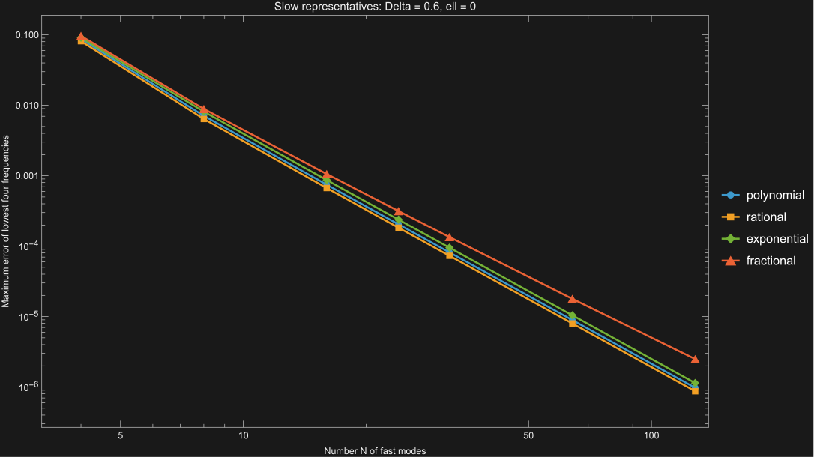

# Slow Representatives and Galerkin Convergence

Four different slow representatives, each with a nonzero fast coefficient, give different spectra at finite cutoff. For every fixed radial level, their exact Ritz frequencies converge monotonically from above to the same alternative-quantization value. The proof below establishes fast-mode density in the zero-slow-trace form domain, identifies the full closed form and its alternative spectrum, and applies the variational principle. At $\Delta=3/5$, $\ell=0$, and $N=128$ fast modes, the separate numerical check gives a maximum error below $2.5\times10^{-6}$ among the lowest four frequencies for every representative.

The original calculation is in [scalar off-shell mode truncation](<scalar off-shell mode truncation.md>), especially “Non-Eigen Slow Seed and Numerical Convergence”; its standalone implementation is [scalar_off_shell_mode_truncation.wl](scalar_off_shell_mode_truncation.wl). It used $s_\ell[1+1/(2(1+r^2))]$, which is not an eigenfunction but still has $\beta=0$. The present calculation keeps the same action and fast basis. Its implementation is [scalar_slow_representatives.wl](scalar_slow_representatives.wl), with [numerical results](scalar_slow_representatives_results.json).

## Action and Boundary Variation

Set the AdS radius to one, use signature $(-,+,+)$, and consider a real scalar with

$$\begin{align}
\mathrm{d}s^2&=-(1+r^2)\mathrm{d}t^2+\frac{\mathrm{d}r^2}{1+r^2}+r^2\mathrm{d}\phi^2, \\
M^2&=\Delta(\Delta-2),\qquad 0<\Delta<1, \\
S_R&=-\frac12\int_{r\leq R}\mathrm{d}^3x\sqrt{-g}
\left(\nabla_\mu\Phi\nabla^\mu\Phi+M^2\Phi^2\right)
-\frac\Delta2\int_{r=R}\mathrm{d}^2x\sqrt{-\gamma}\,\Phi^2.
\end{align}$$

Fix a real angular harmonic of unit norm, with eigenvalue $\ell^2$, $\ell=|m|$. Profiles are regular at $r=0$ and have boundary coefficients defined by

$$\begin{align}
u(r)&=\alpha[u]r^{-\Delta}+\beta[u]r^{\Delta-2}+o(r^{\Delta-2}).
\end{align}$$

The profiles used below also have the corresponding differentiated asymptotics. Variations vanish at the initial and final times. The radial boundary variation is

$$\begin{align}
\delta S_R\big|_\Gamma
&=-\int\mathrm{d}t\,
\left[R(1+R^2)\partial_r\Phi+\Delta R\sqrt{1+R^2}\Phi\right]\delta\Phi, \\
\delta S\big|_\Gamma
&=2(1-\Delta)\int\mathrm{d}t\,\beta\,\delta\alpha.
\end{align}$$

Thus free variation of $\alpha$ yields $\beta=0$ as the natural boundary condition on stationary fields. It is not imposed on the individual trial profiles. No finite boundary deformation is added, and there is no gauge constraint for this scalar.

For a finite radial basis $u_i$, substitute $\Phi=\sum_iq_i(t)u_i(r)$ before varying the coefficients. Suppressing the angular harmonic gives

$$\begin{align}
L_N&=\frac12\dot q^TG\dot q-\frac12q^TKq, \\
G[u,v]&=\int_0^\infty\mathrm{d}r\,\frac{r}{1+r^2}uv, \\
K[u,v]&=\lim_{R\to\infty}\left\{
\int_0^R\mathrm{d}r\left[r(1+r^2)u'v'
+\left(\frac{\ell^2}{r}+M^2r\right)uv\right]
+\Delta R\sqrt{1+R^2}\,u(R)v(R)\right\}, \\
Kv&=\omega^2Gv.
\end{align}$$

At each fixed $N$, the radial cutoff is removed in the matrix elements first. The limit $N\to\infty$ is a separate question.

## Four Representatives

Use the same fast basis as in the original calculation:

$$\begin{align}
z&=\frac1{1+r^2}, &
s_\ell&=r^\ell(1+r^2)^{-(\ell+\Delta)/2}, \\
f_{n\ell}&=r^\ell(1+r^2)^{-(\ell+2-\Delta)/2}
P_n^{(1-\Delta,\ell)}(1-2z), \\
\lambda_n^+&=(\ell+2-\Delta+2n)^2, &
c_n:=\beta[f_{n\ell}]&=\frac{(2-\Delta)_n}{n!}.
\end{align}$$

Define the actual seed by $t_\ell^{(A)}=s_\ell H_A(z)+\kappa_A f_{0\ell}$:

| Representative $A$ | $H_A(z)$ | $\kappa_A$ |
|---|---|---:|
| Polynomial | $1+z/2$ | $1$ |
| Rational | $(1+z/2)^{-1}$ | $-2$ |
| Exponential | $e^{2z}$ | $1/3$ |
| Fractional | $1+z^{3/4}$ | $3/2$ |

Every $H_A(0)=1$. For the first three profiles, $H_A-1=O(z)$, so the correction to $s_\ell$ decays faster than the fast branch throughout $0<\Delta<1$. For the fractional profile, this requires $\Delta+3/2>2-\Delta$, or $\Delta>1/4$. We restrict that family to $1/4<\Delta<1$, including every mass tested below. Consequently,

$$\begin{align}
\alpha[t_\ell^{(A)}]&=1,&\beta[t_\ell^{(A)}]&=\kappa_A\ne0, \\
W_N^{(A)}&=\operatorname{span}\{t_\ell^{(A)},f_{0\ell},\ldots,f_{N-1,\ell}\},&
\dim W_N^{(A)}&=N+1.
\end{align}$$

None of these actual basis elements satisfies $\beta=0$: the seed has $\beta=\kappa_A$, and each fast mode has $\beta=c_n\ne0$. The seeds are regular at the centre. At the main test parameters, direct evaluation of the radial differential operator also confirms that none of the four seeds is an eigenfunction.

There are two distinct comparisons. For a fixed $H_A$, changing $\kappa_A$ does not change $W_N^{(A)}$ when $N\geq1$, because $f_{0\ell}$ is already retained. In the ordering above, the basis change has $T_{21}=\kappa_A$, unit diagonal, and all other off-diagonal entries zero:

$$\begin{align}
G_\kappa&=T^TG_0T,&K_\kappa&=T^TK_0T, \\
\det(K_\kappa-\lambda G_\kappa)&=\det(T)^2\det(K_0-\lambda G_0).
\end{align}$$

This is exact finite-$N$ invariance. Changing $H_A$, however, changes the finite trial space and gives the different spectra below. The comparison between the four shapes is therefore not exhausted by the $\kappa$ basis change.

## Finite Matrix Elements

A positive integral representation avoids subtracting divergent bulk and boundary contributions numerically. Let $u=s_\ell H$ and $v=s_\ell J$. The identity

$$\begin{align}
-\partial_r\left[r(1+r^2)s_\ell'\right]
+\left(\frac{\ell^2}{r}+M^2r\right)s_\ell
&=(\ell+\Delta)^2\frac{r}{1+r^2}s_\ell
\end{align}$$

gives, after integration by parts,

$$\begin{align}
G[s_\ell H,s_\ell J]
&=\frac12\int_0^1\mathrm{d}z\,(1-z)^\ell z^{\Delta-1}HJ, \\
K[s_\ell H,s_\ell J]
&=(\ell+\Delta)^2G[s_\ell H,s_\ell J]
+2\int_0^1\mathrm{d}z\,(1-z)^{\ell+1}z^\Delta H'J'.
\end{align}$$

Here the primes on $H,J$ denote $z$ derivatives. At infinity, the discarded term is

$$\begin{align}
\left[r(1+r^2)\frac{s_\ell'}{s_\ell}
+\Delta r\sqrt{1+r^2}\right]uv=O(r^{-2\Delta})\longrightarrow0
\end{align}$$

for the profiles in this calculation. The centre term also vanishes. These conditions, rather than an assumed $\beta=0$, justify the representation. Both integrals are finite for all four seeds. In particular, the fractional derivative contribution behaves as $z^{\Delta-1/2}$ near zero. The additional fast term has $H\supset\kappa z^{1-\Delta}$ and derivative energy proportional to $\int_0 z^{-\Delta}\mathrm{d}z$, finite for $\Delta<1$.

Write $\widehat t=s_\ell H$, before adding $\kappa f_0$. The diagonal entries follow directly from these two integrals. For a power $h_a=s_\ell z^a$, the useful mixed moment is

$$\begin{align}
G[h_a,f_{n\ell}]
&=\frac{(1-\Delta-a)_n}{2n!}B(\ell+n+1,a+1),\qquad a\geq0, \\
G[f_{n\ell},f_{k\ell}]&=\delta_{nk}g_n, \\
g_n&=\frac{(n+1)_\ell}
{2(2-\Delta+n)_\ell(\ell+2-\Delta+2n)}.
\end{align}$$

The first identity follows by applying shifted Jacobi Rodrigues and integrating by parts $n$ times; the endpoint factors vanish for $a\geq0$, $\ell\geq0$, $0<\Delta<1$. Expanding $H_A$ in powers of $z$ therefore gives the seed–fast Gram entries without integrating high-degree Jacobi polynomials numerically.

The stiffness entries require the boundary term. Integrating the fast eigenfunction by parts gives

$$\begin{align}
K[\widehat t,f_{n\ell}]
&=\lambda_n^+G[\widehat t,f_{n\ell}]-2(1-\Delta)c_n, \\
K[f_{n\ell},f_{k\ell}]&=\delta_{nk}\lambda_n^+g_n.
\end{align}$$

The term $-2(1-\Delta)c_n$ uses $\alpha[\widehat t]=1$ and cannot be dropped. The final matrices for $\beta\ne0$ seeds are obtained by the congruence transformation above. The alternative frequencies are used as comparison targets, not inserted as eigenvalues of these matrices.

## Closed Form and Slow Trace

Fix $0<\Delta<1$ and $\ell\in\mathbb N_0$. Work with the transformed profile $H=u/s_\ell$ on $0<z<1$, where $z=0$ is the AdS boundary and $z=1$ is the centre. Define

$$\begin{align}
\mu(z)&=\frac12z^{\Delta-1}(1-z)^\ell,&
a(z)&=2z^\Delta(1-z)^{\ell+1}, \\
\mathcal H&=L^2((0,1),\mu\,\mathrm dz),&
\langle H,J\rangle_{\mathcal H}&=\int_0^1\mu\,\overline HJ\,\mathrm dz, \\
\mathcal V&=\left\{H\in\mathcal H:\ H\in AC_{\mathrm{loc}}(0,1),\quad
\int_0^1a|H'|^2\,\mathrm dz<\infty\right\}, \\
q(H,J)&=(\ell+\Delta)^2\langle H,J\rangle_{\mathcal H}
+\int_0^1a\,\overline{H'}J'\,\mathrm dz,&
\|H\|_q^2&=q(H,H).
\end{align}$$

Complexification is only for Hilbert-space notation. Multiplication by $s_\ell$ identifies the kinetic norm with the original radial $G$ norm and $q$ with the positive representation of $K$. Since $(\ell+\Delta)^2>0$, $\|\cdot\|_q$ is equivalent to the usual form norm $\bigl(q+\|\cdot\|_{\mathcal H}^2\bigr)^{1/2}$.

The form is densely defined and closed. Indeed, compactly supported smooth functions are dense in $\mathcal H$. A $q$-Cauchy sequence has limits in $L^2(\mu)$ and in the weighted derivative space $L^2(a)$. On every compact subinterval both weights are bounded above and below by positive constants, so the limits are a function and its weak derivative in ordinary $H^1$. This gives a locally absolutely continuous representative and convergence in $\mathcal V$.

At $z=0$, $\int_0^b a^{-1}\mathrm dz<\infty$ for any $b<1$. Weighted Cauchy–Schwarz therefore gives a finite trace and the estimate

$$\begin{align}
\alpha[H]&:=H(0), \\
|H(z)-H(0)|
&\leq\left(\int_0^z a|H'|^2\,\mathrm dt\right)^{1/2}
\left(\int_0^z a^{-1}\,\mathrm dt\right)^{1/2}
=o\!\left(z^{(1-\Delta)/2}\right), \\
|\alpha[H]|&\leq C_{\Delta,\ell}\|H\|_q.
\end{align}$$

For the last inequality, bound $H$ at an interior point using the local $H^1$ norm, then use the preceding estimate to reach zero. Because $s_\ell=r^{-\Delta}(1+O(r^{-2}))$, this trace agrees with the slow coefficient in the earlier asymptotic expansion. Hence

$$\begin{align}
\mathcal V_0&:=\ker\alpha
\end{align}$$

is a closed subspace of codimension one; the constant function $1$ belongs to $\mathcal V$ and has trace one. A general element of $\mathcal V$ need not possess a fast coefficient $\beta$. The definition of $\mathcal V_0$ uses only the continuous slow trace, not a two-term expansion.

The centre requires a separate endpoint estimate. Put $x=1-z$. Applying the same inequality from a fixed interior point, now using $a\asymp x^{\ell+1}$, gives

$$\begin{align}
H(1-x)&=
\begin{cases}
O\!\left(1+\sqrt{|\log x|}\right),&\ell=0,\\
O(x^{-\ell/2}),&\ell>0.
\end{cases}
\end{align}$$

In particular, $a(z)B'(z)H(z)\to0$ at the centre for any $B$ smooth there. No pointwise boundedness of every form-domain element at the centre is assumed. The form cores established below consist of regular radial profiles, so this domain is precisely their finite-energy completion. Singular centre solutions of the homogeneous eigenvalue equation are excluded by their infinite derivative energy.

## Fast Modes Are Form-Dense in the Zero-Trace Sector

In the transformed variables the fast profiles are

$$\begin{align}
F_n(z)&:=\frac{f_{n\ell}}{s_\ell}
=z^{1-\Delta}P_n^{(1-\Delta,\ell)}(1-2z).
\end{align}$$

They belong to $\mathcal V_0$: their derivative energy behaves as $z^{-\Delta}$ at zero and is integrable, while they are smooth at the centre. First establish completeness in $\mathcal H$. Multiplication by $z^{1-\Delta}$ is a unitary map

$$\begin{align}
U:\ L^2\!\left((0,1),\tfrac12z^{1-\Delta}(1-z)^\ell\,\mathrm dz\right)
&\longrightarrow\mathcal H, & (UJ)(z)&=z^{1-\Delta}J(z).
\end{align}$$

The Jacobi polynomials $P_n^{(1-\Delta,\ell)}(1-2z)$ form a complete orthogonal system in the source space. One elementary way to see completeness is that the weight has finite mass on $[0,1]$, continuous functions are dense in its $L^2$ space, and uniform polynomial approximation makes polynomials dense. Since the Jacobi polynomial of degree $n$ has nonzero leading coefficient, their span is exactly the polynomial span. Thus the $F_n$ are complete in $\mathcal H$. The orthogonality conventions and bounded-interval completeness agree with [DLMF §18.3](https://dlmf.nist.gov/18.3) and [§18.2(viii)](https://dlmf.nist.gov/18.2#viii).

To lift this to form completeness, introduce the differential expression

$$\begin{align}
\mathcal A H
&=(\ell+\Delta)^2H-\mu^{-1}(aH')' \\
&=(\ell+\Delta)^2H
-4\left[z(1-z)H''+\bigl(\Delta-(\Delta+\ell+1)z\bigr)H'\right].
\end{align}$$

The Jacobi differential equation gives

$$\begin{align}
\mathcal A F_n&=\lambda_n^+F_n,&
\lim_{z\downarrow0}aF_n'&=2(1-\Delta)c_n.
\end{align}$$

For arbitrary $H\in\mathcal V$, integration by parts on $[\varepsilon,1-\varepsilon]$, followed by the endpoint estimates above, yields

$$\begin{align}
q(F_n,H)
&=\lambda_n^+\langle F_n,H\rangle_{\mathcal H}
-2(1-\Delta)c_n\alpha[H].
\end{align}$$

The bulk integrals converge by weighted Cauchy–Schwarz. The centre contribution vanishes, and the boundary contribution at zero is exactly the displayed trace term. In particular,

$$\begin{align}
q(F_n,H)&=\lambda_n^+\langle F_n,H\rangle_{\mathcal H},
\qquad H\in\mathcal V_0.
\end{align}$$

Now suppose $H\in\mathcal V_0$ is $q$-orthogonal to every $F_n$. Since $\lambda_n^+>0$, it is also $\mathcal H$-orthogonal to every $F_n$. Their Hilbert-space completeness gives $H=0$. The orthogonal-complement criterion in the Hilbert space $(\mathcal V_0,q)$ proves

$$\begin{align}
\boxed{\overline{\operatorname{span}\{F_n:n\geq0\}}^{\|\cdot\|_q}
=\mathcal V_0.}
\end{align}$$

This is the required density result; $L^2$ completeness alone was not used as a substitute for it. More explicitly, set $E_n^+=F_n/\|F_n\|_{\mathcal H}$. Then for every $H\in\mathcal V_0$,

$$\begin{align}
P_N^+H&=\sum_{n=0}^{N-1}\langle E_n^+,H\rangle_{\mathcal H}E_n^+, \\
\|H-P_N^+H\|_q^2
&=\sum_{n=N}^{\infty}\lambda_n^+
|\langle E_n^+,H\rangle_{\mathcal H}|^2\longrightarrow0.
\end{align}$$

The equality follows from completeness and orthogonality in the $q$ inner product, so no unproved interchange of an infinite derivative series and an integral is needed.

## The Full Form Has the Alternative Spectrum

The preceding argument has a second application. Define

$$\begin{align}
A_p(z)&=P_p^{(\Delta-1,\ell)}(1-2z),&
\lambda_p^-&=(\ell+\Delta+2p)^2.
\end{align}$$

These polynomials belong to $\mathcal V$, are complete and orthogonal in $\mathcal H$, and satisfy $\mathcal A A_p=\lambda_p^-A_p$. Here the Jacobi weight is proportional to $\mu$, with exponents $\Delta-1>-1$ and $\ell\geq0$. At zero, $aA_p'=O(z^\Delta)$; at the centre the endpoint estimate applies. Both boundary terms therefore vanish against every $H\in\mathcal V$:

$$\begin{align}
q(A_p,H)&=\lambda_p^-\langle A_p,H\rangle_{\mathcal H}.
\end{align}$$

The same orthogonal-complement argument proves that the $A_p$ span a form core of $\mathcal V$. Their radial profiles $s_\ell A_p$ are regular at the centre and have the stated slow asymptotics. This also identifies the maximal weighted domain defined above with the closure of regular admissible profiles, rather than leaving that identification as an extra assumption. The differential identities are the transformed [Jacobi equation in DLMF §18.8](https://dlmf.nist.gov/18.8).

Normalize $E_p^-=A_p/\|A_p\|_{\mathcal H}$. The form and its associated operator have the explicit spectral descriptions

$$\begin{align}
\mathcal V&=\left\{H\in\mathcal H:
\sum_{p=0}^{\infty}\lambda_p^-|\langle E_p^-,H\rangle_{\mathcal H}|^2<\infty\right\}, \\
q(H,H)&=\sum_{p=0}^{\infty}\lambda_p^-|\langle E_p^-,H\rangle_{\mathcal H}|^2, \\
D(\mathcal A_-)&=\left\{H\in\mathcal H:
\sum_{p=0}^{\infty}(\lambda_p^-)^2|\langle E_p^-,H\rangle_{\mathcal H}|^2<\infty\right\}, \\
\mathcal A_-H&=\sum_{p=0}^{\infty}\lambda_p^-
\langle E_p^-,H\rangle_{\mathcal H}E_p^-.
\end{align}$$

This is a positive self-adjoint diagonal operator, with no missing spectral sector because the eigenvectors are complete. Its form is exactly $q$, and its eigenfrequencies are $\sqrt{\lambda_p^-}=\Delta+\ell+2p$. Compactness also follows directly: for $q(H,H)\leq1$,

$$\begin{align}
\left\|H-\sum_{p=0}^{P-1}\langle E_p^-,H\rangle_{\mathcal H}E_p^-\right\|_{\mathcal H}^2
&\leq\frac1{\lambda_P^-}\longrightarrow0.
\end{align}$$

Finite-dimensional approximation of the form unit ball proves that $\mathcal V\hookrightarrow\mathcal H$ is compact, and equivalently $\mathcal A_-$ has compact resolvent.

The operator also has the intended boundary condition. For $H\in D(\mathcal A_-)$, let $F=aH'$. The weak equation gives

$$\begin{align}
F'&=\mu\bigl((\ell+\Delta)^2H-\mathcal A_-H\bigr).
\end{align}$$

The right side is in $L^1(0,1)$, so $F$ has finite endpoint limits. Finite derivative energy forces $F(1)=0$, since $\int^1a^{-1}=\infty$. Testing the form identity with a smooth function that equals one near zero and vanishes near the centre gives $F(0)=0$. More generally, when $H\in\mathcal V$ and $\mathcal A H\in\mathcal H$, integration of $H'=F/a$ gives

$$\begin{align}
H(z)&=H(0)+\frac{F(0)}{2(1-\Delta)}z^{1-\Delta}
+o(z^{1-\Delta}), \\
\beta[s_\ell H]&=\frac{F(0)}{2(1-\Delta)}.
\end{align}$$

For the remainder estimate, weighted Cauchy–Schwarz gives $F(z)-F(0)=o(z^{\Delta/2})$, whose integral against $a^{-1}$ is $o(z^{1-\Delta/2})$. Thus $F(0)=0$ is precisely $\beta=0$ on the operator domain. No such condition was imposed on the whole form domain. Conversely, a form-domain function with $\mathcal A H\in\mathcal H$ and $F(0)=0$ satisfies the operator form identity: at the centre, $F(1-x)=o(x^{(\ell+1)/2})$, which, together with the endpoint bound on every test function, removes the remaining boundary term.

## Enrichment and Ritz Convergence

Let $\eta\in\mathcal V$ be any fixed representative with $\alpha[\eta]\ne0$, and define the transformed trial spaces

$$\begin{align}
\mathcal W_N(\eta)&=\operatorname{span}\{\eta,F_0,\ldots,F_{N-1}\}.
\end{align}$$

They are nested and have dimension $N+1$, because every $F_n$ has zero trace. For arbitrary $H\in\mathcal V$, subtract its boundary direction:

$$\begin{align}
H&=\frac{\alpha[H]}{\alpha[\eta]}\eta+H_0,& H_0&\in\mathcal V_0, \\
H_N&=\frac{\alpha[H]}{\alpha[\eta]}\eta+P_N^+H_0\in\mathcal W_N(\eta), \\
\|H-H_N\|_q&=\|H_0-P_N^+H_0\|_q\longrightarrow0.
\end{align}$$

Thus every such representative supplies the same complete form domain:

$$\begin{align}
\boxed{\overline{\bigcup_{N\geq1}\mathcal W_N(\eta)}^{\|\cdot\|_q}=\mathcal V.}
\end{align}$$

For the four actual seeds, $\eta_A=t_\ell^{(A)}/s_\ell=H_A+\kappa_Az^{1-\Delta}$. Each has trace one. The first three $H_A$ have bounded derivatives on $[0,1]$; the fractional shape contributes an integrable derivative density proportional to $z^{\Delta-1/2}$; and the fast addition contributes $z^{-\Delta}$. Hence all four belong to $\mathcal V$. In the parameter ranges specified earlier, they also retain their stated nonzero fast coefficients. Their differences belong to $\mathcal V_0$, but need not lie in any finite fast span. This is why their closures agree while their finite spectra differ.

Let $\lambda_{p,N}(\eta)$ be the increasingly ordered generalized eigenvalues of the exact pair $(K,G)$ on $\mathcal W_N(\eta)$, indexed by $p=0,\ldots,N$. The finite and infinite variational principles give

$$\begin{align}
\lambda_{p,N}(\eta)
&=\min_{\substack{L\subset\mathcal W_N(\eta)\\\dim L=p+1}}
\ \max_{0\ne H\in L}\frac{q(H,H)}{\|H\|_{\mathcal H}^2}, \\
\lambda_p^-&\leq\lambda_{p,N+1}(\eta)\leq\lambda_{p,N}(\eta).
\end{align}$$

The infinite-dimensional lower bound follows directly from the spectral expansion: any $(p+1)$-dimensional subspace contains a nonzero vector orthogonal to $E_0^-,\ldots,E_{p-1}^-$, whose Rayleigh quotient is at least $\lambda_p^-$. The span of $E_0^-,\ldots,E_p^-$ attains that value. Nestedness of the trial spaces gives monotonicity.

The upper convergence bound also follows without an additional approximation theorem. Approximate each of $E_0^-,\ldots,E_p^-$ by the explicit $H_N$ construction above. Their Gram and form matrices converge to $I$ and $\operatorname{diag}(\lambda_0^-,\ldots,\lambda_p^-)$, respectively. For sufficiently large $N$ the approximants are independent, and the maximum Rayleigh quotient on their $(p+1)$-dimensional span tends to $\lambda_p^-$. Using this span in the finite minimum yields $\limsup_N\lambda_{p,N}(\eta)\leq\lambda_p^-$. Combined with the lower bound,

$$\begin{align}
\boxed{\lambda_{p,N}(\eta)\downarrow(\Delta+\ell+2p)^2,\qquad
\omega_{p,N}(\eta)\downarrow\Delta+\ell+2p}
\end{align}$$

for every fixed $p$. Equality at some cutoffs is allowed. The statement applies to any fixed finite-form-energy representative with nonzero slow trace, not only the four examples. It concerns exact matrix elements; extending the fixed-precision implementation to arbitrarily large $N$ would additionally require numerical error and conditioning control.

There is also no bounded spectral pollution in this conforming sequence. A sequence of Ritz eigenvalues with indices $p_N\to\infty$ is bounded below by $(\Delta+\ell+2p_N)^2\to\infty$. A bounded accumulation point must therefore come from a bounded index subsequence and belongs to the alternative spectrum. This does not assert a uniform error estimate for all eigenvalues up to the cutoff.

Finally, form convergence does not by itself imply convergence of $\beta$. To see why, let $\chi$ be smooth, equal to one near zero, and zero for arguments at least one. Then

$$\begin{align}
B_\varepsilon(z)&=z^{1-\Delta}\chi(z/\varepsilon),&
\alpha[B_\varepsilon]&=0,&\beta[s_\ell B_\varepsilon]&=1, \\
\|B_\varepsilon\|_q^2&=O(\varepsilon^{1-\Delta})\longrightarrow0.
\end{align}$$

The norm estimate follows by $z=\varepsilon t$: the kinetic contribution is $O(\varepsilon^{2-\Delta})$ and the derivative contribution is $O(\varepsilon^{1-\Delta})$. Thus the fast coefficient is not a continuous functional of the form topology, even on profiles where it is defined. The proved spectral limit and the continuum operator condition $\beta=0$ remain fully compatible with this fact.

## Finite Cutoffs

Take $\Delta=3/5$, $\ell=0$. The target is $\omega_p^-=\Delta+\ell+2p$, namely $0.6,2.6,4.6,6.6$ for $p=0,1,2,3$. The full calculation uses $N=4,8,16,24,32,64,128$. Selected spectra are:

| Representative | $N$ | Lowest four frequencies |
|---|---:|---|
| Polynomial | 4 | $0.6002538251,\ 2.6034713126,\ 4.6212292957,\ 6.6874213135$ |
| Polynomial | 16 | $0.6000031000,\ 2.6000445969,\ 4.6002409922,\ 6.6007470139$ |
| Polynomial | 128 | $0.6000000041,\ 2.6000000594,\ 4.6000003184,\ 6.6000009743$ |
| Rational | 4 | $0.6003039755,\ 2.6015562335,\ 4.6172274943,\ 6.6813681921$ |
| Rational | 16 | $0.6000031238,\ 2.6000208408,\ 4.6001915687,\ 6.6006699268$ |
| Rational | 128 | $0.6000000041,\ 2.6000000278,\ 4.6000002527,\ 6.6000008718$ |
| Exponential | 4 | $0.6019618257,\ 2.6052610105,\ 4.6240527744,\ 6.6913603496$ |
| Exponential | 16 | $0.6000488571,\ 2.6000962314,\ 4.6003246653,\ 6.6008689840$ |
| Exponential | 128 | $0.6000000658,\ 2.6000001289,\ 4.6000004311,\ 6.6000011386$ |
| Fractional | 4 | $0.6043549672,\ 2.6077347305,\ 4.6279295525,\ 6.6967407026$ |
| Fractional | 16 | $0.6002147874,\ 2.6002057568,\ 4.6004664273,\ 6.6010591452$ |
| Fractional | 128 | $0.6000022613,\ 2.6000012200,\ 4.6000015623,\ 6.6000024941$ |

The polynomial rows reproduce the original non-eigen seed calculation despite the added $f_0$. The four families are visibly different at small $N$; none puts the exact lowest frequency into the finite trial space.

To compare all four sequences, define

$$\begin{align}
E_N^{(A)}=\max_{0\leq p\leq3}\left|\omega_{p,N}^{(A)}-(0.6+2p)\right|.
\end{align}$$

| $N$ | Polynomial | Rational | Exponential | Fractional |
|---:|---:|---:|---:|---:|
| 4 | 8.742131e-02 | 8.136819e-02 | 9.136035e-02 | 9.674070e-02 |
| 8 | 7.090112e-03 | 6.401603e-03 | 8.135500e-03 | 8.876862e-03 |
| 16 | 7.470139e-04 | 6.699268e-04 | 8.689840e-04 | 1.059145e-03 |
| 24 | 2.041734e-04 | 1.828779e-04 | 2.381259e-04 | 3.150580e-04 |
| 32 | 8.149390e-05 | 7.296246e-05 | 9.513247e-05 | 1.345428e-04 |
| 64 | 8.918131e-06 | 7.981179e-06 | 1.041985e-05 | 1.787225e-05 |
| 128 | 9.742558e-07 | 8.718079e-07 | 1.138564e-06 | 2.494061e-06 |

Every recorded fixed low frequency decreases with the listed cutoffs and remains above its target. The fractional representative has a larger ground-frequency error and a slower decrease in that error than the three smooth shapes. No universal convergence exponent is inferred from these finite data.

As additional checks, all four representatives were evaluated at $\Delta\in\{3/10,3/5,4/5\}$, $\ell\in\{1,3\}$, and $N=32,64$. The maximum low-four error decreases in every one of these 24 pairs. The largest error at $N=64$ is $9.13\times10^{-5}$, for the exponential representative at $\Delta=3/10$, $\ell=3$. These angular sectors are compared with $\Delta+\ell+2p$, not with the $\ell=0$ target.

## Reproduction and Checks

Run the companion script with Mathematica or `wolframscript -file scalar_slow_representatives.wl`. It writes the results and convergence plot beside itself. Mathematica 14.3 was used. The batch calculation ran through the local `wolframscript` interface after the Mathematica tool's 30-second limit interrupted the full batch; smaller symbolic checks ran through the Mathematica tool.

The main calculation uses 70-digit arithmetic. Mixed overlaps for the rational and exponential shapes use their power series through $z^{160}$; the diagonal entries use beta and hypergeometric functions, without that series truncation. The polynomial and fractional moments are evaluated directly. Repeating all four $N=128$ calculations with 90 digits and powers through $z^{200}$ changes the lowest four frequencies by less than $10^{-49}$. This numerical stability check is distinct from the error relative to the continuum target.

The Gram matrices pass the positive diagonal and positive Schur-complement test at every reported cutoff, and every computed squared frequency is positive. Only imaginary roundoff below $10^{-\mathrm{precision}/2}$ is removed, after explicitly checking that bound. For all four representatives at $N=16$, the maximum frequency difference between $\kappa=0$ and the stated nonzero $\kappa$ is below $10^{-60}$; the normalized residuals of the four lowest generalized eigenpairs are also below $10^{-60}$.

**Verified:** Mathematica gives zero symbolic residual for the ground-state radial equation and the bilinear factorization used above. Exact mixed-moment checks cover $\Delta\in\{3/10,3/5,4/5\}$, $\ell\in\{0,1,3\}$, $a\in\{0,3/4,1,2\}$ and $n=0,1,2,3$; the fast radial equation was checked at the same masses and angular sectors for $n=0,1,2,3$. Independent quadrature checks the seed diagonals for all four shapes at $\Delta=3/5$, $\ell=0,3$ to better than $10^{-38}$, and the mixed stiffness identity for all four shapes at $\Delta=3/5$, $\ell=0$, $n=0,1,2,3$ to better than $10^{-28}$. The numerical spectra, positivity, precision comparisons and finite-basis invariance checks have been executed.

**Assumptions:** Unit AdS radius, the stated counterterm without a finite boundary deformation, regular centre, a fixed normalized angular harmonic, $0<\Delta<1$ (and $\Delta>1/4$ for the fractional representative), and the displayed profiles with their differentiated asymptotics. The boundary variation is evaluated for independently variable slow coefficient. Frequencies are dimensionless; restoring the radius multiplies them by its inverse.

**Verified (analytic proof):** The weighted maximal form is closed; the slow trace is continuous; the fast-mode span is dense in its zero-trace sector; the alternative modes give a form core and the complete spectrum of the full form; the form embedding is compact; and every fixed representative in $\mathcal V$ with nonzero trace gives monotone convergence of every fixed Ritz eigenvalue. Endpoint terms are controlled for arbitrary form-domain test functions. These are Hilbert-space arguments, not conclusions inferred from finite symbolic checks.

**Verified (symbolic support for the proof):** Mathematica reduces the weighted operator to the Jacobi differential expression, verifies its fast-weight conjugation and Hilbert-space weight isometry, and checks both mode equations and boundary fluxes through radial degree five with symbolic $\Delta,\ell$. Exact alternative-mode derivative norms were checked for $\Delta\in\{3/10,3/5,4/5\}$, $\ell\in\{0,1,3\}$ and degrees zero through three. The generic operator and cutoff-scaling identities can be reproduced with [scalar_slow_representatives_form_checks.wl](scalar_slow_representatives_form_checks.wl).

**Not verified:** Uniform estimates as $\Delta$ approaches an endpoint, a convergence rate for general representatives, uniform approximation of the entire growing finite spectrum, or convergence of the fast coefficient of the finite Ritz eigenfunctions. The theorem uses exact form restrictions, not an arbitrarily long run at fixed numerical precision. The BF endpoint $\Delta=1$ and the endpoint $\Delta=0$ are excluded.

## Interpretation

The appropriate distinction is between a trial profile and a stationary solution. The action permits the former to have $\beta\ne0$; its unrestricted boundary variation selects $\beta=0$ for sufficiently regular continuum solutions. Finite Galerkin stationarity imposes the projected equations, so it need not impose that boundary coefficient exactly at finite $N$.

In the positive integral representation, $\alpha$ is the continuous boundary trace $H(0)$. The fast-mode span is form-dense precisely in its kernel. Each representative with nonzero trace supplies the remaining one-dimensional quotient $\mathcal V/\mathcal V_0$, so every enriched sequence has the same form closure. The explicit alternative eigenbasis and min–max argument then prove the common limiting spectrum independently of the numerical tables.

Thus changing the retained fast component of a fixed seed leaves every finite-cutoff eigenvalue unchanged, whereas changing its radial shape can alter the finite spectrum and convergence rate. Neither change alters the limiting alternative tower, provided the representative stays in the same form domain and has nonzero slow trace.
